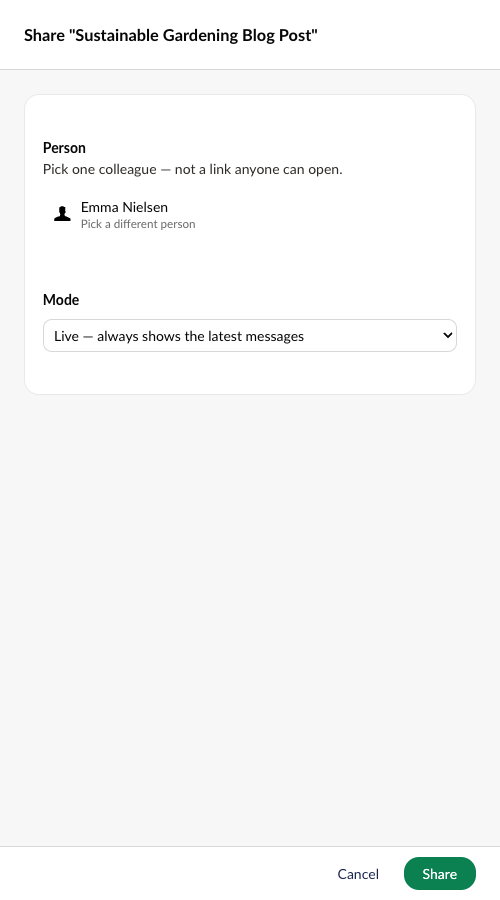
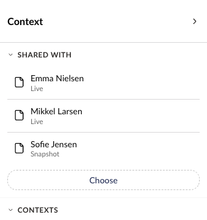
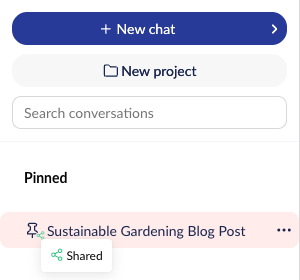
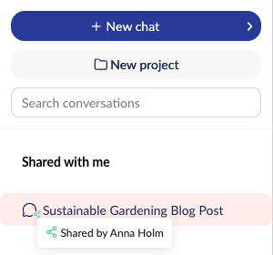
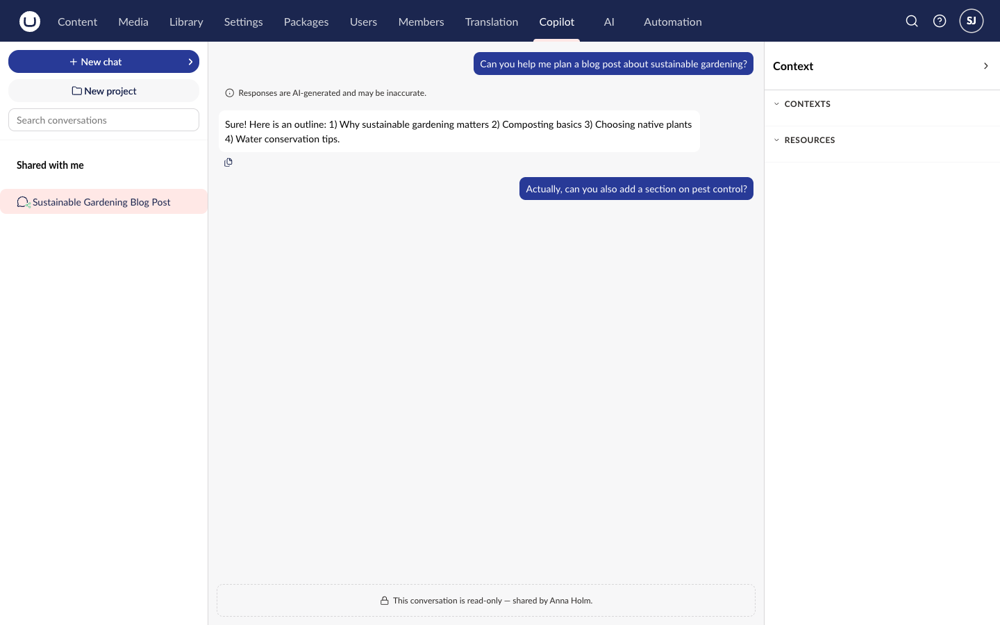

# Sharing Conversations

You can share a Copilot Workspace conversation with other backoffice users. The people you share with can read the conversation, but they can't send messages in it or change it.

Sharing is for colleagues in the same Umbraco installation. There is no public link, and each share names one specific user.

## Who Can Share

Any user with access to the Copilot Workspace section can share their own conversations. Only the owner of a conversation can share it, change who it's shared with, or stop sharing it.

The person you share with also needs access to the Copilot Workspace section to open the conversation.

## Sharing a Conversation

1. Open the conversation in Copilot Workspace.
2. In the context panel, find the **Shared with** section.
3. Select **Choose**.
4. Under **Person**, select **Choose a person** and pick one user.
5. Under **Mode**, pick **Snapshot** or **Live**. See [Snapshot and Live Shares](#snapshot-and-live-shares).
6. Select **Share**.

The person appears in the **Shared with** section with the mode under their name. To share with more people, repeat the steps for each person.



The person you share with sees everything referenced in the conversation. This includes the contexts and resources in the context panel, and pages or files they might not otherwise have permission to open. The share dialog shows this warning when the conversation has contexts or resources attached.



## Snapshot and Live Shares

| Mode | What the person sees |
| --- | --- |
| **Snapshot** | The conversation as it is when you share it. Messages you add later stay hidden from them. |
| **Live** | The whole conversation, including messages you add later. |

You can't share a conversation as a Snapshot before it has any messages.

To change the mode for someone, share the conversation with the same person again and pick the other mode. A new Snapshot share freezes the conversation at its latest messages.

## Seeing What You've Shared

A conversation you've shared shows a small share badge on its icon in the sidebar. Hover over the badge to see the **Shared** label.

To see who a conversation is shared with, open it and look at the **Shared with** section in the context panel. The section shows **Not shared with anyone yet.** when it isn't shared.

## Stopping a Share

In the **Shared with** section, select **Remove** next to the person. There is no confirmation step. The person loses access straight away.

Deleting a conversation also removes all of its shares.

## Opening a Conversation Shared With You

Conversations other people share with you appear under **Shared with me** in the Copilot Workspace sidebar. Hover over the badge on a conversation to see who shared it.

When you open a shared conversation:

- A notice replaces the message box: "This conversation is read-only — shared by" followed by the owner's name.
- The context panel shows the conversation's contexts and resources, but you can't change them.
- Shared conversations have no **Pin**, **Rename**, **Move to project...**, **Archive**, or **Delete** actions.

## Email Notification

The first time you share a conversation with someone, Umbraco sends them an email. The email names you, gives the conversation's title, and links to the conversation in the backoffice. Changing the mode for someone already on the list doesn't send another email.

The email uses the site's normal SMTP settings. If SMTP isn't configured, or the user has no email address, the share still works but no email is sent. See [SMTP settings](https://docs.umbraco.com/umbraco-cms/develop-with-umbraco/configuration/globalsettings#smtp-settings) for how to configure email.

## Related

- [Using Copilot Workspace](copilot-workspace.md) - Conversations, projects, and the context panel
- [AI Contexts](../../concepts/contexts.md) - Brand voice and guidelines
