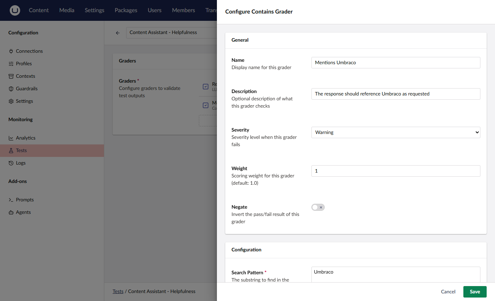

# Graders

Graders define success criteria for evaluating test output. Each grader receives the execution outcome and returns a score (0 to 1) with a pass/fail judgment.

## Shared Configuration

Every grader supports these options in addition to its type-specific configuration:

| Option     | Type   | Default | Description                                    |
| ---------- | ------ | ------- | ---------------------------------------------- |
| `Negate`   | bool   | false   | Inverts the result (pass becomes fail)         |
| `Severity` | string | Error   | `Info`, `Warning`, or `Error`                  |
| `Weight`   | double | 1.0     | Weight for aggregate scoring (0 to 1)          |

**Severity** determines how the grader affects the overall test result:

- **Info** - Informational. Does not affect pass/fail.
- **Warning** - Logs a failure but does not block the test.
- **Error** - Fails the test and blocks (default).



## Code-Based Graders

Code-based graders are deterministic and fast. They return a binary score of 1.0 (pass) or 0.0 (fail).

### exact-match

Validates exact string equality between the output and an expected value.

| Config Property | Type | Default | Description                    |
| --------------- | ---- | ------- | ------------------------------ |
| `ExpectedValue` | string | (empty) | The exact value to match     |
| `IgnoreCase`    | bool | true    | Case-insensitive comparison    |



```json
{
    "graderTypeId": "exact-match",
    "name": "Exact output check",
    "config": {
        "expectedValue": "Hello, world!",
        "ignoreCase": true
    }
}
```



### contains

Validates that the output contains a specific substring.

| Config Property | Type | Default | Description                    |
| --------------- | ---- | ------- | ------------------------------ |
| `SearchPattern` | string | (empty) | The substring to find        |
| `IgnoreCase`    | bool | true    | Case-insensitive search        |



```json
{
    "graderTypeId": "contains",
    "name": "Contains keyword",
    "config": {
        "searchPattern": "Umbraco",
        "ignoreCase": true
    }
}
```




Use `Negate: true` to assert that output does NOT contain a value. For example, validate that a response does not include prohibited content.


### regex

Validates that the output matches a regular expression pattern.

| Config Property | Type | Default | Description                              |
| --------------- | ---- | ------- | ---------------------------------------- |
| `Pattern`       | string | (empty) | The regex pattern to match             |
| `IgnoreCase`    | bool | true    | Case-insensitive matching                |
| `Multiline`     | bool | false   | Enable multiline mode (^ and $ match line boundaries) |

The grader includes match details in the result metadata when the pattern matches (match value, index, length, and named groups).



```json
{
    "graderTypeId": "regex",
    "name": "Valid SEO length",
    "config": {
        "pattern": "^.{50,160}$",
        "ignoreCase": false,
        "multiline": false
    }
}
```



### json-schema

Validates that the output is valid JSON containing expected keys. Uses dot-notation for nested property paths.

| Config Property  | Type | Default | Description                                  |
| ---------------- | ---- | ------- | -------------------------------------------- |
| `ExpectedKeys`   | string | (empty) | Required JSON keys (comma-separated, dot-notation for nested) |
| `RequireAllKeys` | bool | true    | All keys must be present                     |



```json
{
    "graderTypeId": "json-schema",
    "name": "Has required fields",
    "config": {
        "expectedKeys": "title,description,metadata.author",
        "requireAllKeys": true
    }
}
```



When `RequireAllKeys` is `false`, the grader passes if at least one expected key is present.

### tool-call

Validates that specific tools were called during execution. This grader inspects the transcript's tool calls rather than the output text.

| Config Property  | Type   | Default | Description                              |
| ---------------- | ------ | ------- | ---------------------------------------- |
| `ExpectedTools`  | string | (empty) | Tool names (comma-separated)             |
| `ValidationMode` | string | Any     | `Any`, `All`, `Exact`, or `None`         |
| `ValidateOrder`  | bool   | false   | Whether tool calls must appear in order  |

**Validation modes:**

| Mode    | Description                                          |
| ------- | ---------------------------------------------------- |
| `Any`   | At least one expected tool was called                |
| `All`   | All expected tools were called (in any order)        |
| `Exact` | The expected tools match the actual calls (same set) |
| `None`  | None of the expected tools were called               |

When `ValidateOrder` is `true` (with `All` or `Exact` mode), the expected tools must appear in the specified sequence.



```json
{
    "graderTypeId": "tool-call",
    "name": "Called search tool",
    "config": {
        "expectedTools": "search_content,get_page",
        "validationMode": "All",
        "validateOrder": true
    }
}
```



### guardrail

Runs a guardrail evaluator against the test output. The grader passes when the evaluator flags the content.

| Config Property   | Type        | Default | Description                              |
| ----------------- | ----------- | ------- | ---------------------------------------- |
| `EvaluatorId`     | string      | (empty) | The guardrail evaluator to run           |
| `EvaluatorConfig` | JSON (optional) | null  | Evaluator-specific configuration         |



```json
{
    "graderTypeId": "guardrail",
    "name": "Detects email addresses",
    "config": {
        "evaluatorId": "regex",
        "evaluatorConfig": {
            "pattern": "[a-zA-Z0-9._%+-]+@[a-zA-Z0-9.-]+\\.[a-zA-Z]{2,}",
            "ignoreCase": true
        }
    }
}
```




The guardrail grader passes when the evaluator **flags** the content. To assert that content should NOT be flagged, set `Negate: true` on the grader configuration.




```json
{
    "graderTypeId": "guardrail",
    "name": "No competitor mentions",
    "negate": true,
    "config": {
        "evaluatorId": "contains",
        "evaluatorConfig": {
            "searchPattern": "CompetitorBrand",
            "ignoreCase": true
        }
    }
}
```



## Model-Based Graders

Model-based graders use an AI model to evaluate outputs. They return continuous scores between 0 and 1.

### llm-judge

Uses an LLM to evaluate the test output against custom evaluation criteria. The judge returns a score with reasoning.

| Config Property      | Type   | Default | Description                              |
| -------------------- | ------ | ------- | ---------------------------------------- |
| `ProfileId`          | guid   | null    | AI profile for the judge (optional)      |
| `EvaluationCriteria` | string | (default) | What aspects to evaluate               |
| `PassThreshold`      | double | 0.7     | Minimum score to pass (0 to 1)           |

The default evaluation criteria is: "Evaluate the quality, accuracy, and relevance of the response."



```json
{
    "graderTypeId": "llm-judge",
    "name": "Content quality",
    "config": {
        "evaluationCriteria": "Evaluate whether the summary is concise, accurate, and captures the key points of the original content.",
        "passThreshold": 0.8
    }
}
```



The result metadata includes the judge's reasoning, strengths, and weaknesses.


Model-based graders consume AI tokens for each evaluation. Consider using code-based graders for format and structure checks, and reserve the LLM judge for semantic quality evaluation.


### decision-judge


The Decision Judge is **experimental**. It uses the [Decision](../using-the-api/decision/README.md) capability, and is only listed when the `Umbraco:AI:Experimental:Decision` feature flag is enabled.


Asks a Decision profile a yes/no question: does the test output meet your criteria? The answer comes back as a probability between 0 and 1. The grader uses the probability as its score, and passes when the score is at or above `PassThreshold`.

| Config Property      | Type   | Default   | Description                                                            |
| -------------------- | ------ | --------- | ---------------------------------------------------------------------- |
| `ProfileId`          | guid   | null      | Decision profile to use. Only Decision profiles are listed. Leave empty to use the default Decision profile. |
| `EvaluationCriteria` | string | (default) | What aspects to evaluate                                               |
| `PassThreshold`      | double | 0.7       | Minimum score to pass (0 to 1)                                         |

The default evaluation criteria is: "Evaluate the quality, accuracy, and relevance of the response."



```json
{
    "graderTypeId": "decision-judge",
    "name": "Is a recipe",
    "config": {
        "evaluationCriteria": "The response is a recipe with a list of ingredients and numbered steps.",
        "passThreshold": 0.7
    }
}
```



The result metadata includes the probability, the yes/no answer, the threshold, and the model ID.

The grader does not fall back to the `llm-judge` grader. Instead, it fails with a reason in these cases:

- The Decision feature flag is turned off.
- No profile is set and no default Decision profile is configured.
- The call to the Decision profile fails.


`Negate: true` also inverts these failures. A negated Decision Judge passes when Decision is turned off or the call fails. The `llm-judge` grader behaves the same way when its call fails.



The test output is sent to the provider behind the Decision profile, such as [TypeSafe AI](../providers/typesafe.md). This provider can be different from the one that runs the model under test.


## Combining Graders

You can add multiple graders to a test. Each grader evaluates independently. A test run passes when all `Error`-severity graders pass.



```json
{
    "graders": [
        {
            "graderTypeId": "regex",
            "name": "Length check",
            "config": { "pattern": "^.{50,160}$" },
            "severity": "Error",
            "weight": 1.0
        },
        {
            "graderTypeId": "contains",
            "name": "Has keyword",
            "config": { "searchPattern": "Umbraco" },
            "severity": "Warning",
            "weight": 0.5
        },
        {
            "graderTypeId": "llm-judge",
            "name": "Quality score",
            "config": {
                "evaluationCriteria": "Is the meta description compelling and action-oriented?",
                "passThreshold": 0.7
            },
            "severity": "Error",
            "weight": 1.0
        }
    ]
}
```



In this example, the test fails if the length check or quality score grader fails. The keyword check is a warning and does not block.

## Related

- [Concepts](concepts.md) - Core testing concepts
- [Variations](variations.md) - A/B testing across configurations
- [Guardrails](../concepts/guardrails.md) - Guardrail evaluators
