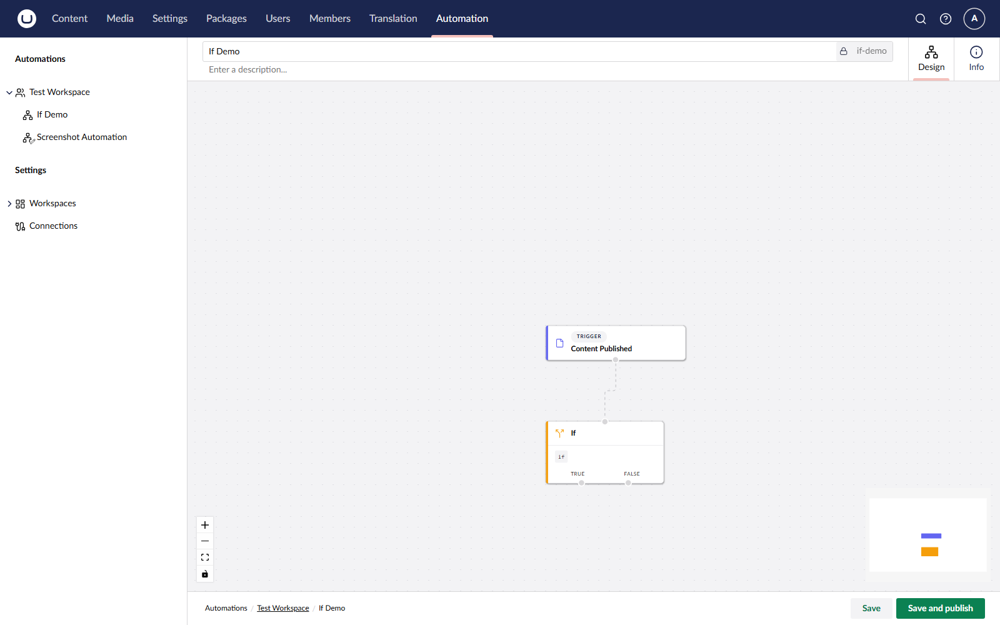

# Control Flow

Control flow nodes let an automation branch based on data or run steps repeatedly. They are added to the canvas in the same way as actions, from the same picker.

## Available Built-in Control Flow Nodes

| Node         | Behaviour                                                                            |
| ------------ | ------------------------------------------------------------------------------------ |
| **If**       | Run the **then** branch when a condition is true, otherwise run the **else** branch. |
| **Switch**   | Run the first case whose condition is true, or a **default** branch if none match.   |
| **While**    | Repeat the inner branch while a condition is true.                                   |
| **For Each** | Run the inner branch once per item in a collection.                                  |
| **Parallel** | Run multiple branches concurrently and wait for all of them to finish.               |

## If

The **If** node evaluates a binding expression and routes the run down one of two branches. Use it to send only certain events to an action — for example, only Slack-notify when a content item of type `News` is published.

<figure><figcaption><p>An If node with two outgoing branches.</p></figcaption></figure>

## Body and Done: While, For Each, and Parallel

**While**, **For Each**, and **Parallel** are container nodes — instead of a single next step, each owns a body of steps and renders two handles:

* **Body** — the step(s) that run inside the loop, or as a branch of the Parallel.
* **Done** — the step that runs once, after every iteration or branch has finished.

Connect whatever comes next after the loop to the **Done** handle, not the Body handle. Otherwise, it runs on every iteration instead of once at the end.

For **Parallel** only, the Body handle accepts more than one connection — each one becomes its own concurrent branch. Every other output accepts one connection. Drawing a new connection from an output that is already connected moves that connection.

A step can receive connections from more than one output. Use this to rejoin branches, for example to connect both **True** and **False** of an **If** to one shared step. Automate refuses a connection that would create a loop.


Automations built before these handles existed keep working as they did. With no Done connection, Automate works out what runs next from the shape of the steps drawn after the loop.


## For Each

The **For Each** node iterates over a collection. The current item and index are exposed inside the inner branch so you can reference them from steps:

```
${ loop.item.title }
${ loop.item.url }
${ loop.index }
```

## Other Steps That Branch

Not every branch comes from a control flow node. An action can declare named outcomes, and the canvas draws one exit per outcome on the right edge of the step. You then connect each exit to its own next step, without an **If** or **Switch** after the action. For example, **Get Content** has a **Found** exit and a **Not found** exit. See [Actions](actions.md) for the exits each built-in action has.

**Request Approval** branches on **Approved** and **Rejected** instead of running a single next step — see [Use Approvals](../backoffice/approvals.md).

### How Outcomes Route a Run

When a step whose action declares outcomes succeeds, the run follows the exit for the outcome the action returned:

* An action can finish without naming an outcome. The run then follows the action's default exit, which the canvas marks **(default)**. Not every action has a default.
* A step that fails doesn't follow any outcome exit. The step's error behavior applies instead.
* An exit with nothing connected to it ends that path of the run.

The run view shows the exit each step took. See [Runs](runs.md#exit-taken).

### Outcomes From Settings

Some actions build their exits from their settings, for example one exit per option you enter. The exits update when you save the step's settings. See [Build an Automation](../backoffice/building-an-automation.md#branch-on-action-outcomes).

Exits always come from the settings you saved, never from bound values. A setting that holds a `${ ... }` binding adds no exit, because its value isn't known until the run. To branch on a value that is only known at run time, add a **Switch** after the step.

### Any Result Lines

An automation saved before an action declared outcomes has a single, unnamed line from that action's step. The canvas shows that line on an **Any result** exit. An **Any result** line runs whatever the step returns, so the automation runs the same as it did before.

**Any result** only appears while such a line exists, and you can't draw a new line from it. Move the line to a named exit to choose when it runs.



While an **Any result** line and a line from a named exit both leave the same step, both paths run on that result. The step shows a warning until you move the **Any result** line to a named exit.



## See Also

* [Bindings](bindings.md)
* [Build an Automation](../backoffice/building-an-automation.md)
* [Use Approvals](../backoffice/approvals.md)
* [Create a Custom Action](../extending/custom-action.md#declaring-outcomes)
