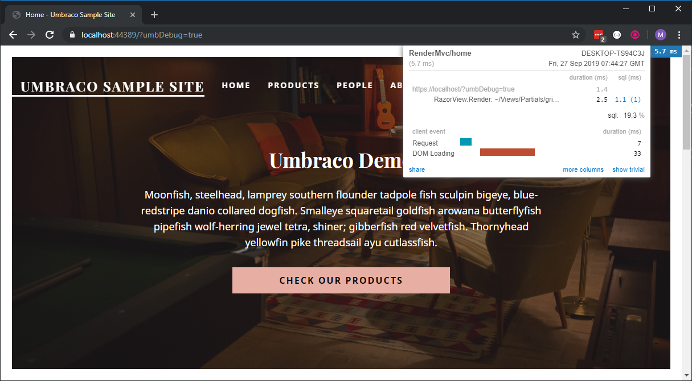
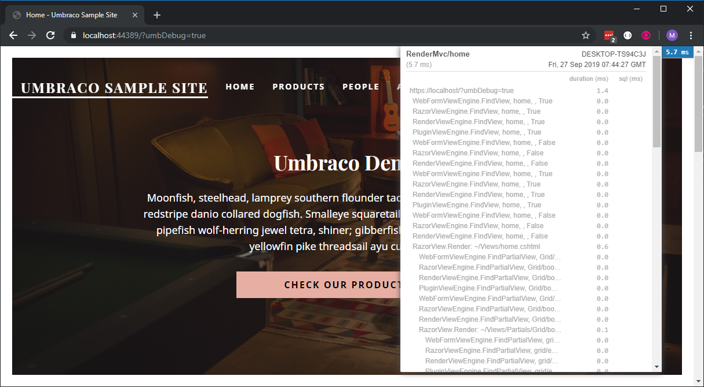
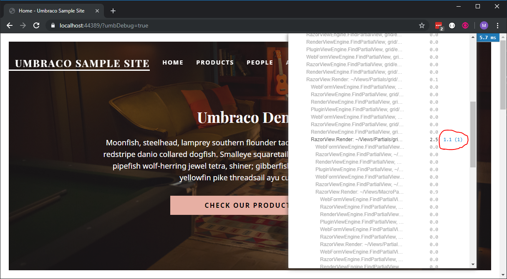
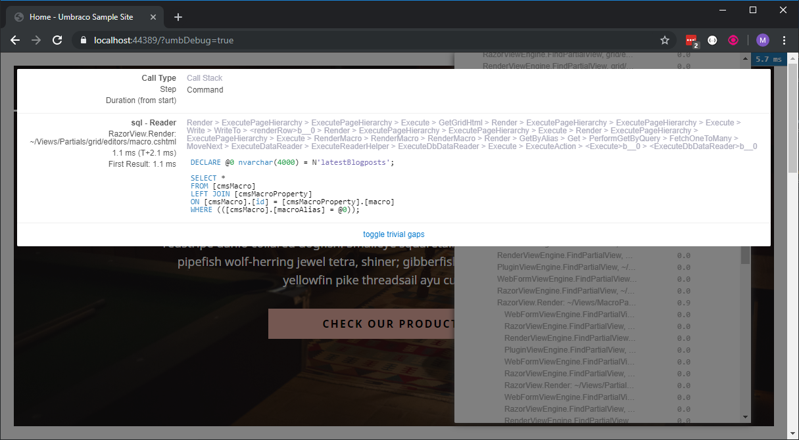
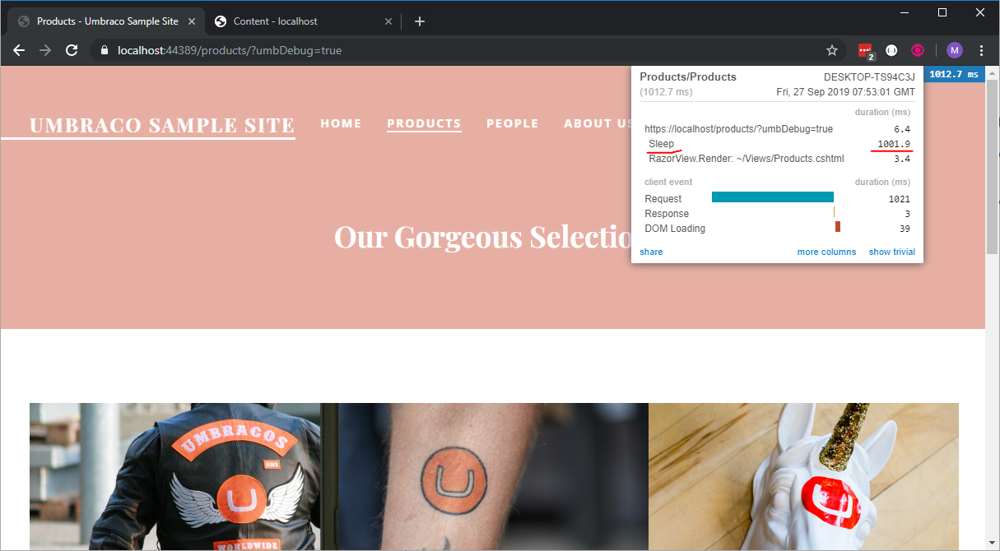

# MiniProfiler

Umbraco includes the Mini Profiler project in its core (see [https://miniprofiler.com](https://miniprofiler.com) for more details). The MiniProfiler profiles your code method calls, giving you a greater insight into code duration and query time for (for example) underlying SQL queries. It's great for tracking down performance issues in your site's implementation.

## Displaying the MiniProfiler

To display the profiler on the front end of your site:

* Set `Umbraco:CMS:Hosting:Debug` to `true` in `appsettings.json`.
* Sign in to the backoffice as a user who has access to the **Settings** section.
* Add `?umbDebug=true` to the request query string.

Instead of the query string, you can activate the profiler in either of the ways described below. Keep in mind that `Debug: true` and a signed-in Settings user are still required.

* Use the **Activate the profiler by default** toggle on the **Profiling** dashboard in the **Settings** section. The toggle sets a cookie, so it only works when the backoffice and website share the same domain. For more information, see the [Settings Dashboards](../../model-your-content/content-types-and-structure/backoffice/settings-dashboards.md) article.
* Send an `X-UMB-DEBUG: true` header with the request. Use this option for cross-site setups.

The profiler is displayed on pages rendered by Razor views. For other requests, such as calls to the Content Delivery API, view the stored results at `/umbraco/profiler/results-index`. Only backoffice users with access to the **Settings** section can view these results.


The results list relies on an inline script. If your site uses a Content Security Policy that blocks inline scripts, the list is empty. For more information, see the [Content Security Policy (CSP)](../../run-in-production/infrastructure-and-ops/health-check/guides/contentsecuritypolicy.md) article.


<figure><figcaption></figcaption></figure>

If you click 'Show Trivial' you can seen the kind of detail the MiniProfiler makes available to you about the execution path of your page:

<figure><figcaption></figcaption></figure>

and any underlying SQL Statements that are being executed for a part of the execution:

<figure><figcaption></figcaption></figure>



## Profiling Views and Partials

Umbraco profiles SQL queries and the time spent locating views. The first profiled request after the site starts also includes the startup timings.

Umbraco includes the render time of a partial view in the timing of its parent view.

For each SQL query, the MiniProfiler shows a stack trace of the code that executed it. When partial views, view components, or services run asynchronously, this stack trace is less useful. It shows framework and compiler-generated methods rather than your own code, so you can't tell which partial view ran the query.

To see how long each part of a view takes, wrap it in the `<profile>` tag helper. The tag helper adds a named step to the profiler. The SQL queries executed inside the tag helper appear under that step.

The tag helper is part of the `MiniProfiler.AspNetCore.Mvc` package, which Umbraco already references. To use it, register the tag helper in `Views/_ViewImports.cshtml`:


```csharp
@addTagHelper *, MiniProfiler.AspNetCore.Mvc
```


Then wrap the markup you want to profile:


```csharp
<profile name="Latest articles">
    <partial name="LatestArticles" />
</profile>

<profile name="Navigation">
    @await Html.PartialAsync("Navigation")
</profile>
```


When the profiler is not active, the `<profile>` tag helper renders its content without recording anything. You can leave the tag helper in your views when you deploy to production.

For more information, see the [MiniProfiler ASP.NET Core documentation](https://miniprofiler.com/dotnet/AspDotNetCore).

## Writing to the MiniProfiler

If you feel like a part of your application is slow you can use the MiniProfiler in your code to test the speed of it.

All you have to do is inject the IProfiler interface and add a step around your logic:

```csharp
using Microsoft.AspNetCore.Mvc;
using Microsoft.AspNetCore.Mvc.ViewEngines;
using Microsoft.Extensions.Logging;
using Umbraco.Cms.Core.Logging;
using Umbraco.Cms.Core.Web;
using Umbraco.Cms.Web.Common.Controllers;

namespace MyCustomUmbracoProject;

public class RootController : RenderController
{
    private readonly IProfiler _profiler;

    public RootController(
        IProfiler profiler,
        ILogger<RenderController> logger,
        ICompositeViewEngine compositeViewEngine,
        IUmbracoContextAccessor umbracoContextAccessor)
        : base(logger, compositeViewEngine, umbracoContextAccessor)
    {
        _profiler = profiler;
    }

    public override IActionResult Index()
    {
        // Perform a step
        using (_profiler.Step("Sleep"))
        {
            System.Threading.Thread.Sleep(1000);
        }

        return base.Index();
    }
}
```

and now in the profiler you can see:



### Using the MiniProfiler API

`IProfiler` is the Umbraco abstraction over the MiniProfiler and covers most profiling needs. Use `IProfiler` when a `Step` is enough. Your code then doesn't depend on the MiniProfiler package, and you can mock the profiler in unit tests.

`IProfiler` doesn't expose every MiniProfiler feature. For these features, use `MiniProfiler.Current` from the `StackExchange.Profiling` namespace. It provides methods such as:

* `StepIf`: records a step only when it takes longer than a given number of milliseconds.
* `CustomTiming`: records a timing in its own category, for example, calls to an external API.
* `Ignore`: excludes a block of code from the results.

The following example records calls to an external API in an `http` category. The MiniProfiler displays these timings in a separate column, next to the SQL timings.


```csharp
using StackExchange.Profiling;

namespace MyCustomUmbracoProject;

public class WeatherService
{
    private readonly HttpClient _httpClient;

    public WeatherService(HttpClient httpClient) => _httpClient = httpClient;

    public async Task<string> GetForecastAsync(string city)
    {
        var url = $"https://api.example.com/forecast?city={city}";

        using (MiniProfiler.Current.CustomTiming("http", url, "GET"))
        {
            return await _httpClient.GetStringAsync(url);
        }
    }
}
```


The `MiniProfiler.Current` methods do nothing when the profiler is not active.

For details of these and other methods, see [Profile Code](https://miniprofiler.com/dotnet/HowTo/ProfileCode) in the MiniProfiler documentation.

