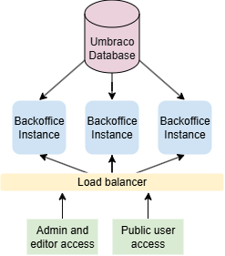
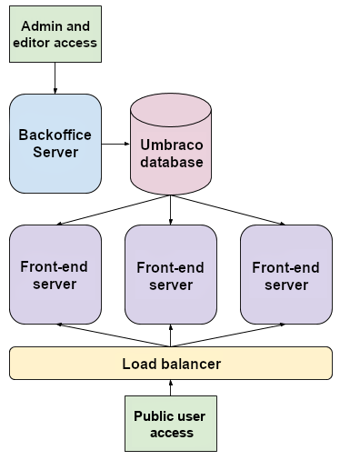

# Umbraco in Load Balanced Environments

## Overview

Configuring and setting up a load balanced server environment requires planning, design and testing. This document should assist you in setting up your servers, load balanced environment and Umbraco configuration.

This document assumes that you have a fair amount of knowledge about:

* Umbraco
* IIS 10+
* Networking & DNS
* Windows Server
* .NET5+


It is highly recommended that you setup your staging environment to also be load balanced so that you can run all of your testing on a similar environment to your live environment.


## Design

These instructions make the following assumptions:

* All web servers can communicate with the database where Umbraco data is stored
* You are running Umbraco 17.0.0 or above
* You will choose how to handle the backoffice: either designate a single server outside the load balancer, or load balance the backoffice itself (requires additional configuration).

There are three design alternatives you can use to effectively load balance servers:

1. You use cloud based auto-scaling appliances like [Microsoft's Azure Web Apps](https://azure.microsoft.com/en-us/services/app-service/web/)
2. Each server hosts copies of the load balanced website files and a file replication service is running to ensure that all files on all servers are up to date
3. The load balanced website files are located on a centralized file share (SAN/NAS/Clustered File Server/Network Share)

You will need a load balancer to do your load balancing.

## How Umbraco load balancing works

In order to understand how to host your site it is best to understand how Umbraco's flexible load balancing works.

There are two approaches to structuring your load balanced environment:

**Option 1: Load balance the backoffice**

You can place the backoffice behind the load balancer alongside your front-end servers. This requires additional configuration steps — see [Load Balancing the Backoffice](load-balancing-backoffice.md) for details.

**Option 2: Dedicated backoffice server (SchedulingPublisher/Subscriber)**

Alternatively, you can designate a single server as the backoffice (`SchedulingPublisher`) that sits outside the load balancer, with the remaining servers acting as `Subscriber` (front-end) nodes. This is the more traditional approach.

In this setup, the data flow works as follows:

* Administrators and editors create, update, delete data/content on the backoffice server
* These events are converted into data structures called "instructions" and are stored in the database in a queue
* Each front-end server checks to see if there are any outstanding instructions it hasn't processed yet
* When a front-end server detects that there are pending instructions, it downloads them and processes them and in turn updates it's cache, cache files and indexes on its own file system
* There can be a delay between content updates and a front-end server's refreshing, this is expected and normal behaviour.

## Scheduling and server role election

Umbraco elects one server to hold the `SchedulingPublisher` role. Recurring background jobs run on this server by default.

Distributed background jobs work differently. Any server with write access to the database can pick them up. Built-in distributed jobs include scheduled publishing, health check notifications, log scrubbing, and content version cleanup. For timing options, see [Distributed jobs settings](../../../../develop-with-umbraco/configuration/distributedjobssettings.md).

### Automatic Server Role Election

Umbraco automatically elects which server holds the `SchedulingPublisher` role.

There are two server roles:

* `SchedulingPublisher` - Usually this is the backoffice instance.
* `Subscriber` - These are the scalable front-end instances - not recommended to be used for backoffice access.


These new terms replace 'Master and Replica', in Umbraco versions 7 and 8.


Each instance will be allocated a role by the automatic server role election process, but they can also be set explicitly (recommended)

Scheduling does not depend on `UmbracoApplicationUrl`. Servers do not send HTTP requests to themselves to run scheduled tasks or scheduled publishing.

When `UmbracoApplicationUrl` is not set, `ApplicationUrlDetection` controls how the URL is found. The default is `None`, so no URL is detected. For details, see [WebRouting settings](../../../../develop-with-umbraco/configuration/webroutingsettings.md#umbraco-application-url).

**Recommended**: [set your front-end servers to be explicit subscriber servers](flexible-advanced.md#explicit-schedulingpublisher-server) by creating a custom `IServerRoleAccessor`. The front-end servers will then never take the `SchedulingPublisher` role.

## Common load balancing setup information

_The below section applies to all ASP.NET load balancing configurations._

## Server Configuration

This section describes the configuration options depending on your hosting setup:

1. [Azure Web Apps](azure-web-apps.md) - _You use cloud based auto-scaling appliances like_ [_Microsoft's Azure Web Apps_](https://azure.microsoft.com/en-us/services/app-service/web/)
2. [File Replication](file-system-replication.md#synchronized-file-system) - _Each server hosts copies of the load balanced website files. A file replication service keeps the files on all servers up to date._
3. [Centralized file share](file-system-replication.md#synchronized-file-system) - _The load balanced website files are located on a centralized file share (SAN/NAS/Clustered File Server/Network Share)_

[Full documentation is available here](file-system-replication.md)

### Data Protection

The replacement for Machine Keys in ASP.NET Core are called Data Protection. You will need to setup data protection to the same keys on all servers, without this you will end up with view state errors, validation errors and encryption/decryption errors since each server will have its own generated key.

ASP.NET Core supports multiple ways to share keys. Use the [official docs](https://docs.microsoft.com/en-us/aspnet/core/security/data-protection/configuration/overview) to find a description that fits your setup the best.

### Session State and Distributed Cache

It is required to setup a distributed cache, like `DistributedSqlServerCache` or an alternative provider (see [https://docs.microsoft.com/en-us/aspnet/core/performance/caching/distributed](https://docs.microsoft.com/en-us/aspnet/core/performance/caching/distributed) for more details). The distributed cache is used by the session in your application, which is used by the default TempDataProvider in MVC.

Because Umbraco in some cases uses TempData, your setup needs to be configured with a distributed cache.

### Logging

There are some logging configurations to take into account no matter what type of load balancing environment you are using.

[Full documentation is available here](logging.md)

### Testing

Your staging environment should also be load balanced so that you can see any issues relating to load balancing in that environment before going to production.

You'll need to test this solution **a lot** before going to production. You need to ensure there are no windows security issues, etc... The best way to determine issues is have a lot of people testing this setup and ensuring all errors and warnings in your application/system logs in Windows are fixed.

Ensure to analyze logs from all servers and check for any warnings and errors.

## Unattended upgrades

When upgrading it is possible to run the upgrades unattended.

Find steps on how to enable the feature for a load balanced setup in the [General Upgrades](../../../../get-started/upgrading-and-migrating/upgrade-unattended.md#unattended-upgrades-in-a-load-balanced-setup) article.

***

## Umbraco Training


