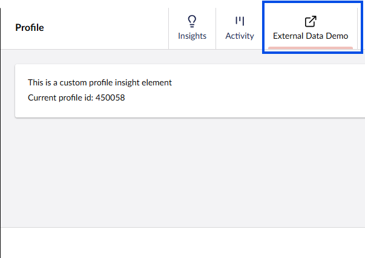

# External Profile Data

Your system may associate an Umbraco Engage visitor with other data coming from an external system such as a Customer Relation Management (CRM) system.

It is possible to visualize this external data alongside the Umbraco Engage profile by providing a custom Web Component.

## Visualization

When the component is registered, a new tab is rendered in the Engage Profile workspace. The tab renders your custom component. The component reads the Umbraco Engage visitor ID from the workspace context.



### Register custom components


Check the [Creating your first extension](https://docs.umbraco.com/umbraco-cms/extend-your-project/tutorials/creating-your-first-extension) and [Vite Package Setup](https://docs.umbraco.com/umbraco-cms/extend-your-project/backoffice-extensions/development-flow/vite-package-setup) articles for detailed extension-building tutorials.


To render this External Data Demo tab with a custom component, create your component and register it with Umbraco Engage. The links above demonstrate different approaches to building Umbraco extensions. This demo uses a Lit element without a build step.

The following code demonstrates both steps. 

1. Add the below code in a JavaScript file:

```javascript
import { html } from "@umbraco-cms/backoffice/external/lit";
import { UmbLitElement } from '@umbraco-cms/backoffice/lit-element';
import { UMB_ENTITY_WORKSPACE_CONTEXT } from "@umbraco-cms/backoffice/workspace";

export class EngageExternalProfileDataElement extends UmbLitElement {
    static properties = {
        _profileId: { state: true },
    };

    constructor() {
        super();
        this.consumeContext(UMB_ENTITY_WORKSPACE_CONTEXT, context => {
            this.observe(context?.unique, unique => {
                this._profileId = unique;
            });
        });
    }

    render() {
        return html`
            <p>This is a custom profile view</p>
            <p>Current profile id: ${this._profileId}</p>
        `;
    }
}

export { EngageExternalProfileDataElement as element }

customElements.define("external-profile-data-demo", EngageExternalProfileDataElement);
```

2. Load your component via an `umbraco-package.json` file. The extension type must be `engageExternalDataComponent`.

```json
{
  "$schema": "../../umbraco-package-schema.json",
  "name": "Engage External Profile Data Demo",
  "allowPublicAccess": true,
  "extensions": [
    {
      "type": "engageExternalDataComponent",
      "alias": "EngageDemo.ExternalProfileData",
      "name": "External Profile Data Demo",
      "weight": 100,
      "js": "/App_Plugins/path/to/my-element.js"
    }
  ]
}
```
