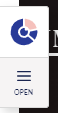
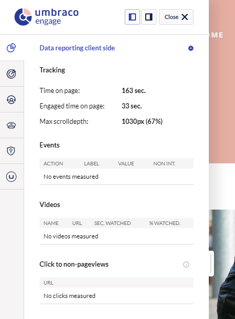

# Cockpit

Umbraco Engage includes a cockpit feature to help verify the tracking of analytics and understand personalization behavior. The cockpit adds a button to the front end, giving real-time insights.

As of Umbraco Engage 16, the cockpit is automatically added. The cockpit is visible to logged-in Umbraco users with the right access. Learn more in the [Access to the cockpit](#access-to-the-cockpit) section.


Automatic injection of the Cockpit can be disabled by setting ‘**Engage:Cockpit:EnableInjection**’ configuration to **false** in your appsettings.json file.


When visiting the front-end website, the Umbraco Engage Cockpit will appear on the left or right side of the screen. The cockpit is only rendered if the user is logged in to Umbraco.

Clicking the **Open** button provides detailed information:

If the Cockpit is missing and the Umbraco backoffice runs on a different domain, see the [Load Balancing and CM/CD Environments](loadbalancing-and-cm-cd-environments.md) article.

## Access to the cockpit


The cockpit permission checks require Umbraco Engage 17.6 or later.


The user needs access to the **Engage** section. Each part of the cockpit is shown only when the user's group has the **Read** permission for that feature:

* Analytics data requires the **Read** permission for Analytics.
* Personas, customer journeys, segments, and the personalization variant require the **Read** permission for Personalization.
* The A/B test variant requires the **Read** permission for A/B Testing.
* The link to the visitor profile requires the **Read** permission for Profiles.

Access is checked on every request. Learn more in the [Permissions](../../marketers-and-editors/settings/permissions.md#user-group-permissions) article.

## Opening the Cockpit in CM/CD Environments

In load-balanced setups where the backoffice runs separately, you can use the **Open Cockpit** button. It is located in the top-right corner of the **Engage** section. This provides secure authentication without requiring cookie domain configuration.

See [Load Balancing and CM/CD Environments](loadbalancing-and-cm-cd-environments.md#cockpit) for detailed setup instructions.
