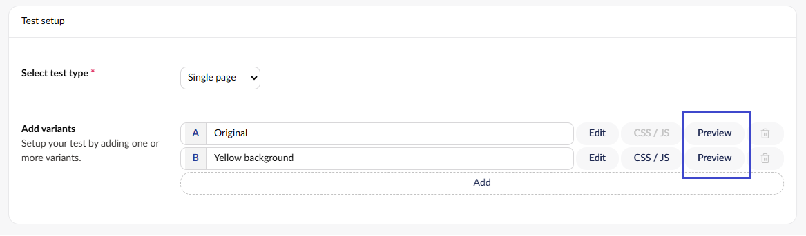
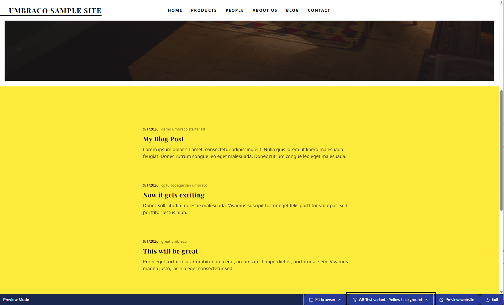
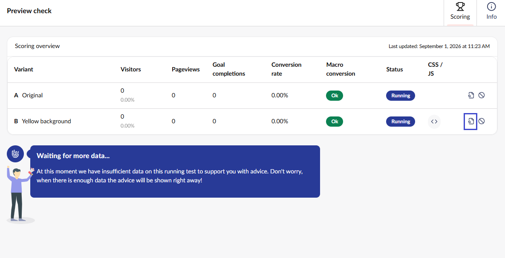

# Previewing an A/B Test

There are different ways to preview your A/B Test variants.

## During the setup of your new A/B Test

You can preview a variant while setting up a new A/B Test. Under **Add variants**, select **Preview** next to the variant:

The page opens in Preview Mode. The variant is selected in the bar at the bottom of the preview, for example **AB Test variant - Yellow background**.

## During a running test

You can preview all the A/B test variants while a test is running. Open the test to see the **Scoring overview** view with the current results. Select the preview icon in the **CSS / JS** column of a variant to preview it.

