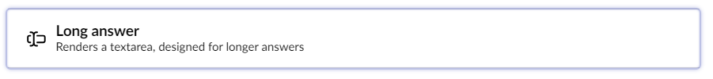
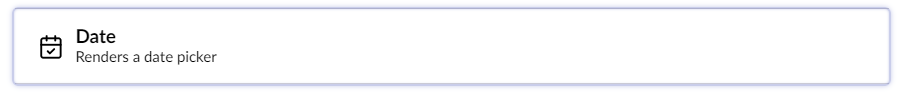
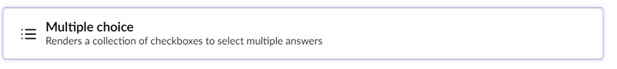
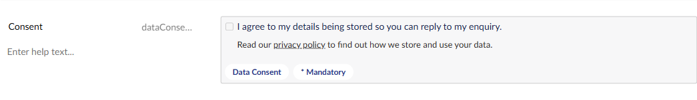
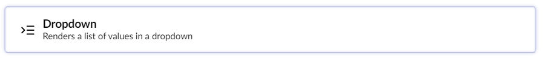
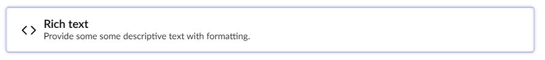
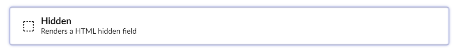
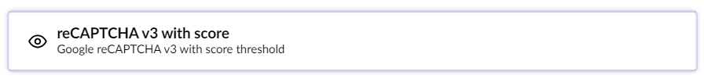

# Overview Of The Field Types

Umbraco Forms comes with a bunch of default Field Types, also known as **Answer Types**. You can choose from different field types when adding new fields to your Forms.

By default, the following Field Types are available:

*   **Short Answer**: A textbox allows up to 250 characters.

    
*   **Long Answer**: A bigger text field that allows multiline text and more than 250 characters.

    
*   [Date](date.md): Displays a picker that allows the user to select a date.

    
*   **Checkbox**: Displays a single checkbox that can be checked or not.

    
*   [File Upload](fileupload.md): Allows the user to select and upload a local file.

    
*   **Password**: Allows typing a password. The input is not visible when typing.

    
*   **Multiple Choice**: Displays a list of items with a checkbox for each item where the user can select multiple options.

    
*   **Data Consent**: A field for the purpose of asking for data consent. By default, this field is added to all new Forms. The **Consent text** setting holds the text next to the checkbox. From Umbraco Forms 17.7.0, the optional **Consent details** setting holds formatted text shown under the checkbox. Use it to link to your privacy policy, for example. See [HTML in rich text settings](#html-in-rich-text-settings).

    

    
*   **Dropdown**: Displays a list of items in a drop-down box where the user can select a single option.

    
*   **Single Choice**: Displays a list of items with a radio button for each item where the user can select a single option.

    
*   **Title and Description**: Displays a read-only title and description for a set of form fields.

    
*   **Rich Text**: Displays read-only formatted text that can be used to provide additional information and links within a form. See [HTML in rich text settings](#html-in-rich-text-settings).

    
*   **Hidden**: A hidden field allows developers to include data that cannot be seen or modified by users when a Form is submitted.

    
*   [Recaptcha V2](recaptcha2.md): The field displays a single checkbox for the user to select to validate the Form.

    
*   [Recaptcha V3 with Score](recaptcha3.md): This field returns a score for each request without user interaction. The score is based on user interactions with the site and enables you to take an appropriate action for your site based on the score.

    
* [Recaptcha Enterprise with Score](recaptcha-enterprise.md): This field returns a score for each request without user interaction. The score is based on user interactions with the site and enables you to take an appropriate action for your site based on the score.

## HTML in rich text settings

The **Consent details** setting of the Data Consent field and the **Rich text** setting of the Rich Text field hold HTML. That HTML is stored and rendered as entered. The default theme outputs it unchanged, and the Delivery API returns it unchanged.

When a form is saved, Forms passes these settings, and a submit message written in HTML, through the Umbraco `IHtmlSanitizer`. The default implementation in Umbraco CMS returns the HTML unchanged. To remove unsafe markup, register your own `IHtmlSanitizer`. You might do this if, for example, less-trusted users can edit forms. For more information, see the [Sanitizing the Rich Text Editor](https://docs.umbraco.com/umbraco-cms/run-in-production/security/serverside-sanitizing) article.

Placeholder values supplied by visitors, such as `[@name]`, are HTML-encoded when they're inserted into these settings.
