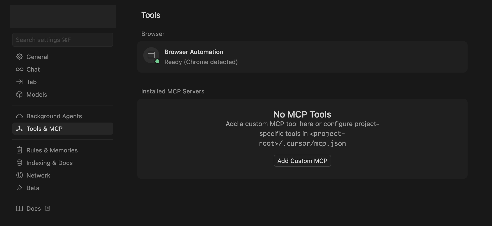
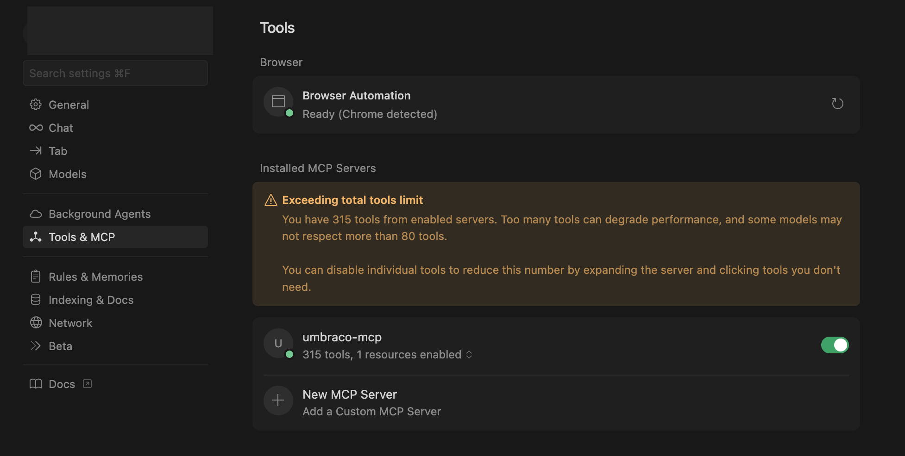

# Cursor

[Cursor](https://cursor.com/) is an AI-powered code editor built as a fork of Visual Studio Code. It enhances the familiar Visual Studio Code experience with conversational AI features that help you write, refactor, and understand code more efficiently.


The examples below use the Developer MCP package (`@umbraco-cms/mcp-dev`). Replace the package name if you are using a different Umbraco MCP server.


## Getting started

1. Go to **Cursor Settings** -> **Tools & MCP** -> **Add Custom MCP**.



2. Add the following code to the config file.

```json
{
  "mcpServers": {
    "umbraco-mcp": {
      "command": "npx", 
      "args": ["@umbraco-cms/mcp-dev@lts-17"],
      "env": {
        "NODE_TLS_REJECT_UNAUTHORIZED": "0",
        "UMBRACO_CLIENT_ID": "umbraco-back-office-mcp",
        "UMBRACO_CLIENT_SECRET": "1234567890",
        "UMBRACO_BASE_URL": "https://localhost:12345",
        "UMBRACO_INCLUDE_TOOL_COLLECTIONS": "document,media,document-type,data-type,template"
      }
    }
  }
}
```


`NODE_TLS_REJECT_UNAUTHORIZED` set to `0` lets the MCP server accept the self-signed certificate of a local Umbraco. Only use it when `UMBRACO_BASE_URL` is `localhost`, `127.0.0.1` or `[::1]`. With any other base URL, the server refuses to start, so remove the setting for a remote site. See [TLS Certificates](tls-certificates.md) for the reasons, and how to keep verification on with `NODE_EXTRA_CA_CERTS`.



`UMBRACO_INCLUDE_TOOL_COLLECTIONS` restricts the MCP Server to only the tool collections listed here. Nearly every Umbraco Management API operation is available as a tool, so add any additional collections your task requires. See [Available Tools](../../mcp-servers/cms-developer-mcp/available-tools.md) for the full list of collections.


Replace the `UMBRACO_CLIENT_ID`, `UMBRACO_CLIENT_SECRET`, and `UMBRACO_BASE_URL` values with your local connection details.



* The warning above indicates that the number of tools exceeds the limit is expected behaviour.
* [Choose which tools or tool collections](../../mcp-servers/cms-developer-mcp/available-tools.md) you want to enable for your first task.


Selecting only the tools you need helps keep your setup efficient and conversations with your AI assistant more focused.

