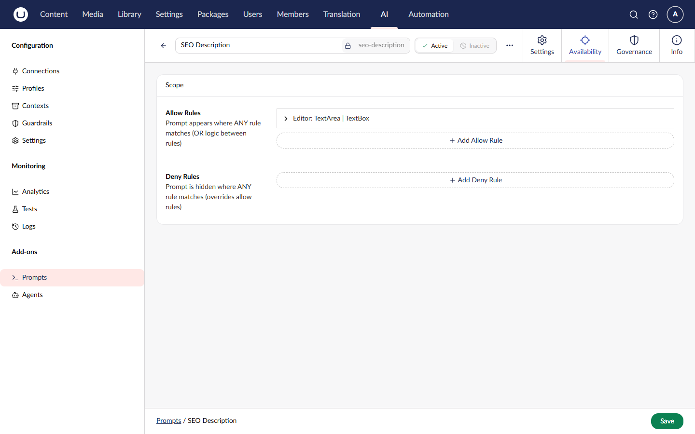
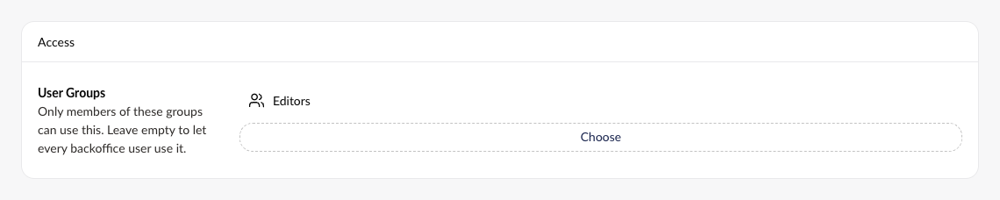

# Prompt Scoping

Scoping controls where a prompt is allowed to run. You can restrict prompts to specific content types, property editors, or properties, and use a combination of allow and deny rules to shape editorial workflows.

## How Scoping Works

A prompt's scope is made up of two lists:

- **Allow rules** - Whitelist the places where a prompt **can** be used. At least one allow rule must match for the prompt to execute.
- **Deny rules** - Blacklist the places where a prompt **cannot** be used. If any deny rule matches, execution is blocked. Deny rules take precedence over allow rules.

Each rule is an `AIPromptScopeRule` that can match against one or more of the following:

| Property                  | Description                                                      |
| ------------------------- | ---------------------------------------------------------------- |
| `ContentTypeAliases`      | Document, media, member, or element type aliases to match        |
| `PropertyAliases`         | Property aliases to match (for example `pageTitle`, `summary`)   |
| `PropertyEditorUiAliases` | Property Editor UI aliases (for example `Umb.PropertyEditorUi.TextBox`) |


Within a single rule, every non-empty property must match (AND logic). Within each list, any value can match (OR logic). Between rules, any rule matching is enough (OR logic).



A prompt with no scope, or with an empty `AllowRules` list, is **not allowed to run anywhere**. To make a prompt available, you must add at least one allow rule.


## Configuring Scope

### Via Backoffice

1. Edit the prompt.
2. Expand the **Scope** section.
3. Add one or more **Allow Rules** describing where the prompt should be available.
4. Optionally add **Deny Rules** to exclude specific places.
5. Save.



### Via Code



```csharp
var prompt = new AIPrompt
{
    Alias = "product-description",
    Name = "Product Description",
    Instructions = "Write a product description...",
    Scope = new AIPromptScope
    {
        AllowRules = [
            new AIPromptScopeRule
            {
                ContentTypeAliases = ["product", "productVariant"]
            }
        ]
    }
};

await _promptService.SavePromptAsync(prompt);
```



### Via API



```json
{
    "alias": "product-description",
    "name": "Product Description",
    "instructions": "Write a product description...",
    "scope": {
        "allowRules": [
            {
                "contentTypeAliases": ["product", "productVariant"]
            }
        ],
        "denyRules": []
    }
}
```



## Scope Model



```csharp
public class AIPromptScope
{
    public IReadOnlyList<AIPromptScopeRule> AllowRules { get; set; } = [];
    public IReadOnlyList<AIPromptScopeRule> DenyRules { get; set; } = [];
}

public class AIPromptScopeRule
{
    public IReadOnlyList<string>? PropertyEditorUiAliases { get; set; }
    public IReadOnlyList<string>? PropertyAliases { get; set; }
    public IReadOnlyList<string>? ContentTypeAliases { get; set; }
}
```



## Examples

### Allow on specific content types

Make the prompt available on any property of two content types:

```csharp
Scope = new AIPromptScope
{
    AllowRules = [
        new AIPromptScopeRule
        {
            ContentTypeAliases = ["blogPost", "article"]
        }
    ]
}
```

### Allow on specific property editors

Make the prompt available on any textbox or textarea, regardless of content type:

```csharp
Scope = new AIPromptScope
{
    AllowRules = [
        new AIPromptScopeRule
        {
            PropertyEditorUiAliases = [
                "Umb.PropertyEditorUi.TextBox",
                "Umb.PropertyEditorUi.TextArea"
            ]
        }
    ]
}
```

### Combine constraints within a rule

Require both a content type and a property alias match (AND logic):

```csharp
Scope = new AIPromptScope
{
    AllowRules = [
        new AIPromptScopeRule
        {
            ContentTypeAliases = ["blogPost"],
            PropertyAliases = ["summary", "excerpt"]
        }
    ]
}
```

### Allow and deny combined

Allow the prompt for all blog posts, but exclude a sensitive property:

```csharp
Scope = new AIPromptScope
{
    AllowRules = [
        new AIPromptScopeRule
        {
            ContentTypeAliases = ["blogPost"]
        }
    ],
    DenyRules = [
        new AIPromptScopeRule
        {
            PropertyAliases = ["legalDisclaimer"]
        }
    ]
}
```

## Limiting a Prompt to User Groups

Scope controls where a prompt runs. The **Access** box controls who can use it. By default, every backoffice user can use every prompt.

To limit a prompt to chosen user groups:

1. Go to **AI** > **Prompts** and open the prompt.
2. Open the **Availability** tab.
3. In the **Access** box, select **Choose** under **User Groups** and pick one or more groups.
4. Save the prompt.



A user can use the prompt when they are in at least one of the chosen groups. Leave the list empty to let every backoffice user use it. Existing prompts start with an empty list, so an upgrade changes nothing.

The limit applies to every user, administrators included, and works together with the prompt's scope. Users outside the chosen groups:

- Don't see the prompt as a property action or in the rich text editor toolbar.
- Get a `403` response with the title "Prompt not available" if they call the execute endpoint directly.
- Can't see the prompt's version history, unless they have the **Manage prompts** permission.

If a chosen user group is deleted, the prompt keeps the entry and it matches no one. The list shows it as **Deleted user group** with a **Deleted** tag, so you can remove it.

Users with the **Manage prompts** permission see and edit every prompt in the AI section. The rules for changing the **User Groups** list are the same as for agents:

- Administrators can add and remove any group.
- Other users can only change the list on a prompt they can use, and only add or remove groups they belong to.
- Only an administrator can remove the last group, because an empty list opens the prompt to everyone.

For more about the **Manage prompts** permission, see [User Permissions](../../backoffice/user-permissions.md).

## Enforcement

Scope validation runs both in the backoffice (to decide which prompts appear on a given property) and server-side when a prompt is executed. A prompt execution request that does not match any allow rule, or that matches a deny rule, is rejected by the `AIPromptScopeValidator`.

## Related

- [Concepts](concepts.md) - Prompt fundamentals
- [Template Syntax](template-syntax.md) - Variable interpolation
