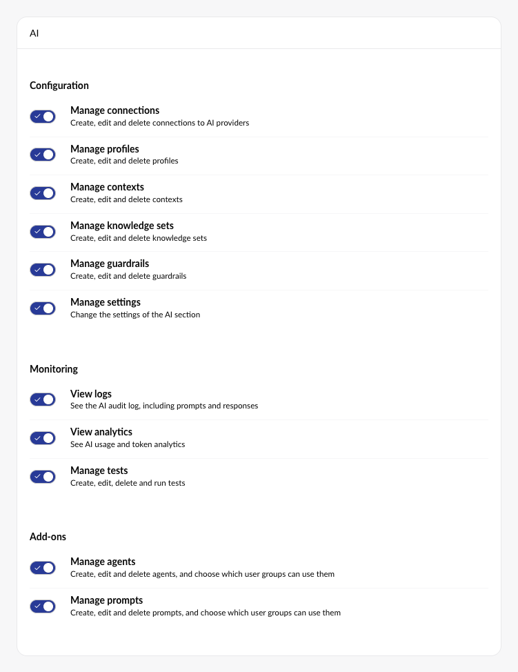

# User Permissions

Access to the AI section lets a user open it. The AI permissions decide what they can change once they are there. You set them per user group, next to every other user group permission.

## Setting AI Permissions

1. Go to **Users** > **User Groups**.
2. Open the user group.
3. Make sure **AI** is in the **Sections** list.
4. In the **AI** box, turn on the permissions the group needs.
5. Save the user group.

A user has a permission when any of their user groups has it.

## Available Permissions

The **AI** box groups the permissions under three headings.

| Heading | Permission | What it allows |
| --- | --- | --- |
| Configuration | **Manage connections** | Create, edit, delete, and test connections to AI providers. |
| Configuration | **Manage profiles** | Create, edit, and delete profiles. |
| Configuration | **Manage contexts** | Create, edit, and delete contexts. |
| Configuration | **Manage knowledge sets** | Create, edit, and delete knowledge sets. |
| Configuration | **Manage guardrails** | Create, edit, and delete guardrails. |
| Configuration | **Manage settings** | Change the settings of the AI section. Also needed to delete audit log entries. |
| Monitoring | **View logs** | See the AI audit log, including prompts and responses. |
| Monitoring | **View analytics** | See AI usage and token analytics. |
| Monitoring | **Manage tests** | Create, edit, delete, and run tests. |
| Add-ons | **Manage agents** | Create, edit, and delete agents, and choose which user groups can use them. |
| Add-ons | **Manage prompts** | Create, edit, and delete prompts, and choose which user groups can use them. |

A permission only shows when its package is installed. For example, **Manage agents** needs Umbraco.AI.Agent and **Manage prompts** needs Umbraco.AI.Prompt.

Restoring an older version of an item from [Version History](version-history.md) needs the same permission as saving that item. The version history of an agent or prompt limited to user groups is hidden from users outside those groups. Users with **Manage agents** or **Manage prompts** still see it.

## What a User Without a Permission Sees

Without a permission, the area is closed to the user:

- The area's item in the AI section menu is hidden.
- The create, delete, and save actions for the area are hidden.
- The Management API refuses any change to the area with a `403` response.

Pickers keep working. A user who can manage contexts but not profiles can still pick a profile in another editor. The lists behind the pickers stay readable to every user with access to the AI section.

The Administrators group has no special treatment. It gets the AI permissions the same way as any other group.



A change to a user group's permissions applies on the user's next request. The AI section menu updates after the user reloads the backoffice.



## Managing Agents and Prompts

**Manage agents** and **Manage prompts** give access to every agent or prompt in the AI section. This includes items limited to user groups that the user isn't in.

These permissions don't change who can use an agent or prompt elsewhere in the backoffice. For that, see [Limiting an Agent to User Groups](../add-ons/agent/permissions.md#limiting-an-agent-to-user-groups) and [Limiting a Prompt to User Groups](../add-ons/prompt/scoping.md#limiting-a-prompt-to-user-groups).

## Upgrading an Existing Site

When you upgrade, every user group with access to the AI section gets every AI permission. The Administrators group gets them too. Existing users keep the access they had before, and you don't need to change anything.

- Each package grants its own permissions. If you install Umbraco.AI.Agent or Umbraco.AI.Prompt later, groups with access to the AI section at that point get **Manage agents** or **Manage prompts**.
- A user group that gets access to the AI section after the upgrade has no AI permissions until you turn them on.
- The upgrade never removes a permission, and doesn't add back a permission you turned off.

## Related

- [Backoffice](backoffice.md) - The AI section overview
- [Permissions](../add-ons/agent/permissions.md) - Agent tool permissions and who can use an agent
- [Prompt Scoping](../add-ons/prompt/scoping.md) - Where a prompt can run and who can use it
