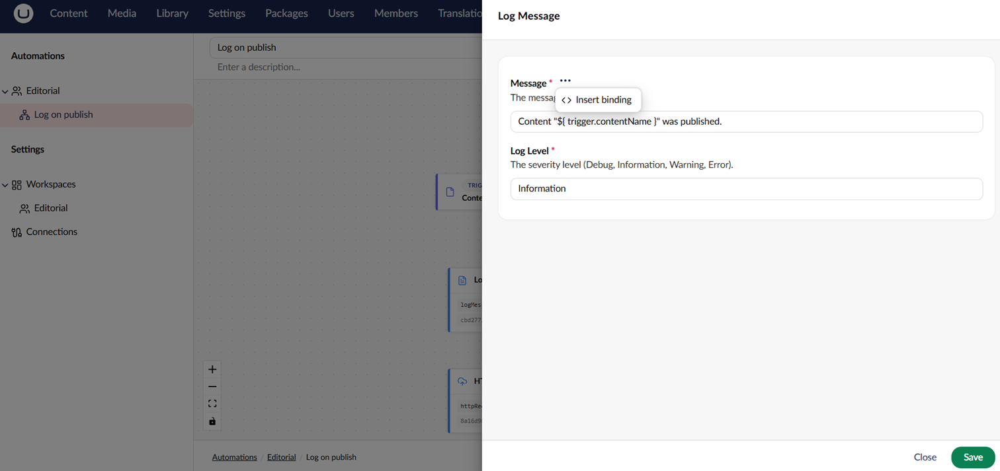

# Bindings

Bindings pass data between the steps of an automation. A binding is a `${ ... }` placeholder inside an action setting that is resolved at runtime against the data produced by previous steps.

## Syntax

A binding has a path and zero or more filters:

```
${ <path> }
${ <path> | <filter> }
${ <path> | <filter>:<arg> | <filter>:<arg> }
```

Output property names are exposed to bindings in camelCase. For example, `ContentName` on the trigger output becomes `${trigger.contentName}`.

## Root Paths

| Root                    | Resolves to                                                                                             |
| ----------------------- | ------------------------------------------------------------------------------------------------------- |
| `trigger.<field>`       | A field on the trigger output.                                                                          |
| `steps.<alias>.<field>` | A field on a previous step's output. The alias is set in the step settings. The step's GUID also works. |
| `previous.<field>`      | The output of the step immediately before this one.                                                     |
| `loop.item.<field>`     | Inside a **For Each**, the current item.                                                                |
| `loop.index`            | Inside a **For Each**, the zero-based iteration index.                                                  |

Paths support nested dictionaries, array indexes (`items[0]`), and dictionary keys (`headers["Content-Type"]`). A `length` or `count` segment on a list resolves to the list size.

A Run Script step reads the same values from its `data` argument, using the same paths. See [Run Script Data](actions.md#run-script-data).

## Examples

```
${ trigger.contentName }
${ trigger.firedAtUtc | formatDate:yyyy-MM-dd }
${ steps.callApi.responseBody | truncate:200 }
${ trigger.body | stripHtml | truncate:500 }
${ previous.statusCode }
```

## Built-in Filters

| Filter                | Purpose                                                                                                              |
| --------------------- | -------------------------------------------------------------------------------------------------------------------- |
| `truncate:<length>`   | Truncate the value to the given length. An optional second argument appends a suffix when the value is truncated.    |
| `formatDate:<format>` | Format a date, or an ISO 8601 date string, using a .NET format string. See [Format Dates](bindings.md#format-dates). |
| `fallback:<value>`    | Use the provided value if the path resolves to null or empty.                                                        |
| `stripHtml`           | Remove HTML tags from a string.                                                                                      |
| `uppercase`           | Convert the value to uppercase.                                                                                      |
| `lowercase`           | Convert the value to lowercase.                                                                                      |
| `json`                | Serialize the value to JSON.                                                                                         |

Filters can be chained using the `|` separator. Arguments are colon-separated, so an argument value must not contain a literal colon.

A filter name that doesn't exist, such as the typo `uppercse`, fails the step instead of passing the value through unfiltered. Automate doesn't retry the step, and the error names the filter and the binding's path. A `|` inside an argument starts a new filter, so it fails the same way. Publishing an automation that uses an unknown filter is rejected, with an error that names the step, the field, and the filter.

### Format Dates

`formatDate` works on date values and on ISO 8601 date strings, such as `2026-11-04` or `2026-11-04T10:00:00+05:00`. Trigger output, webhook bodies, and HTTP responses often hold dates as strings like these. A string with a UTC offset keeps its offset, so `formatDate:HH` on `2026-11-04T10:00:00+05:00` gives `10`.

`formatDate` leaves the value unchanged in these cases:

* The value isn't a date or an ISO 8601 date string.
* The format doesn't fit the value, for example `HH` on a date with no time.

Without a format, `formatDate` writes the ISO 8601 round-trip format, the same as a bare binding.

## Dates and Numbers

Dates and numbers in bindings render the same way on every server, whatever its culture:

* A date renders as ISO 8601, for example `2026-11-04T10:00:00.0000000Z`. A date with no time zone is written without one. Use `formatDate` for readable text.
* A number renders with the invariant culture, so a decimal always uses a `.`, for example `0.99`.
* A date string with a UTC offset keeps its offset between steps, so `formatDate` gives the same result in every step.

Number comparisons in conditions read the value with the invariant culture first, then with the server culture. A literal typed as `0,8` still works on a server that uses a comma as the decimal separator.


Before Umbraco Automate 18.6.0, dates and numbers in bindings used the server culture. On a server that uses a comma as the decimal separator, a literal `1.000` in a condition now reads as 1. If a condition compares a date to text in the server's date format, change the text to ISO 8601 or use `formatDate`.


## Where Bindings Work

A setting supports bindings when the underlying setting model marks the field with `SupportsBindings = true`. The settings editor surfaces a binding picker on those fields. The picker lists every binding source available at that point: the trigger output and the output of every preceding step. Steps are listed in the order they run, earliest first. Each entry shows the value's type and a short description of what it contains. When a value has a fixed set of options, the picker lists them.

<figure><figcaption><p>The binding picker in an action setting.</p></figcaption></figure>

## Pick or Bind an Item

Content, media, and Library element pickers in step settings can take a binding instead of a picked item. Turn on **Use a binding expression** above the picker to swap the picker for a binding text box. The box has the same **Insert Binding Expression** action as other bound fields. Turn the switch off to pick an item again.

* The switch only shows when there is something to bind to, or when the field already holds a binding.
* A saved binding opens as a binding, and a picked item opens in the picker.
* While the step settings are open, switching back and forth keeps the last binding and the last picked item. Only the value you can see is saved.
* When you turn the switch off with a GUID in the box, the picker shows that item.

An empty parent or folder field, such as **Parent** on **Create Content** or **Target Parent** on **Move Content**, means the root. When a binding in one of these fields resolves to nothing, the step fails instead of using the root. The error names the field.
