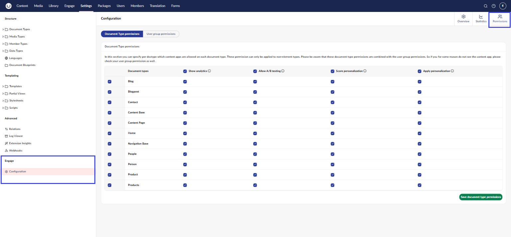

# Permissions

Umbraco Engage has two kinds of permissions:

* Document Type permissions control which Document Types show the Engage workspace views.
* User group permissions control which Engage features each Umbraco user group can read, change, or export.

## Document Type permissions

In the **Settings** section, navigate to **Engage** > **Configuration** and select **Permissions** in the top-right corner. Here you manage which Document Types show workspace views.

From Umbraco Engage 18.3, saving Document Type permissions requires the **Write** permission for Engage **Settings**.

## User group permissions


User group permissions for Engage features are available from Umbraco Engage 18.3. Earlier versions use a **User group permissions** option on the **Permissions** screen.


Access to Engage features is part of the permissions of each Umbraco user group. Edit a user group in the **Users** section to find the permissions under **Engage**.

Each feature has a **Read** permission. Features with data to change also have a **Write** permission. Features with data to download also have an **Export** permission.

| Feature | Read | Write | Export |
| --- | --- | --- | --- |
| Analytics | View Analytics. | Change Analytics data, such as annotations. | Not available |
| A/B Testing | View A/B tests. | Create, change, and end A/B tests. | Not available |
| Personalization | View Personalization. | Create, change, and apply personalization. | Export the persona and customer journey scoring overviews. |
| Profiles | View Profiles. | Change Profiles, such as locking a score. | Export Profiles data. |
| Reporting | View Reporting. | Not available | Not available |
| Settings | View Engage settings. | Change Engage settings, such as goals and traffic filters. | Not available |

Each permission is stored on the user group as a verb named `Engage.<Feature>.<Verb>`, for example `Engage.AbTesting.Write`.

### How the permissions work

* Each permission is checked on its own. **Write** does not include **Read**, so grant both to let a user group view and change a feature.
* Without **Write**, the screens of a feature are read-only. Buttons for creating, saving, deleting, and scheduling are hidden or disabled.
* A workspace view is shown only when the user group has the **Read** permission for that feature and the Document Type allows the workspace view.
* The Browser and Device segment rules are offered only to users who also have the **Read** permission for Analytics.
* A profile export includes the member name and email only for users with access to the **Members** section.
* The Engage backoffice API checks the same permissions. A user cannot call an endpoint for a feature without the matching permission.
* Opening the Engage section also requires access to the **Engage** section on the user group.
* The Engage screens in the **Settings** section also require access to the **Settings** section.

### Permissions after upgrading

When you upgrade from a version that used the **User group permissions** screen, a migration copies the previous settings to the new permissions:

* A user group with no saved Engage settings had access to every feature. The user group gets every Engage permission.
* A user group with saved Engage settings gets **Read**, **Write**, and **Export** for each feature the user group was allowed to use.
* A user group that was not allowed to use any feature gets no Engage permissions.

Nothing else on the user group changes. After you upgrade, check that your user groups have the access you expect.
