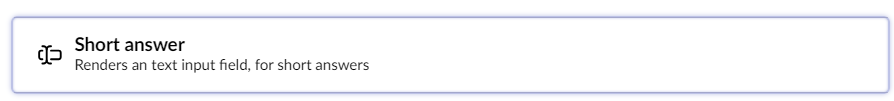
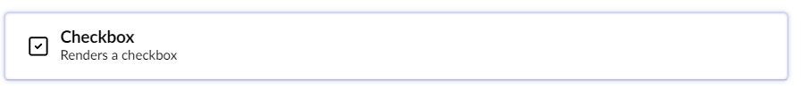
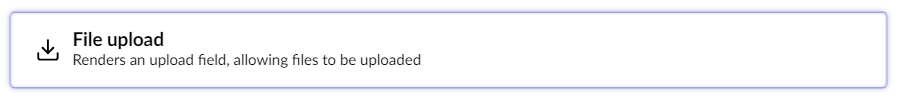
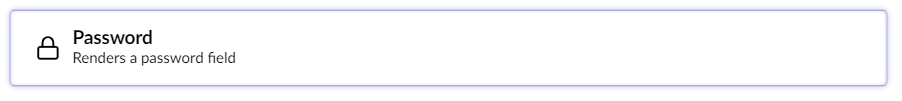
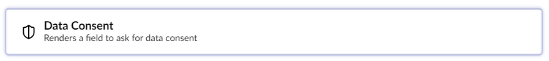
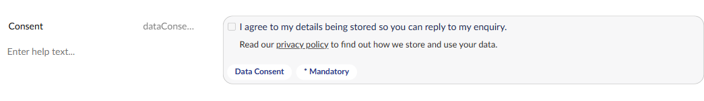
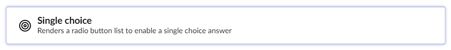
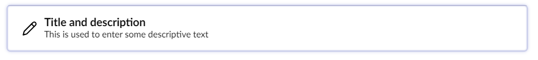
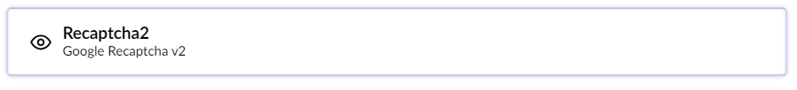

# Overview Of The Field Types

Umbraco Forms comes with a bunch of default Field Types, also known as **Answer Types**. You can choose from different field types when adding new fields to your Forms.

This article describes the Field Types that are available by default.

## Short Answer

The Short Answer field displays a textbox that allows up to 250 characters.

## Long Answer

The Long Answer field displays a bigger text field that allows multiline text and more than 250 characters.

## Date

The Date field displays a picker that allows the user to select a date.

For more information, see the [Date](date.md) article.

## Checkbox

The Checkbox field displays a single checkbox that can be checked or not.

## File Upload

The File Upload field allows the user to select and upload a local file.

For more information, see the [File Upload](fileupload.md) article.

## Password

The Password field allows the user to type a password. The input is not visible when typing.

## Multiple Choice

The Multiple Choice field displays a list of items with a checkbox for each item. The user can select multiple options.

## Data Consent

The Data Consent field asks the user for consent to store their data. By default, this field is added to all new Forms. The **Consent text** setting holds the text next to the checkbox.

### Consent details


This feature is available from Umbraco Forms 18.3.0, which is currently a release candidate.


The optional **Consent details** setting holds formatted text shown under the checkbox. Use it to link to your privacy policy, for example. For more information, see the [HTML in rich text settings](#html-in-rich-text-settings) section.

## Dropdown

The Dropdown field displays a list of items in a drop-down box. The user can select a single option.

## Single Choice

The Single Choice field displays a list of items with a radio button for each item. The user can select a single option.

## Title and Description

The Title and Description field displays a read-only title and description for a set of form fields.

## Rich Text

The Rich Text field displays read-only formatted text. Use it to provide additional information and links within a form.

For more information, see the [HTML in rich text settings](#html-in-rich-text-settings) section.

## Hidden

The Hidden field allows developers to include data that users cannot see or modify when a Form is submitted.

## Recaptcha V2

The Recaptcha V2 field displays a single checkbox that the user selects to validate the Form.

For more information, see the [Recaptcha V2](recaptcha2.md) article.

## Recaptcha V3 with Score

The Recaptcha V3 with Score field returns a score for each request without user interaction. The score is based on user interactions with the site. Use the score to take an appropriate action for your site.

For more information, see the [Recaptcha V3 with Score](recaptcha3.md) article.

## Recaptcha Enterprise with Score

The Recaptcha Enterprise with Score field returns a score for each request without user interaction. The score is based on user interactions with the site. Use the score to take an appropriate action for your site.

For more information, see the [Recaptcha Enterprise with Score](recaptcha-enterprise.md) article.

## HTML in rich text settings

The **Consent details** setting of the Data Consent field and the **Rich text** setting of the Rich Text field hold HTML. That HTML is stored and rendered as entered. The default theme outputs it unchanged, and the Delivery API returns it unchanged.

When a form is saved, Forms passes these settings, and a submit message written in HTML, through the Umbraco `IHtmlSanitizer`. The default implementation in Umbraco CMS returns the HTML unchanged. To remove unsafe markup, register your own `IHtmlSanitizer`. You might do this if, for example, less-trusted users can edit forms. For more information, see the [Sanitizing the Rich Text Editor](https://docs.umbraco.com/umbraco-cms/run-in-production/security/serverside-sanitizing) article.

Placeholder values supplied by visitors, such as `[@name]`, are HTML-encoded when they're inserted into these settings.
