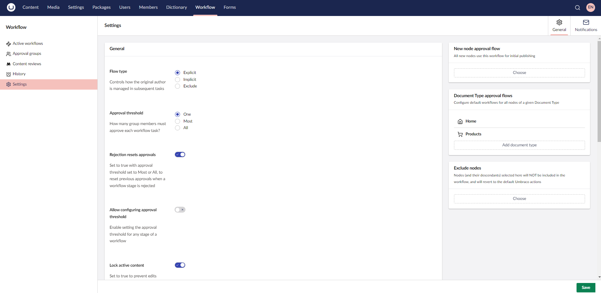
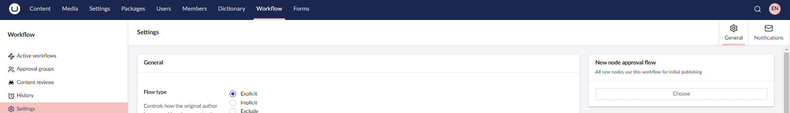
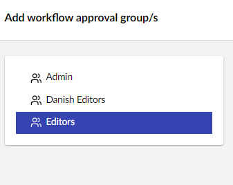
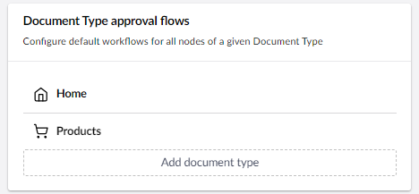
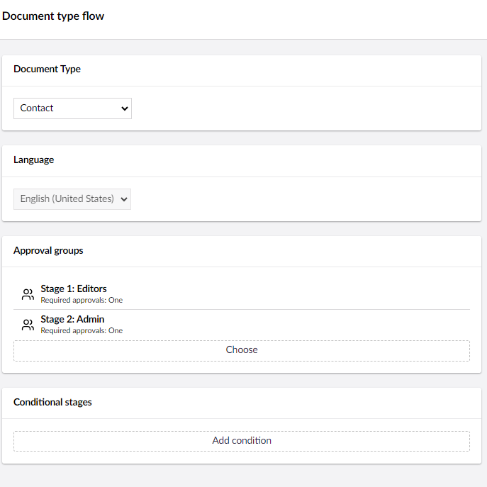
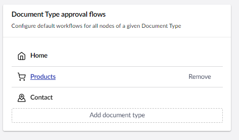
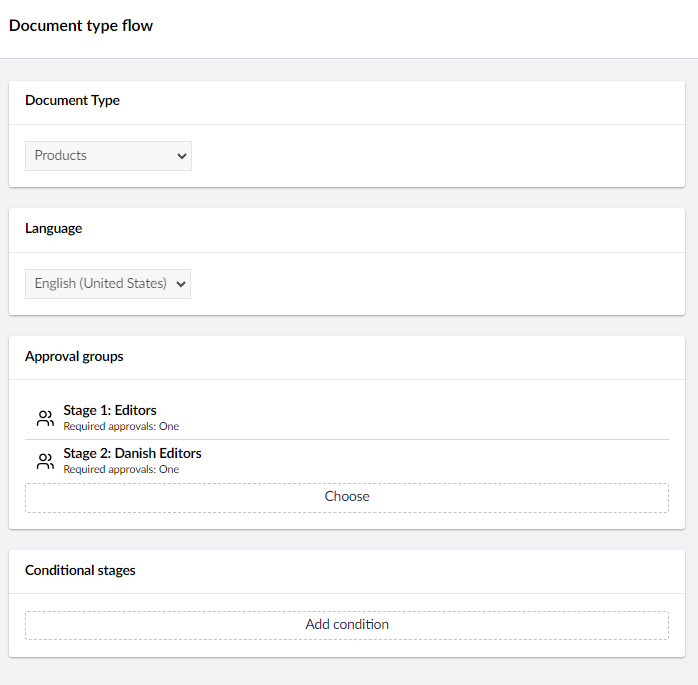
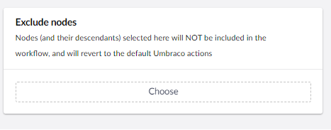
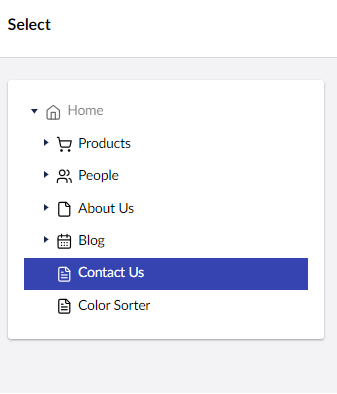
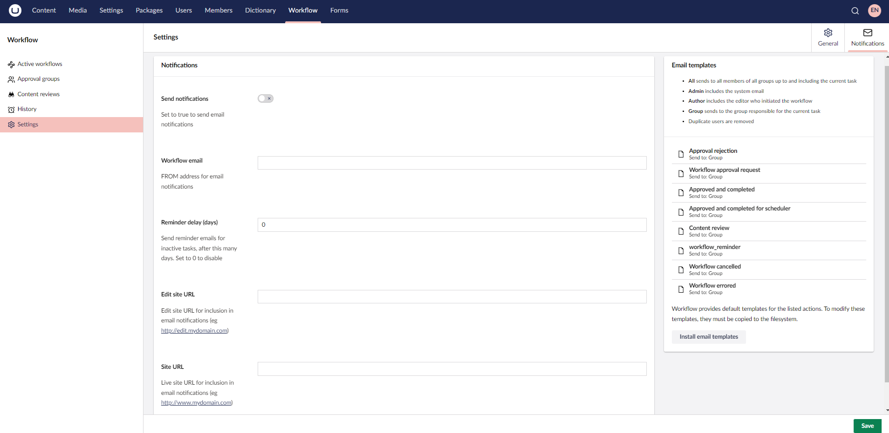

# Content Approval Settings

When working with Umbraco Workflow, you can handle the content approval settings directly in the Backoffice from the **Settings** section. 

* [General settings](#general-settings)
* [New node approval flow](#new-node-approval-flow)
* [Document Type approval flows](#document-type-approval-flows)
* [Exclude nodes](#exclude-nodes)
* [Notification Settings](#notifications-settings)
* [Email templates](#email-templates)



## General Settings

You can configure the **General** Settings from the **Content Approvals** menu in the **Settings** section. The following settings are available:


* **Flow type** - Determines the approval flow progress. These options manage how the Change Author is included in the workflow:
  * **Explicit** - All steps of the workflow must be completed, and all users will be notified of tasks (including the Change Author).
  * **Implicit** - All steps where the original Change Author is _not_ a member of the group must be completed. Steps where the original Change Author is a member of the approving group will be completed automatically and noted in the workflow history as not required.
  * **Exclude** - Similar to Explicit. All steps must be completed, but the original Change Author is not included in the notifications or shown in the dashboard tasks.
* **Approval threshold** - Sets the global approval threshold to One, Most, or All:
  * **One** - Pending task requires approval from any member of the assigned approval group. This is the default behavior for all installations (trial and licensed).
  * **Most** - Pending task requires an absolute majority of group members. For example, a group with three members requires two approvals, and a group with four members requires three approvals.
  * **All** - Pending task requires approval from all group members.
* **Rejection resets approvals** - When true, and the approval threshold is Most or All, rejecting a task resets the previous approvals for the workflow stage.
* **Allow configuring approval threshold** - Enables setting the approval threshold for any stage of a workflow (on a content node or Document Type).
* **Lock active content** - Determines how the content in a workflow should be managed. Set to `true` or `false` depending on whether the approval group responsible for the active workflow step should make modifications to the content. Content is locked after the first approval in the workflow - until then, the content can be edited as normal.
* **Administrators can edit** - Set to true to allow administrators to edit content at any stage of the workflow, ensuring flexibility and control over the content approval process.
* **Mandatory comments** - Set to true to require comments when approving workflows. Comments are always required when submitting changes for approval, and are always optional for admin users.
* **Allow attachments** - Provide an attachment (such as a supporting document or enable referencing a media item) when initiating a workflow. This feature is useful when a workflow requires supporting documentation.
* **Allow scheduling** - Provides an option to select a scheduled date when initiating a workflow.
* **Use workflow for unpublish** - Determines if unpublish actions require workflow approval. Set to true to add a **Request unpublish** option to the **Request publish** button menu.
* **Extend permissions** - Determines if Umbraco Workflow should extend or replace the users' save and publish permissions. The default behavior is to replace the users' permissions.
* **Require publish for initiate** - Determines the minimum user permission for initiating a workflow process. The default (false) behaviour requires the user have permission to update the entity. When true, the user must have permission to publish the entity to be able to submit for workflow approval. This setting was added in 18.0.1, defaulting to the legacy behaviour (requiring update permission only).

### New Node Approval Flow

All new nodes use this workflow for initial publishing. You can add, edit, or remove an approval group to/from the workflow.

To add an approval group to the workflow:

1. Go to the **Workflow** section.
2. Go to the **General** tab in the **Settings** menu.
3.  Click **Choose** in the **New node approval flow** section.

    
4.  Select an **approval group** to add to the workflow.

    
5. Click **Submit**.
6. Click **Save**.

When you click on the approval group, you are presented with different configuration options for that group. For more information on the approval group settings, see the [Approval Groups](../workflow-section/approval-groups.md#approval-groups-settings) article.

To remove an approval group, click **Remove**.

### Document Type Approval Flows

Configure default workflows that should be applied to all content nodes of the selected Document Type. This feature requires a license.

To add a Document type approval flow:

1. Go to the **Workflow** section.
2. Go to the **General** tab in the **Settings** menu.
3.  Click **Add document type** in the **Document type approval flows** section.



4. Select a **Document Type** from the drop-down list.
5. Select a **Language** from the drop-down list.
6. Click **Choose** in the **Approval groups**.
7. Click **Submit**.
8.  Click **Add condition** to add a condition to the workflow process.



9. Click **Submit**.
10. Click **Save**.

To edit a Document type approval flow:

1. Go to the **Workflow** section.
2. Go to the **General** tab in the **Settings** menu.
3.  Click the content node in the **Document type approval flows** section.



4. **Add**, **Edit**, or **Remove** approval groups from the current workflow.
5.  Click **Add condition** to add or edit a condition to the workflow process.



6. Click **Submit**.
7. Click **Save**.

## Exclude Nodes

Nodes and their descendants selected here are excluded from the workflow process and will be published as per the configured Umbraco user permissions. This feature requires a license.

To exclude a node from the workflow process:

1. Go to the **Workflow** section.
2. Go to the **General** tab in the **Settings** menu.
3.  Click **Choose** in the **Exclude nodes** section.



4.  Select the **Content node** from the Content tree.



5. Click **Choose**.
6. Click **Save**.

## Notifications Settings

Umbraco Workflow uses Notifications to allow you to configure email notifications for all workflow activities for the backoffice.

From the **Content Approvals** view in the **Settings** section, the **Notifications** tab provides access to the following:

* **Send notifications:** If you wish to send email notifications to approval groups, you can enable it here. If your users are active in the backoffice, email notifications might not be required.
* **Workflow email:** Provide a sender address for email notifications. This is a mandatory field.
* **Reminder delay (days):** Set a delay in days for sending reminder emails for outstanding workflow processes. Set to 0 to disable reminder emails.
* **Edit site URL:** The URL for the editing environment (including schema - http\[s]). This is a mandatory field.
* **Site URL:** The URL for the public website (including schema - http\[s]). This is a mandatory field.
* [**Email templates**](#email-templates)**:** Configure which users receive emails for which workflow actions and modify the templates for those emails.



## Notifications Overview

Notification emails use HTML templates, which render information from the `ContentApprovalEmailModel` type, which lives in the `Umbraco.Workflow.Core.ContentApprovals.Email` namespace. While it is possible to modify the email templates from the backoffice, you should make changes via an Integrated Development Environment (IDE) of your choice.

The `ContentApprovalEmailModel` contains the following fields:

| Fields        | Data Type                 | Description                                                                                                       |
| ------------- | ------------------------- | ----------------------------------------------------------------------------------------------------------------- |
| WorkflowType  | WorkflowType              | An `enum` value containing either 1 or 2 for Publish and Unpublish, respectively.                                  |
| ReleaseDate   | DateTime                  | If a scheduled release date exists for the workflow, it is found here.                                            |
| ExpireDate    | DateTime                  | If a scheduled expiry date exists for the workflow, it is found here.                                             |
| Summary       | IHtmlString               | A pre-generated representation of the current workflow state.                                                     |
| CurrentTask   | WorkflowTaskViewModel     | The view model data for the current workflow task. Contains a lot of useful data, best explored via IntelliSense. |
| Instance      | WorkflowInstanceViewModel | The view model data for the current workflow. Best explored via IntelliSense.                                     |

The `HtmlEmailBase` contains the following fields:

| Fields       | Data Type      | Description                                                                                          |
| ------------ | -------------- | ---------------------------------------------------------------------------------------------------- |
| SiteUrl      | string         | The public URL of your site.                                                                         |
| NodeName     | string         | The name of the node from the current workflow.                                                      |
| Type         | string         | The workflow type - "Publish" or "Unpublish", localized.                                             |
| ScheduledDate | string         | A localized description of the release or expiry date, in the recipient's language and time zone. Empty when the workflow is not scheduled. |
| EmailType    | EmailType      | An `enum` value representing the current email type that relates directly to the workflow task type. |
| To           | EmailUserModel | The model defining the receiver of the email.                                                        |
| Email        | string         | The user's email address or a group address (if a group email is being sent).                        |
| Name         | Name           | The user's name.                                                                                     |
| Language     | string         | The user's language.                                                                                 |
| Id           | int            | The user's ID or group ID (when sending to a group email address).                                   |
| IsGroupEmail | bool           | Is the email being sent to a generic group email address?                                            |

Umbraco Workflow provides **Settings** for determining who receives emails at which stages of a workflow. While these are set to default values during installation, it is recommended to update your Notifications Settings to better suit your installation needs. Emails can be sent to:

* **All**: All the participants in all workflow stages (previous and current).
* **Admin**: The admin user.
* **Author**: The user who initiated the workflow.
* **Group**: All members of the group assigned to the current task.


Duplicate users are removed from email notifications.


By default, all emails are sent to the **Group**. This might not always be an ideal situation. For example, cancelled workflows would be best sent to the **Author** only, likewise with rejected.

It might be useful to notify **All** the participants of completed workflows, but even this may be excessive. Depending on your website, you can adjust the best configuration.

## Reminders Overview

Umbraco Workflow uses a reminder email system to prompt editors to complete the pending workflows. Reminders are sent using Umbraco's internal task scheduler, every 24 hours after an initial delay. For example, setting the **Reminder delay (days)** value to 2 in the Workflow **Settings** section will allow pending workflows to sit for 2 days. After that, reminder emails will be sent every 24 hours to all members of the group assigned to the pending workflow task.

The emails use a similar model to the notification emails, also inheriting from `HtmlEmailBase`. In addition to the inherited fields, `ContentApprovalReminderEmailModel` includes:

| Fields       | Data Type | Description                                                           |
| ------------ | --------- | --------------------------------------------------------------------- |
| OverdueTasks | IList     | A list containing all the overdue tasks assigned to the current user. |
| TaskCount    | int       | The count of overdue tasks assigned to the current user.              |

## Email Templates

Umbraco Workflow ships the following email templates. They are compiled into the Workflow package, so emails render without any template files on disk.

| Template                                  | Email                                         |
| ----------------------------------------- | --------------------------------------------- |
| `ApprovalRequest.cshtml`                  | Workflow approval request                     |
| `ApprovalRejection.cshtml`                | Workflow approval rejected                    |
| `ApprovedAndCompleted.cshtml`             | Workflow approved and completed               |
| `ApprovedAndCompletedForScheduler.cshtml` | Workflow approved and completed for scheduler |
| `WorkflowCancelled.cshtml`                | Workflow cancelled                            |
| `WorkflowErrored.cshtml`                  | Workflow error                                |
| `Reminder.cshtml`                         | Workflow overdue reminder                     |
| `ContentReview.cshtml`                    | Content review reminder                       |

To get a copy of the templates to customize, go to **Content Approvals** > **Notifications** in the **Settings** section and select **Install email templates**. Workflow copies the templates to `~/Views/Partials/workflow/email/`. The option is not available in `Production` mode, and is hidden once all the templates are on disk. Keep the file names unchanged: Workflow finds each template by its name.

Text in the templates is localized when the email is rendered, in the recipient's language, using `@Model.Localize("key")`. One template serves every language.

Dates and times in the emails are shown in the recipient's time zone. Workflow records a user's time zone from their browser each time they load the backoffice, so it reflects where they last used it. Emails sent to a group address, and to users with no recorded time zone, use the server's time zone.

## Customizing an Email Template

Razor templates must be compiled before they can render. The shipped templates are compiled into the Workflow package, and your copy replaces one only if something compiles it. Which copy is used depends on the site's runtime mode:

| Runtime mode                  | Your copy is used when                                                                                                                                                                             |
| ----------------------------- | -------------------------------------------------------------------------------------------------------------------------------------------------------------------------------------------------- |
| `BackofficeDevelopment`       | The file on disk differs from the shipped template. Changes apply without restarting the site. Requires Umbraco Workflow 18.2.1 or later and the `Umbraco.Cms.DevelopmentMode.Backoffice` package. |
| `Development` or `Production` | The template was part of your project when the site was built.                                                                                                                                    |


Templates customized for Workflow 17 do not compile in Workflow 18, because the email models were renamed. If such a template is part of your project, the build fails until it is updated. From Workflow 18.2.1, a copy on disk that does not compile falls back to the shipped template. The Email Templates health check lists it. For the new model names, see the [Version Specific Upgrade Notes](../upgrading/version-specific.md#email-templates).


### Deploying Customized Templates to Production

`Production` mode compiles views only at build and publish time, so customized templates must be part of the build.

1. In your local environment, select **Install email templates** to copy the templates to `~/Views/Partials/workflow/email/`.
2. Edit the templates you want to change.
3. Add only the templates you changed to source control. Every template in your project is compiled into your site and replaces the shipped version, including a copy you have not changed. Workflow does not update that copy when you upgrade, so it keeps rendering the version it was copied from.
4. Make sure views are compiled at build time by removing the following properties from your `.csproj` file:

    ```xml
    <RazorCompileOnBuild>false</RazorCompileOnBuild>
    <RazorCompileOnPublish>false</RazorCompileOnPublish>
    ```

    This is already required for `Production` mode, and is not compatible with the `InMemoryAuto` Models Builder mode. For more information, see the [Runtime Modes](https://docs.umbraco.com/umbraco-cms/run-in-production/runtime-modes) article.
5. Build, publish, and deploy the site.

If a template on disk does not compile, Workflow renders the version shipped in the package instead and logs the error. To find templates that fail to compile, go to **Settings** > **Health Check** > **Workflow** > **Email Templates**. The check reports each failing template with the compiler message. It also reports culture-specific templates.


Upgrading Workflow does not update the templates on disk. A copy installed by an earlier release keeps rendering as it is.

Workflow never overwrites a template on disk. To get the current version of a template, delete your copy locally and select **Install email templates**. Then reapply any changes.


### Culture-Specific Templates

Templates named with a culture suffix, such as `ApprovalRequest_da-DK.cshtml`, are still used for recipients whose language differs from the site's default language. Templates are localized at render time, so culture-specific templates are no longer needed. Remove them unless the wording must differ from the translation.

## Sample Email Template

Below is an excerpt of the shipped `ApprovalRequest.cshtml` template:

```csharp
@model Umbraco.Workflow.Core.ContentApprovals.Email.ContentApprovalEmailModel
@addTagHelper *, Umbraco.Workflow.Core

<!DOCTYPE html>

<html lang="@Model.To.Language">
<head>
    @* the title is used as the email subject line *@
    <uw-head title="@Model.Localize("emailApprovalRequestSubject")"></uw-head>
</head>
<body>
    <div>
        <p>@Model.Localize("emailGreeting", Model.To.Name)</p>
        <p>@Model.Localize("emailApprovalRequestIntro", Model.Type.ToLower(), Model.ScheduledDate)</p>
        <ul>
            <li>
                <a href="@(Model.CurrentTask?.BackofficeUrl)">@(Model.CurrentTask?.Node?.Name)</a>
            </li>
        </ul>

        @* approval buttons omitted - see the full template *@

        @Model.Summary
    </div>
</body>
</html>
```
