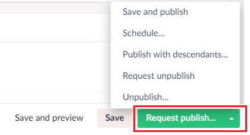
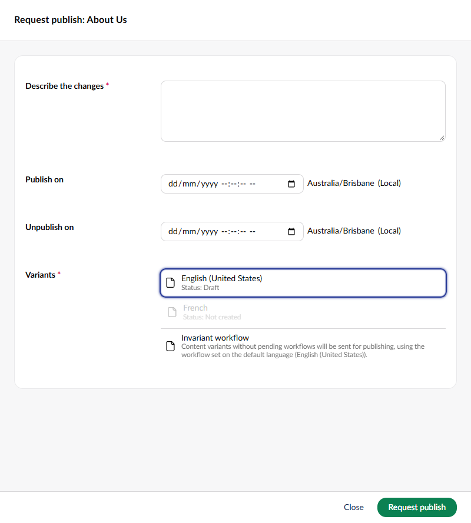
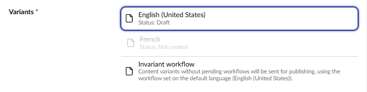

# Submitting Content for Approval

When requesting workflow approval for content changes, editors must provide additional information detailing the change.

To submit the content changes, click the **Request publish** button in the editor footer.

To submit an unpublish request, select **Request unpublish** from the **Request publish** button menu. The option is available when **Use workflow for unpublish** is enabled.


Before Umbraco Workflow 18.2.4, unpublish requests were made by selecting the **Action** option in the request approval overlay.


Both options open the request approval overlay. The overlay headline shows the requested action and the document name:

Depending on the Document Type and Workflow settings, the overlay will provide inputs for:

| Fields                   | Description                                                              | Visibility Conditions                                                                                                                                                       |
| ------------------------ | ------------------------------------------------------------------------ | --------------------------------------------------------------------------------------------------------------------------------------------------------------------------- |
| **Describe the changes** | A field for adding comments to describe the changes made to the content. | Always visible.                                                                                                                                                             |
| **Attachment**           | Upload media or files attachment.                                        | Visible only when **Allow attachments** is set to true.                                                                                                                     |
| **Publish on**           | A date picker for scheduling the content's publishing date.              | Visible only when **Allow scheduling** is set to true. Hidden for unpublish requests.                                                                                       |
| **Unpublish on**         | A date picker for scheduling the content's unpublishing date.            | Visible only when **Allow scheduling** is set to true.                                                                                                                      |
| **Variants**             | Allows selection of language variants to publish.                        | Visible only for variant content.                                                                                                                                           |

It is possible to schedule both **Publish on** and **Unpublish on** dates in a Publish workflow. Once content has been unpublished, a new workflow process is required to republish the content.

## Variant Workflows

If the document varies by culture, the editor must select one or more variants to submit for approval.

When a document is invariant, the variants selector is not displayed, and the approval flow follows the [default permissions inheritance pattern](workflow-workspace-view.md#approval-flow-types).

The editor will not be able to select variants where:

* They do not have permission to edit the language, or
* The variant is already in a workflow.

When submitting multiple variants, a workflow process is started for each variant, using the [default permissions inheritance pattern](workflow-workspace-view.md#approval-flow-types). Newly created variants are automatically assigned the configuration from the default language.

Alternatively, all variants can be submitted in an invariant workflow, where they will be approved in a single workflow process. Invariant workflows use the permissions set on the default language. Editors must have permission to edit all the current node's variants to be able to initiate an invariant workflow.

The invariant workflow will publish all variants, regardless of their node state, that are not already in workflows. This means that previously unpublished variants will be republished when using invariant workflows. In most cases, it is preferable to select the individual variants.

## Content Validation and Pending Changes

When submitting for approval, Workflow will automatically save variants with pending changes.

Validation errors are reported in the UI using Umbraco's validation messages. 
