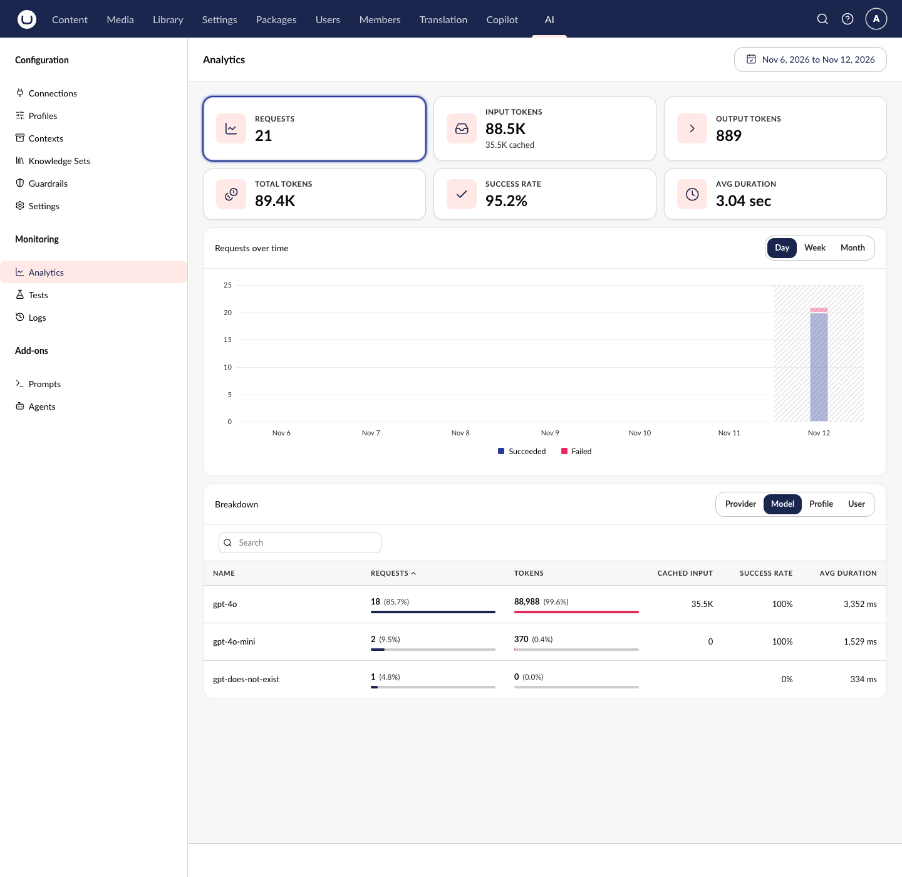

# Usage Analytics

The Usage Analytics dashboard provides aggregated insights into AI operations, helping you understand usage patterns and performance.

## Accessing Analytics

1. Navigate to the **AI** section in the main navigation.
2. Click **Analytics** under **Monitoring** in the tree.

The **Usage** view opens. It shows the last seven days by default.

## Dashboard Overview



### Metric Tiles

The dashboard shows six tiles at the top:

| Tile          | Description |
| ------------- | ----------- |
| Requests      | Number of AI requests in the selected period |
| Input tokens  | Tokens sent to AI providers. When a provider reports prompt caching, a second line shows how many were cached. |
| Output tokens | Tokens received from AI providers |
| Total tokens  | Input and output tokens together |
| Success rate  | Share of requests that succeeded |
| Avg duration  | Average time a request took |

When you compare with another period, each tile also shows the change from that period.

Select a tile to plot its metric in the chart below.

### Over Time Chart

The chart plots the selected metric across the period:

| Metric        | Chart |
| ------------- | ----- |
| Requests      | Stacked bars of succeeded and failed requests |
| Input tokens  | Bars of input tokens, split into cached and uncached input when a provider reports caching |
| Output tokens | Bars of output tokens |
| Total tokens  | Stacked bars of input and output tokens |
| Success rate  | A line of the success rate |
| Avg duration  | Bars of the average duration |

Use the buttons above the chart to group the bars by **Day**, **Week**, or **Month**. For a period of two days or fewer, you can group by **Hour** or **Day**.

### Breakdown

The **Breakdown** table shows how usage splits across one dimension at a time. Use the buttons above the table to break usage down by **Provider**, **Model**, **Profile**, or **User**.

The table has these columns:

| Column       | Description |
| ------------ | ----------- |
| Name         | The provider, model, profile, or user |
| Requests     | Requests, with each row's share of the total |
| Tokens       | Total tokens, with each row's share of the total |
| Cached input | Cached input tokens. Only shown when a provider reports prompt caching. |
| Success rate | Share of the row's requests that succeeded |
| Avg duration | Average time a request took, in milliseconds |

Click a column heading to sort by it. Use **Search** to filter rows by name. The table shows ten rows per page by default.

## Date Range

Select the period to analyze with the date range button in the top-right corner. The **Date range** dialog offers these presets:

* **Today**
* **Yesterday**
* **Last 7 days**
* **Last 30 days**
* **This month**
* **Last month**
* **Last year**
* **Custom**, to pick your own dates

Use **Compare** in the same dialog to compare the period with another one. Choose **Previous period**, **Previous year**, or **Custom** dates.

## Programmatic Access

For custom dashboards or integrations, use the [Analytics API](../management-api/analytics/README.md).

## Configuration

Configure analytics options in `appsettings.json`:



```json
{
    "Umbraco": {
        "AI": {
            "Analytics": {
                "Enabled": true,
                "UsageHourlyRetentionDays": 30,
                "UsageDailyRetentionDays": 365,
                "IncludeUsageUserDimension": true,
                "IncludeUsageEntityTypeDimension": true,
                "IncludeUsageFeatureTypeDimension": true
            }
        }
    }
}
```



| Property                           | Default | Description                                                          |
| ---------------------------------- | ------- | -------------------------------------------------------------------- |
| `Enabled`                          | `true`  | Whether usage analytics is enabled                                   |
| `UsageHourlyRetentionDays`         | `30`    | Retention period for hourly aggregated statistics (valid: 30-90)     |
| `UsageDailyRetentionDays`          | `365`   | Retention period for daily aggregated statistics                     |
| `IncludeUsageUserDimension`        | `true`  | Include user ID as a dimension in aggregations (privacy consideration) |
| `IncludeUsageEntityTypeDimension`  | `true`  | Include entity type (for example, `content`, `media`) as a dimension |
| `IncludeUsageFeatureTypeDimension` | `true`  | Include feature type (for example, `prompt`, `agent`) as a dimension |

## Related

- [Audit Logs](audit-logs.md) - Individual AI operation records
- [Analytics API](../management-api/analytics/README.md) - Programmatic access
