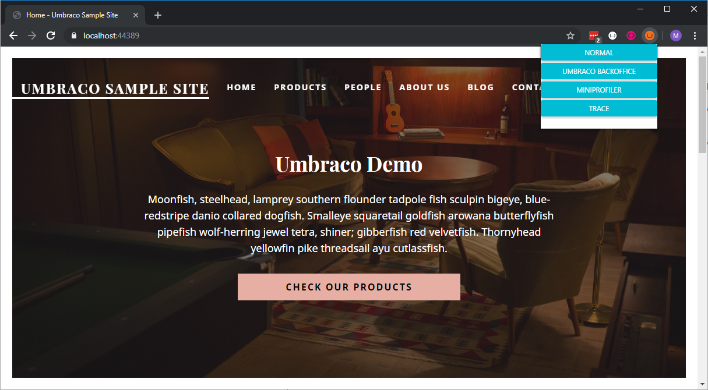

# Testing and Debugging

During the development of your Umbraco site you can debug and profile the code you have written to analyze and discover bottlenecks in your code.

To perform proper debugging on your site you need to set your application to have debug enabled. This can be done by setting `Umbraco:CMS:Hosting:Debug="true"` for example in the `appsettings.json` file:

```json
{
  "Umbraco": {
    "CMS": {
      "Hosting": {
        "Debug": true
      }
    }
  }
}
```


Debug should always be set to false in production.


## Tracing

Tracing and trace logging are two names for the same technique. You need to configure which log messages you want to log.

### Enabling Trace Logging


Do not enable trace logging in your production environment! It reveals an awful lot of (sensitive) information about your production environment.


We recommend at least logging the following namespace at minimum (Verbose) level to enable valuable trace logging. Thereby you will have information about all endpoints that have been executed.

```json
{
  "Serilog": {
    "MinimumLevel": {
      "Override": {
        "Microsoft.AspNetCore.Mvc": "Verbose"
      }
    }
  }
}
```

The logged messages can as always be monitored in the log viewer in backoffice

## MiniProfiler

Umbraco includes the MiniProfiler, which profiles method calls and SQL queries to help you find performance issues. For more information, see the [MiniProfiler](miniprofiler.md) article.

## Umbraco Productivity Tool - Chrome Extension

If you are using the Google Chrome browser you can install this [Umbraco Productivity Tool Chrome Extension](https://chrome.google.com/webstore/detail/umbraco-productivity/kepkgaeokeknlghbiiipbhgclikjgkdp?hl=en).

This will allow you to quickly switch between debugging with the MiniProfiler, Trace viewer and normal mode.



## [Logging](logging.md)

Learn how Umbraco writes log files and how you can write to them.
