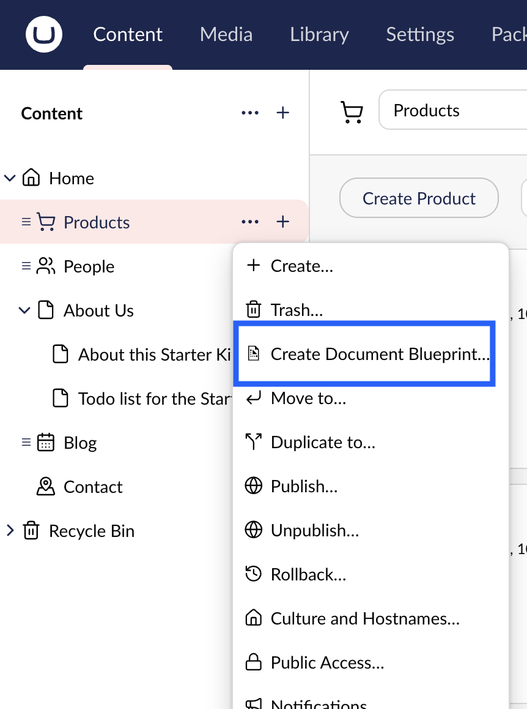
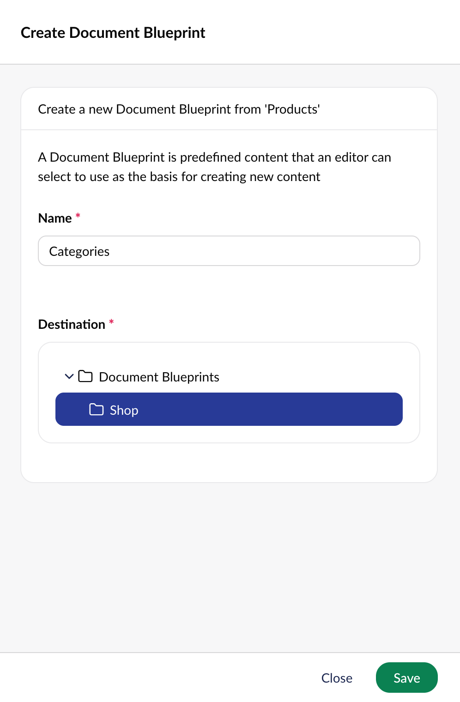
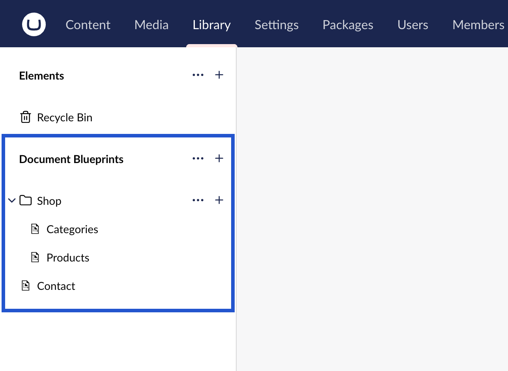
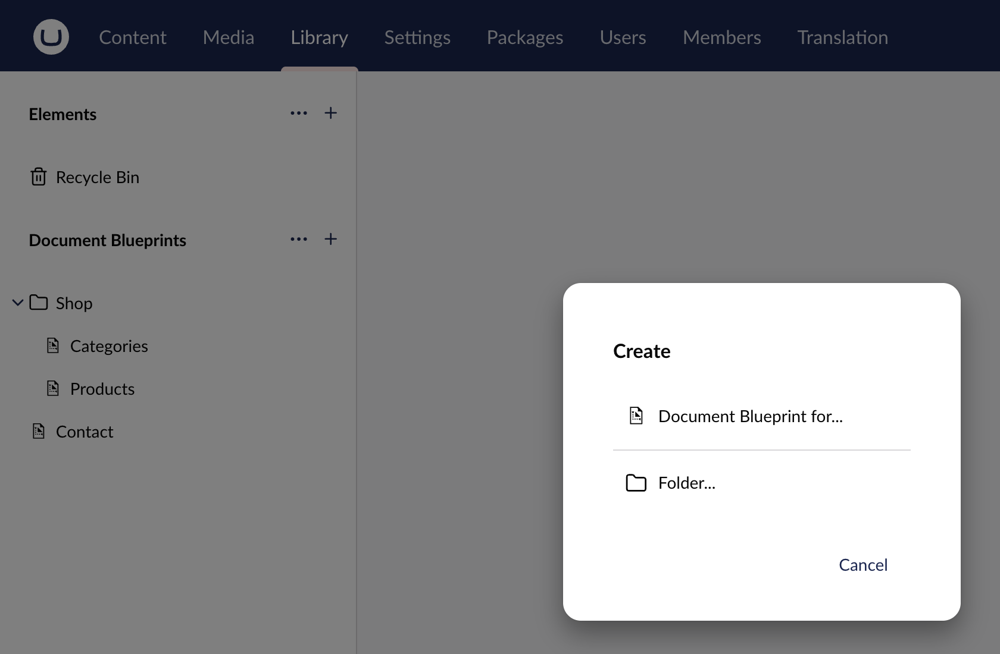
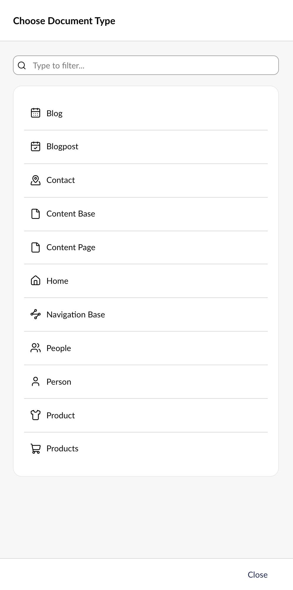
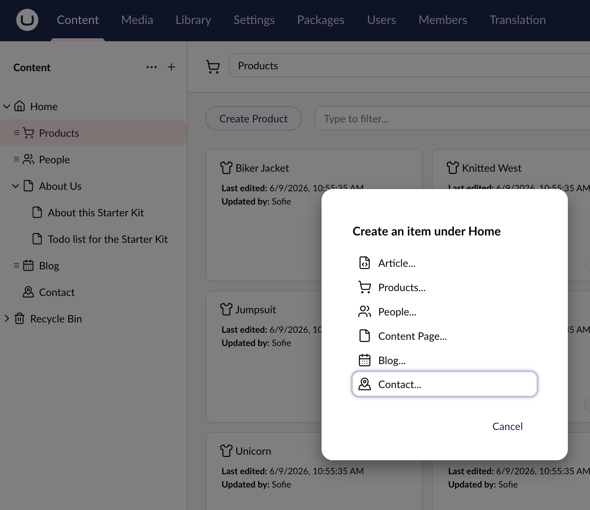
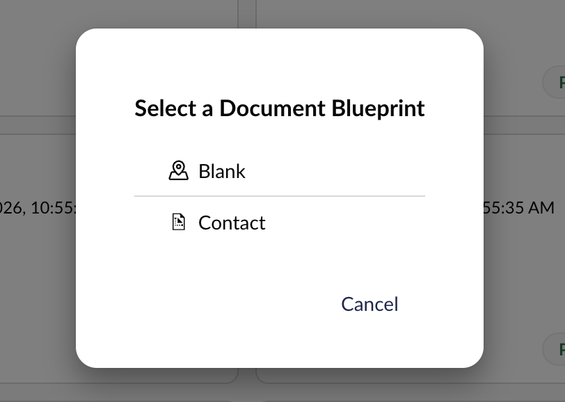

# Document Blueprints


Document Blueprints were previously called Content Templates.


## Document Blueprints Overview

A Document Blueprint allows editors to preconfigure a content node. It serves as a reusable starting point when creating new content.

Document Blueprints are managed in the **Library** section. To work with them, a user needs access to the **Library** section and access to Document Blueprints (all or a start node). For more information, see the [Access to Document Blueprints](#access-to-document-blueprints) section.

### Method 1 – Create a Document Blueprint from the Content Section


Before using this method, make sure you have already [created some content](../data/defining-content/README.md#3-creating-the-content).


1. Go to the **Content** section and select an existing content node.
2. Click the **...** menu next to the node and choose **Create Document Blueprint**.

3. Enter a **Name** for the new blueprint.

4. Select the **Destination** folder for the blueprint.
5. Click **Save**.

The new blueprint appears in the selected folder of the **Document Blueprints** tree in the **Library** section.


If you don’t see the new blueprint, try refreshing your browser.


### Method 2 – Create a Document Blueprint from the Library Section

1. Go to the **Library** section.
2. Click the **...** menu next to the **Document Blueprints** tree, or next to a folder within it.
3. Select **Create...**.

4. Choose the Document Type you want to base the blueprint on.


You can only create Document Blueprints from **Document Types** or **Document Types with Templates**. Element Types are not offered.


5. Enter a **Name** for the blueprint.
6. Click **Save**.

The new blueprint appears in the folder you selected in the **Document Blueprints** tree.

### Edit a Document Blueprint

To edit an existing Document Blueprint, follow these steps:

1. Go to the **Library** section.
2. Open the **Document Blueprints** tree.
3. Select the blueprint you want to edit.
4. Make your changes.
5. Click **Save**.

### Use a Document Blueprint

Once you have created a Document Blueprint, you can use it to create new content nodes.


Document Blueprints can only be selected when creating a new content node. They cannot be applied to existing content.


To use a Document Blueprint, follow these steps:

1. Go to the **Content** section.
2. Click **+** on the root node and select **Create**.

3. Select the **Document Type** that has an associated blueprint.
4. Choose how to create the new content:
   * Use the Document Blueprint
   * Start with a blank node

## Access to Document Blueprints

Access to Document Blueprints is configured on User Groups and Users, in the same way as for documents, media, and elements.

* **Allow access to all document blueprints**: The user can manage every Document Blueprint and folder.
* **Document blueprint start node**: The user can only manage the Document Blueprints within the selected folder. A User Group has one start node, while a User can have more than one. Folders above a start node are shown but cannot be selected.

Within their start node, a user can create, edit, move, and delete Document Blueprints and folders. A user without any Document Blueprint access does not see the **Document Blueprints** tree.

To create a Document Blueprint from the **Content** section, a user also needs the **Create Document Blueprint** document permission. Without Document Blueprint access, the action shows a message that the user does not have access.

On new installs, the **Administrators** and **Editors** User Groups have access to all Document Blueprints. For upgraded sites, see the [Breaking Changes Overview](../../../get-started/upgrading-and-migrating/version-specific.md) article.

For more information, see the [Users](../../../manage-and-publish-content/users-and-members/users/README.md) article.

## Restricting the Document Types for Document Blueprints

As an implementer or package creator, you can limit which Document Types appear when you create a Document Blueprint. Use the `FilterAllowedForBlueprintsAsync` method of a Content Type Filter.

For more information, see the [Filtering Allowed Content Types](../../../extend-your-project/server-side-extensions/content-type-filters.md) article.
