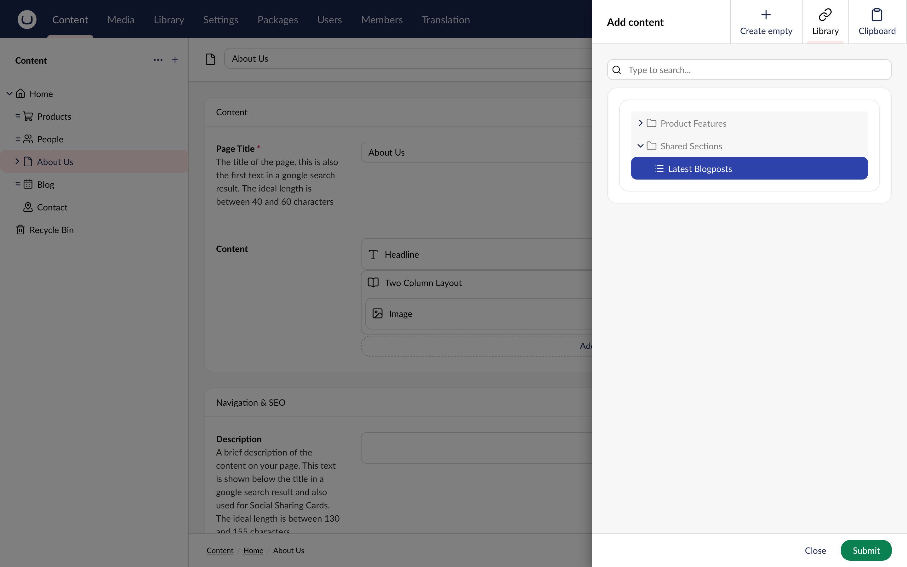
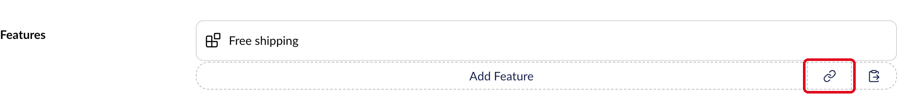
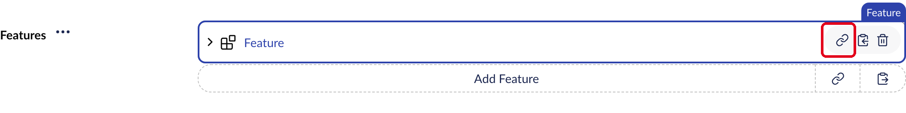
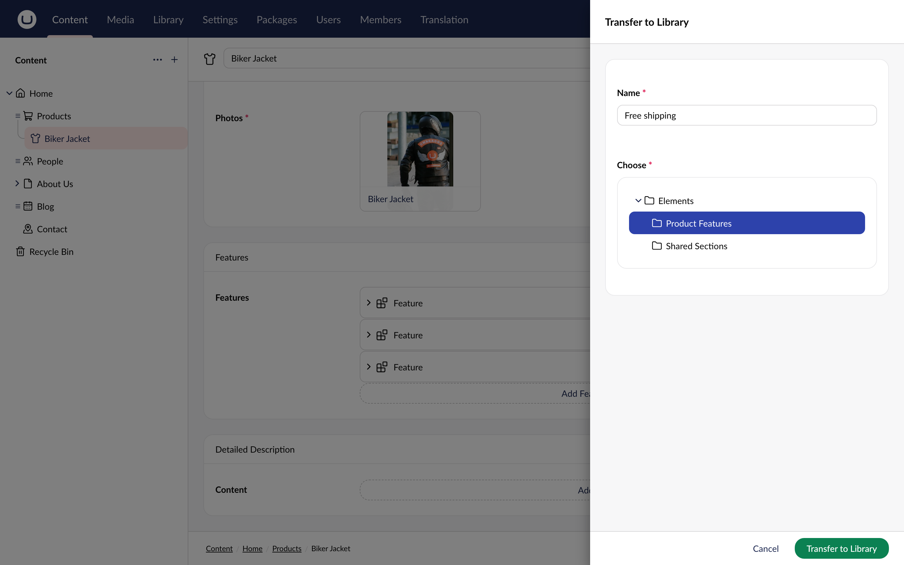
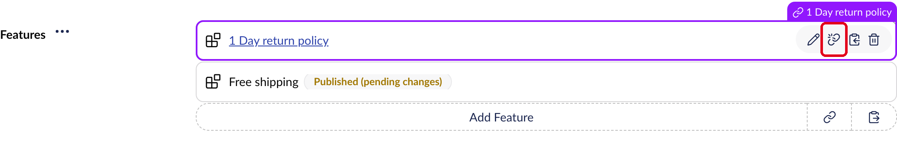
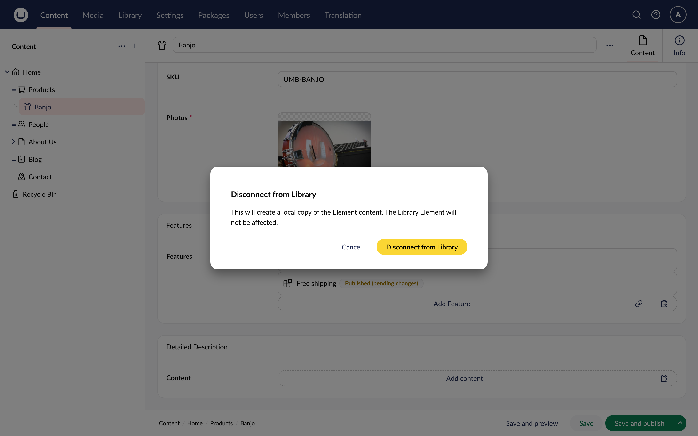
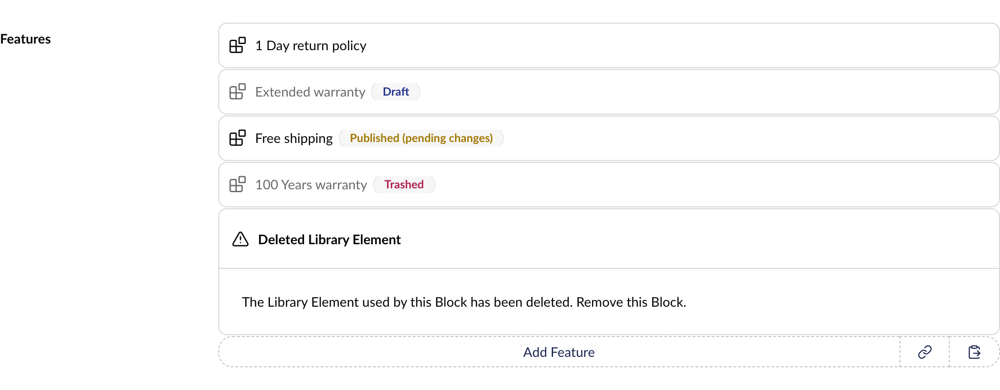
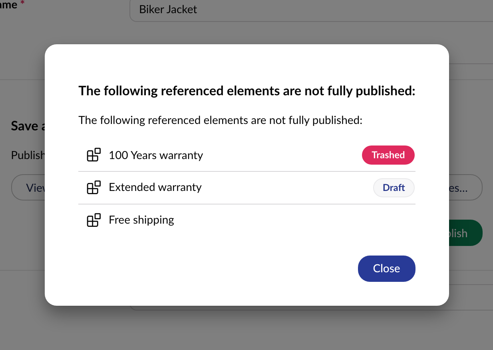

# Reusable Content in Block Editors

A block can reference an [Element](../../../content-types-and-structure/data/defining-content/elements.md) from the Library instead of holding its own content. When you update the Element, every Library Element block that references it shows the change. Use this for content that repeats across pages, such as a shipping policy or a call-to-action.

Library Element blocks work in the following property editors:

* [Block List](block-list-editor.md)
* [Block Grid](block-grid-editor.md)
* Single Block
* [Rich Text Editor](../rich-text-editor/blocks.md)

## Prerequisites

To add an Element as a block, its Element Type needs two things:

* It is configured as a Block Type on the property's Data Type.
* It has **Allow in Library** enabled. For more information, see the [Elements](../../../content-types-and-structure/data/defining-content/elements.md) article.

If none of the property's Block Types are allowed in the Library, you won't see the **Library** option.

## Add a Library Element to a Block Editor

1. Click **Add content** on the property to open the Block Catalogue.
2. Select the **Library** tab.
3. Select the Element you want to add.
4. Click **Submit**.



In the Rich Text Editor, open the Block Catalogue with **Insert Block** in the toolbar. You can add the same Element as many times as you need.

### The Library button

Some Block List and Single Block properties skip the Block Catalogue when you add a block. This happens when **Inline editing mode** is enabled and only one Block Type is configured.

In that case, use the **Library** button next to the **Add** button. It opens the Block Catalogue straight on the **Library** tab.



## Transfer a Block to the Library

You can turn an existing block into a Library Element. The block then becomes a reference to the new Element.

1. Hover over the block and click the **Transfer to Library** icon.



2. Enter a **Name** for the new Element.
3. Choose the Library folder to save the Element in.
4. Click **Transfer to Library**.
5. Save the Document to keep the reference.



You only see **Transfer to Library** on blocks whose Element Type is allowed in the Library.

A transfer can be blocked in two cases:

* **The folder:** you need permission to create and publish Elements in the folder you pick, and the Element Type must be allowed there. If it isn't, the dialog tells you why and you can't continue.
* **Languages:** if the block has content in a language you can't edit, Umbraco lists those languages and doesn't create the Element.

Once the transfer is done, the new Element is published in the cultures where the block was exposed. For more information, see [The "unexposed" Block state](block-level-variance.md#the-unexposed-block-state).

If the new Element doesn't pass validation, it is saved as a draft instead. Click **Open Element** to fix the issues and publish it.

## Edit a Library Element Block

Hover over the block and click **Edit** to open the Element in its own workspace.


Saving and publishing here changes the Element itself, so every block that uses it shows the change. To see where the Element is used, open the **Info** view and check **Referenced by**.


Library Element blocks always open in the workspace, even if the property uses **Inline editing mode**.

## Disconnect a Block from the Library

Use **Disconnect from Library** to stop a block from following the Element. The block gets a local copy of the Element's content, which you can then edit independently. The Element in the Library is not affected.

1. Hover over the block and click the **Disconnect from Library** icon.



2. Confirm by clicking **Disconnect from Library** in the dialog.
3. Save the Document to keep the change.



## Library Element Block States

A Library Element block shows the Element's name instead of the block label. When something about the Element needs your attention, the block also shows its state.



| State | Shown when |
| --- | --- |
| **Draft** | The Element has never been published. |
| **Published (pending changes)** | The Element has changes that are not published yet. |
| **Trashed** | The Element is in the Recycle Bin. |
| **Deleted Library Element** | The Element has been deleted. |

## Publishing and Rendering

If a Document references Elements that aren't fully published, the publish dialog lets you know. Select **View referenced elements with pending changes** to see which ones.



On the website, a Library Element block shows the published version of the Element. If the Element is unpublished, in the Recycle Bin, or deleted, the block isn't rendered.

Other blocks are shown per culture based on whether they are exposed. For more information, see [Block Level Variance](block-level-variance.md). Library Element blocks work differently: they show up in a culture when the Element is published in that culture.

By default, the content of Library Elements is not added to the search index of the Documents that reference them. To include it, see the [IndexExternalBlockElements](../../../../develop-with-umbraco/configuration/indexingsettings.md#indexexternalblockelements) setting.

## Library Element Blocks in the Stored Value

A Library Element block is stored as a layout entry only. The `contentKey` holds the key of the Element, and `isExternalContent` is `true`. The value has no `contentData` entry for the block. Settings stay local to the block and are stored in `settingsData`.

```json
{
  "layout": {
    "Umbraco.BlockList": [
      {
        "key": "7b94e979-ecbf-4595-8e27-06895498d584",
        "contentKey": "9ba14e0f-1a16-4db8-b935-37a8d6879a41",
        "settingsKey": null,
        "isExternalContent": true
      }
    ]
  },
  "contentData": [],
  "settingsData": [],
  "expose": []
}
```

The layout `key` identifies the layout entry. It is separate from the `contentKey`, because the same Element can be referenced by more than one entry. When you add references in code, give each one its own `key`. For an example, see [Referencing a Library Element](block-list-editor.md#referencing-a-library-element).
