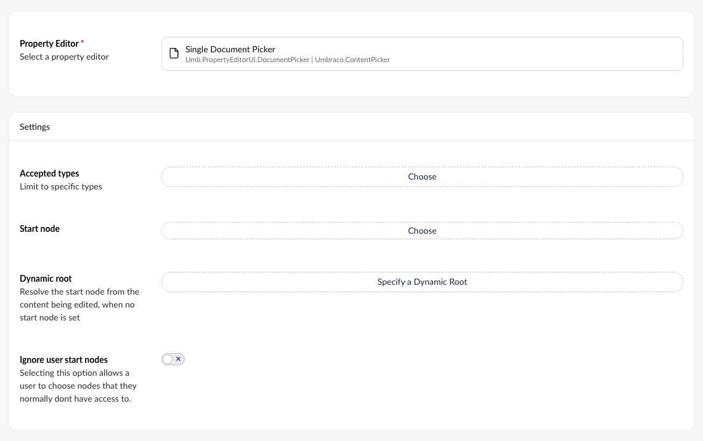
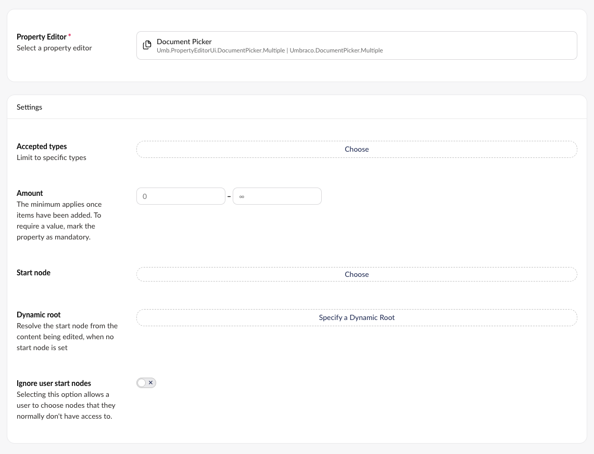

# Document Picker

The Document Picker opens a panel to pick a specific page from the content structure.

There are two variants of the Document Picker: the **Single Document Picker** for selecting one page, and the **Document Picker** for selecting multiple pages.


The Document Picker was formerly known as the **Content Picker** in version 13 and below.

The renaming is purely a client-side UI change, meaning the property editor still uses the `Umbraco.ContentPicker` schema alias.


## Single Document Picker

`Schema Alias: Umbraco.ContentPicker`

`UI Alias: Umb.PropertyEditorUi.DocumentPicker`

`Returns: IPublishedContent`

Use the Single Document Picker when editors should select exactly one page, for example a link to a related article or a call-to-action target. The value saved is the selected page's [UDI](../../../develop-with-umbraco/templating-and-rendering/querying/udi-identifiers.md).

### Data Type Definition Example



### Document Picker Example


### MVC View Example

#### Without Models Builder

```csharp
@{
    IPublishedContent typedContentPicker = Model.Value<IPublishedContent>("featurePicker");
    if (typedContentPicker != null)
    {
        <p>@typedContentPicker.Name</p>
    }
}
```

#### With Models Builder

```csharp
@{
    IPublishedContent typedContentPicker = Model.FeaturePicker;
    if (typedContentPicker != null)
    {
        <p>@typedContentPicker.Name</p>
    }
}
```

### Add values programmatically

See the example below to see how a value can be added or changed programmatically. To update a value of a property editor you need the [Content Service](https://apidocs.umbraco.com/v19/csharp/api/Umbraco.Cms.Core.Services.ContentService.html).


The example below demonstrates how to add values programmatically using a Razor view. However, this is used for illustrative purposes only and is not the recommended method for production environments.


```csharp
@using Umbraco.Cms.Core
@using Umbraco.Cms.Core.Services
@inject IContentService ContentService
@{
    // Create a variable for the GUID of the page you want to update
    var guid = Guid.Parse("32e60db4-1283-4caa-9645-f2153f9888ef");

    // Get the page using the GUID you've defined
    var content = ContentService.GetById(guid); // ID of your page

    // Get the page you want to assign to the document picker
    var page = Umbraco.Content("665d7368-e43e-4a83-b1d4-43853860dc45");

    // Create an Udi of the page
    var udi = Udi.Create(Constants.UdiEntityType.Document, page.Key);

    // Set the value of the property with alias 'featurePicker'.
    content.SetValue("featurePicker", udi.ToString());

    // Save the change
    ContentService.Save(content);
}
```

Although the use of a GUID is preferable, you can also use the numeric ID to get the page:

```csharp
@{
    // Get the page using it's id
    var content = ContentService.GetById(1234);
}
```

If Models Builder is enabled you can get the alias of the desired property without using a magic string:

```csharp
@using Umbraco.Cms.Core.PublishedCache
@inject IPublishedContentTypeCache PublishedContentTypeCache
@{
    // Set the value of the property with alias 'featurePicker'
    content.SetValue(Home.GetModelPropertyType(PublishedContentTypeCache, x => x.FeaturePicker).Alias, udi.ToString());
}
```

## Document Picker (Multiple)

`Schema Alias: Umbraco.DocumentPicker.Multiple`

`UI Alias: Umb.PropertyEditorUi.DocumentPicker.Multiple`

`Returns: IEnumerable<IPublishedContent>`

Use the Document Picker when editors should select multiple pages, for example a list of featured or related articles. The value saved is a JSON array containing the keys (GUIDs) of the selected pages.

### Data Type Definition Example



### Document Picker Example


### MVC View Example

#### Without Models Builder

```csharp
@{
    IEnumerable<IPublishedContent> typedDocumentPicker = Model.Value<IEnumerable<IPublishedContent>>("featurePicker");
    if (typedDocumentPicker != null)
    {
        foreach (var item in typedDocumentPicker)
        {
            <p>@item.Name</p>
        }
    }
}
```

#### With Models Builder

```csharp
@{
    IEnumerable<IPublishedContent> typedDocumentPicker = Model.FeaturePicker;
    if (typedDocumentPicker != null)
    {
        foreach (var item in typedDocumentPicker)
        {
            <p>@item.Name</p>
        }
    }
}
```

### Add values programmatically

See the example below to see how a value can be added or changed programmatically. To update a value of a property editor you need the [Content Service](https://apidocs.umbraco.com/v19/csharp/api/Umbraco.Cms.Core.Services.ContentService.html).


The example below demonstrates how to add values programmatically using a Razor view. However, this is used for illustrative purposes only and is not the recommended method for production environments.


```csharp
@using Umbraco.Cms.Core.Services
@inject IContentService ContentService
@{
    // Create a variable for the GUID of the page you want to update
    var guid = Guid.Parse("32e60db4-1283-4caa-9645-f2153f9888ef");

    // Get the page using the GUID you've defined
    var content = ContentService.GetById(guid); // ID of your page

    // Get the pages you want to assign to the document picker
    var page = Umbraco.Content("665d7368-e43e-4a83-b1d4-43853860dc45");
    var anotherPage = Umbraco.Content("1f8cabd5-2b06-4ca1-9ed5-fbf14d300d59");

    // Create a list of the keys of the pages
    var keys = new List<Guid> { page.Key, anotherPage.Key };

    // Set the value of the property with alias 'featurePicker'.
    // The value is stored as a JSON array of keys.
    content.SetValue("featurePicker", System.Text.Json.JsonSerializer.Serialize(keys));

    // Save the change
    ContentService.Save(content);
}
```

Although the use of a GUID is preferable, you can also use the numeric ID to get the page:

```csharp
@{
    // Get the page using it's id
    var content = ContentService.GetById(1234);
}
```

If Models Builder is enabled you can get the alias of the desired property without using a magic string:

```csharp
@using Umbraco.Cms.Core.PublishedCache
@inject IPublishedContentTypeCache PublishedContentTypeCache
@{
    // Set the value of the property with alias 'featurePicker'
    content.SetValue(Home.GetModelPropertyType(PublishedContentTypeCache, x => x.FeaturePicker).Alias, System.Text.Json.JsonSerializer.Serialize(keys));
}
```
