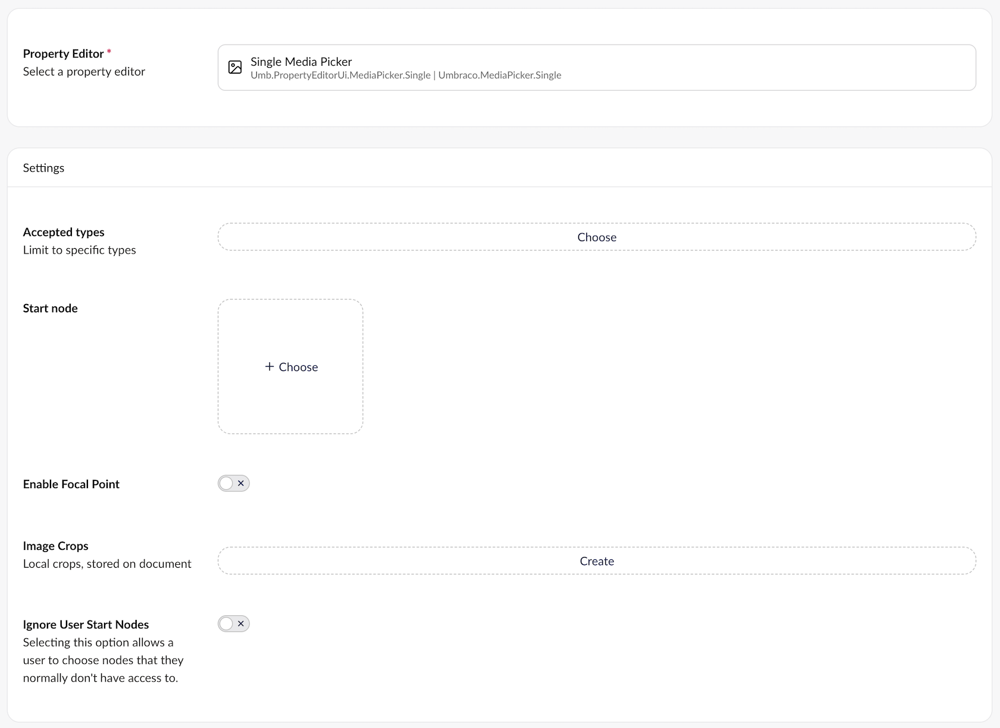
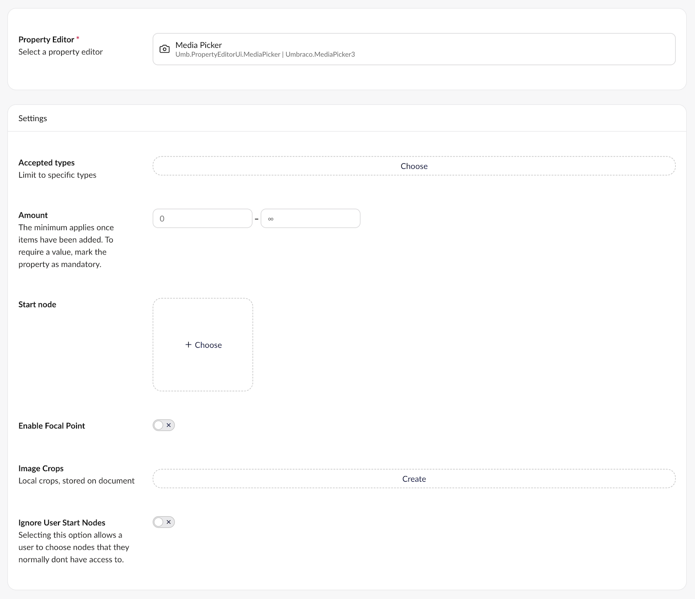

# Media Picker

The Media Picker opens a panel to pick one or more items from the media library.

There are two variants of the Media Picker:

* **Single Media Picker** for selecting one media item.
* **Media Picker** for selecting multiple media items.

## Single Media Picker

`Schema Alias: Umbraco.MediaPicker.Single`

`UI Alias: Umb.PropertyEditorUi.MediaPicker.Single`

`Returns: MediaWithCrops`

Use the Single Media Picker when editors should select exactly one media item, for example a hero image or a downloadable file. The available options are described in [Data Type settings](#data-type-settings).

### Data Type Definition Example



### Media Picker Example


### MVC View Example

The Single Media Picker returns a `MediaWithCrops` item. This wraps the media item together with the crops and focal point of the property.

Use `MediaUrl()` to render the original image, or `GetCropUrl()` to render a specific crop. Learn more in the [Working with crops](#working-with-crops) section.

#### Without Models Builder

```csharp
@using Umbraco.Cms.Core.Models
@{
    var typedMediaPickerSingle = Model.Value<MediaWithCrops>("media");
    if (typedMediaPickerSingle != null)
    {
        
    }
}
```

#### With Models Builder

```csharp
@using Umbraco.Cms.Core.Models
@{
    var typedMediaPickerSingle = Model.Media;
    if (typedMediaPickerSingle is MediaWithCrops mediaEntry)
    {
        
    }
}
```

<details>

<summary>Add values programmatically</summary>

See the example below to see how a value can be added or changed programmatically. To update a value of a property editor you need the [Content Service](https://apidocs.umbraco.com/v19/csharp/api/Umbraco.Cms.Core.Services.ContentService.html).

The following sample will update the image in a Single Media Picker.


The example below demonstrates how to add values programmatically using a Razor view. However, this is used for illustrative purposes only and is not the recommended method for production environments.


```csharp
@using Umbraco.Cms.Core.Services
@inject IContentService ContentService
@{
    // Create a variable for the GUID of the page you want to update
    var guid = Guid.Parse("32e60db4-1283-4caa-9645-f2153f9888ef");

    // Get the page using the GUID you've defined
    var content = ContentService.GetById(guid); // ID of your page

    // Get the media you want to assign to the media picker
    var media = Umbraco.Media("bca8d5fa-de0a-4f2b-9520-02118d8329a8");

    // Create an entry for the media item
    var items = new[]
    {
        new
        {
            key = Guid.NewGuid(),
            mediaKey = media.Key,
            crops = Array.Empty<object>(),
            focalPoint = (object)null
        }
    };

    // Set the value of the property with alias 'featuredBanner'.
    // The value is stored as a JSON array of entries.
    content.SetValue("featuredBanner", System.Text.Json.JsonSerializer.Serialize(items));

    // Save the change
    ContentService.Save(content);
}
```

Although the use of a GUID is preferable, you can also use the numeric ID to get the page:

```csharp
@{
    // Get the page using it's id
    var content = ContentService.GetById(1234);
}
```

If Models Builder is enabled you can get the alias of the desired property without using a magic string:

```csharp
@using Umbraco.Cms.Core.PublishedCache
@inject IPublishedContentTypeCache PublishedContentTypeCache
@{
    // Set the value of the property with alias 'featuredBanner'
    content.SetValue(Home.GetModelPropertyType(PublishedContentTypeCache, x => x.FeaturedBanner).Alias, System.Text.Json.JsonSerializer.Serialize(items));
}
```

</details>

## Media Picker (Multiple)

`Schema Alias: Umbraco.MediaPicker3`

`UI Alias: Umb.PropertyEditorUi.MediaPicker`

`Returns: IEnumerable<MediaWithCrops>`

Use the Media Picker when editors should select multiple media items, for example an image gallery or a list of related documents. The available options are described in [Data Type settings](#data-type-settings).

### Data Type Definition Example



### Media Picker Example


### MVC View Example

The Media Picker returns a collection of `MediaWithCrops` items. Each item wraps the media item together with the crops and focal point of the property.

Use `MediaUrl()` to render the original image, or `GetCropUrl()` to render a specific crop. Learn more in the [Working with crops](#working-with-crops) section.

#### Without Models Builder

```csharp
@using Umbraco.Cms.Core.Models
@{
    var typedMultiMediaPicker = Model.Value<IEnumerable<MediaWithCrops>>("medias");
    foreach (var entry in typedMultiMediaPicker)
    {
        
    }
}
```

#### Without Models Builder to retrieve IEnumerable data

```csharp
@using Umbraco.Cms.Core.Models
@{
    var listOfImages = Model.Value<IEnumerable<IPublishedContent>>("medias");
    foreach (var image in listOfImages)
    {
        
    }
}
```


While `MediaWithCrops` is the default return type, `IPublishedContent` may be used in backward-compatible implementations or when working directly with core APIs.


#### With Models Builder

```csharp
@{
    var typedMultiMediaPicker = Model.Medias;
    foreach (var entry in typedMultiMediaPicker)
    {
        
    }
}
```

<details>

<summary>Add values programmatically</summary>

See the example below to see how a value can be added or changed programmatically. To update a value of a property editor you need the [Content Service](https://apidocs.umbraco.com/v19/csharp/api/Umbraco.Cms.Core.Services.ContentService.html).

The following sample will update the images in a Media Picker.


The example below demonstrates how to add values programmatically using a Razor view. However, this is used for illustrative purposes only and is not the recommended method for production environments.


```csharp
@using Umbraco.Cms.Core.Services
@inject IContentService ContentService
@{
    // Create a variable for the GUID of the page you want to update
    var guid = Guid.Parse("32e60db4-1283-4caa-9645-f2153f9888ef");

    // Get the page using the GUID you've defined
    var content = ContentService.GetById(guid); // ID of your page

    // Get the media you want to assign to the media picker
    var media = Umbraco.Media("bca8d5fa-de0a-4f2b-9520-02118d8329a8");
    var anotherMedia = Umbraco.Media("0c9b8d3e-5d8a-4f6e-9a3c-7d1f2b4e6a10");

    // Create an entry for each of the media items
    var items = new[] { media, anotherMedia }.Select(m => new
    {
        key = Guid.NewGuid(),
        mediaKey = m.Key,
        crops = Array.Empty<object>(),
        focalPoint = (object)null
    });

    // Set the value of the property with alias 'featuredBanners'.
    // The value is stored as a JSON array of entries.
    content.SetValue("featuredBanners", System.Text.Json.JsonSerializer.Serialize(items));

    // Save the change
    ContentService.Save(content);
}
```

Although the use of a GUID is preferable, you can also use the numeric ID to get the page:

```csharp
@{
    // Get the page using it's id
    var content = ContentService.GetById(1234);
}
```

If Models Builder is enabled you can get the alias of the desired property without using a magic string:

```csharp
@using Umbraco.Cms.Core.PublishedCache
@inject IPublishedContentTypeCache PublishedContentTypeCache
@{
    // Set the value of the property with alias 'featuredBanners'
    content.SetValue(Home.GetModelPropertyType(PublishedContentTypeCache, x => x.FeaturedBanners).Alias, System.Text.Json.JsonSerializer.Serialize(items));
}
```

</details>

## Data Type settings

The following settings are available for both the Single Media Picker and the Media Picker, unless noted otherwise.

### Accepted types

Use this setting to limit the picker to only select Media Items of these types.

### Amount

This setting is only available for the Media Picker.

Use this setting to enforce a minimum and/or maximum amount of selected Media Items.

You can set the maximum amount to 1. Do so when you want to retrieve a collection but only allow the Content Editors to select one Media Item. To retrieve a single `MediaWithCrops` item, use the Single Media Picker instead.

### Start node

This setting is used to limit the Media Picker to certain parts of the Media Tree.

### Ignore user start nodes

Use this setting to overrule user permissions, to enable any user of this property to pick any Media Item of the chosen Start node.

When this setting is enabled, a user can access the media available under the selected "Start Node" (/Design in this case). This applies even if they normally lack access. The access is granted specifically when using this particular Media Picker.

### Enable Focal Point

Enable the focal point setter. Only enable this if the focal point is used or if you have image crops defined.

### Image Crops

Define local image crops for the Data Type. Read more about how local and global crops work in the [Working with crops](#working-with-crops) section.

## Working with crops

Image crops work the same way for the Single Media Picker and the Media Picker. Crops can be defined in two places:

* **Local crops** are defined in the **Image Crops** setting of the Data Type. Local image crop data is stored on the document in the property. This means it can differentiate between documents.
* **Global crops** are defined on the Media Item. This makes the crops shared between all usages of that Media Item. Global crops are configured on the Image Cropper property of the Image Media Type.

[Read about the Image Cropper here](image-cropper.md)

### Retrieving crops

Both local and global crops are retrieved using the method `GetCropUrl`. If crops with identical aliases are defined both locally and globally, the locally defined crops are always prioritized by `GetCropUrl`. If no crop with the alias exists, `GetCropUrl` returns an empty string.

The following is an example of how to retrieve a crop from a `MediaWithCrops` entry.

#### Single Media Picker

```csharp
@using Umbraco.Cms.Core.Models
@{
    if (Model.Media is MediaWithCrops media)
    {
        
    }
}
```

#### Media Picker (Multiple)

```csharp
@{
    foreach (var entry in Model.Medias)
    {
        
    }
}
```

### Explicitly retrieving global crops

You can retrieve globally defined crops explicitly by using `GetCropUrl` on the `UrlHelper`. This ignores any local crops, even when they have the same alias:

#### Single Media Picker

```csharp
@using Umbraco.Cms.Core.Models
@{
    if (Model.Media is MediaWithCrops media)
    {
        
    }
}
```

#### Media Picker (Multiple)

```csharp
@{
    foreach (var entry in Model.Medias)
    {
        
    }
}
```
