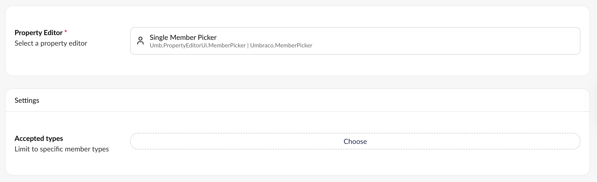
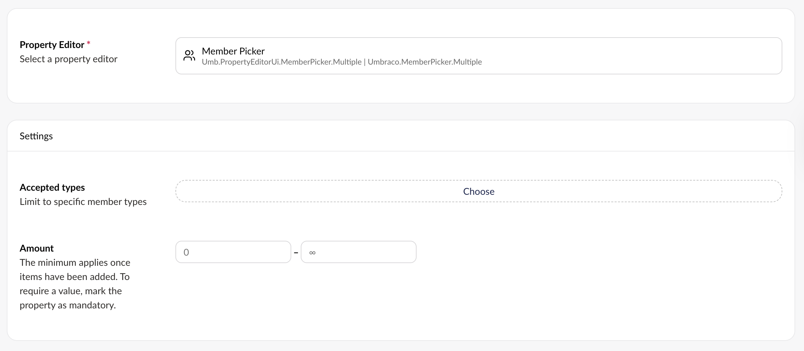

# Member Picker

The Member Picker opens a panel to pick one or more members from the Members section.

There are two variants of the Member Picker:

* **Single Member Picker** for selecting one member.
* **Member Picker** for selecting multiple members.

## Single Member Picker

`Schema Alias: Umbraco.MemberPicker`

`UI Alias: Umb.PropertyEditorUi.MemberPicker`

`Returns: IPublishedContent`

Use the Single Member Picker when editors should select exactly one member, for example the author of an article. The value saved is the [UDI](../../../develop-with-umbraco/templating-and-rendering/querying/udi-identifiers.md) of the selected member.

### Data Type Definition Example



#### Accepted types

Use this setting to limit the picker to only select members of specific Member Types.

### Member Picker Example


### MVC View Example

#### Without Models Builder

```csharp
@{
    if (Model.HasValue("author"))
    {
        var member = Model.Value<IPublishedContent>("author");
        @member.Name
    }
}
```

#### With Models Builder

```csharp
@{
    if (Model.Author != null)
    {
        var member = Model.Author;
        @member.Name
    }
}
```

<details>

<summary>Add values programmatically</summary>

See the example below to see how a value can be added or changed programmatically. To update a value of a property editor you need the [Content Service](https://apidocs.umbraco.com/v19/csharp/api/Umbraco.Cms.Core.Services.ContentService.html).


The example below demonstrates how to add values programmatically using a Razor view. However, this is used for illustrative purposes only and is not the recommended method for production environments.


```csharp
@using Umbraco.Cms.Core
@using Umbraco.Cms.Core.Services
@inject IContentService ContentService
@{
    // Create a variable for the GUID of the page you want to update
    var guid = Guid.Parse("32e60db4-1283-4caa-9645-f2153f9888ef");

    // Get the page using the GUID you've defined
    var content = ContentService.GetById(guid); // ID of your page

    // Create a variable for the GUID of the member
    var authorId = Guid.Parse("ed944097281e4492bcdf783355219450");

    // Create a udi
    var memberUdi = Udi.Create(Constants.UdiEntityType.Member, authorId);

    // Set the value of the property with alias 'author'.
    content.SetValue("author", memberUdi);

    // Save the change
    ContentService.Save(content);
}
```

Although the use of a GUID is preferable, you can also use the numeric ID to get the page:

```csharp
@{
    // Get the page using it's id
    var content = ContentService.GetById(1234);
}
```

If Models Builder is enabled you can get the alias of the desired property without using a magic string:

```csharp
@using Umbraco.Cms.Core.PublishedCache
@inject IPublishedContentTypeCache PublishedContentTypeCache
@{
    // Set the value of the property with alias 'author'
    content.SetValue(Home.GetModelPropertyType(PublishedContentTypeCache, x => x.Author).Alias, memberUdi);
}
```

</details>

## Member Picker (Multiple)

`Schema Alias: Umbraco.MemberPicker.Multiple`

`UI Alias: Umb.PropertyEditorUi.MemberPicker.Multiple`

`Returns: IEnumerable<IPublishedContent>`

Use the Member Picker when editors should select multiple members, for example a list of contributors or the members of a team. The value saved is a JSON array containing the keys (GUIDs) of the selected members.

### Data Type Definition Example



#### Accepted types

Use this setting to limit the picker to only select members of specific Member Types.

#### Amount

Use this setting to enforce a minimum and/or maximum amount of selected members.

### Member Picker Example


### MVC View Example

#### Without Models Builder

```csharp
@{
    if (Model.HasValue("authors"))
    {
        var members = Model.Value<IEnumerable<IPublishedContent>>("authors");
        foreach (var member in members)
        {
            <p>@member.Name</p>
        }
    }
}
```

#### With Models Builder

```csharp
@{
    var members = Model.Authors;
    foreach (var member in members)
    {
        <p>@member.Name</p>
    }
}
```

<details>

<summary>Add values programmatically</summary>

See the example below to see how a value can be added or changed programmatically. To update a value of a property editor you need the [Content Service](https://apidocs.umbraco.com/v19/csharp/api/Umbraco.Cms.Core.Services.ContentService.html).


The example below demonstrates how to add values programmatically using a Razor view. However, this is used for illustrative purposes only and is not the recommended method for production environments.



The Member Picker only accepts a JSON array of keys. If you save a value in another format, such as a UDI, reading the property value on the front end throws an error.


```csharp
@using Umbraco.Cms.Core.Services
@inject IContentService ContentService
@{
    // Create a variable for the GUID of the page you want to update
    var guid = Guid.Parse("32e60db4-1283-4caa-9645-f2153f9888ef");

    // Get the page using the GUID you've defined
    var content = ContentService.GetById(guid); // ID of your page

    // Create variables for the GUIDs of the members
    var authorId = Guid.Parse("ed944097281e4492bcdf783355219450");
    var anotherAuthorId = Guid.Parse("3b2f6a3c9d1e4f8a8c6d5e7f90a1b2c3");

    // Create a list of the keys of the members
    var keys = new List<Guid> { authorId, anotherAuthorId };

    // Set the value of the property with alias 'authors'.
    // The value is stored as a JSON array of keys.
    content.SetValue("authors", System.Text.Json.JsonSerializer.Serialize(keys));

    // Save the change
    ContentService.Save(content);
}
```

Although the use of a GUID is preferable, you can also use the numeric ID to get the page:

```csharp
@{
    // Get the page using it's id
    var content = ContentService.GetById(1234);
}
```

If Models Builder is enabled you can get the alias of the desired property without using a magic string:

```csharp
@using Umbraco.Cms.Core.PublishedCache
@inject IPublishedContentTypeCache PublishedContentTypeCache
@{
    // Set the value of the property with alias 'authors'
    content.SetValue(Home.GetModelPropertyType(PublishedContentTypeCache, x => x.Authors).Alias, System.Text.Json.JsonSerializer.Serialize(keys));
}
```

</details>
