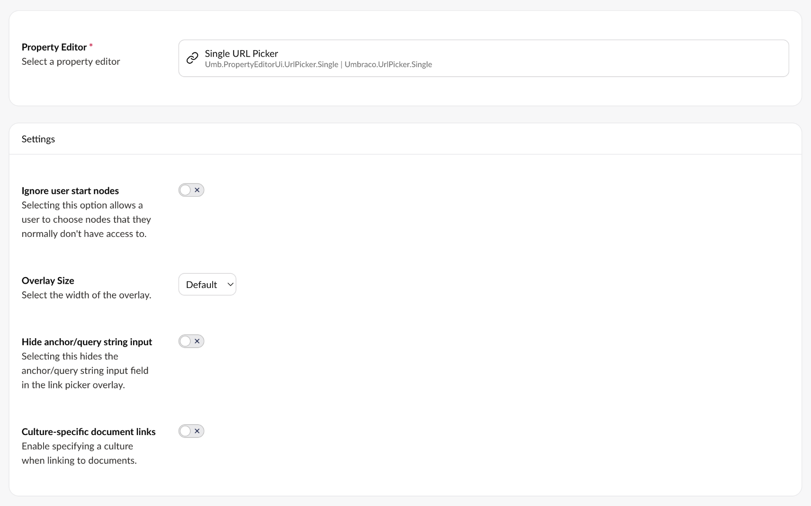
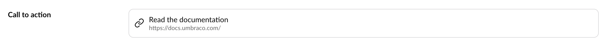
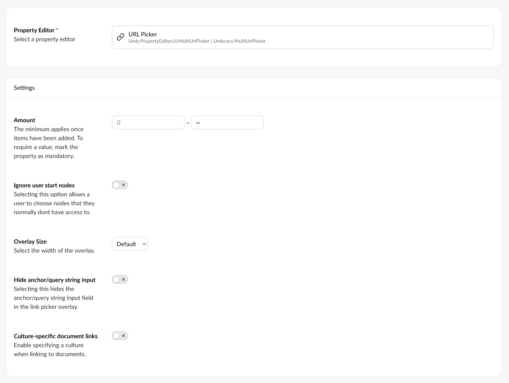
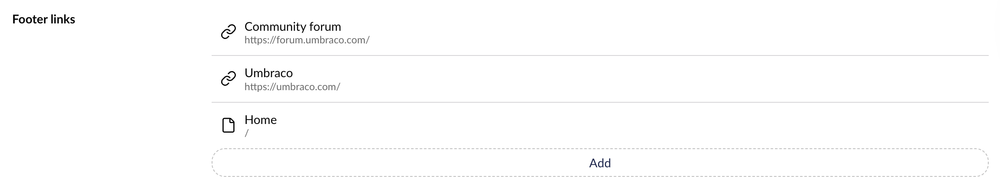

# URL Picker

The URL Picker allows editors to select links. The URLs can point to **internal**, **external**, or **media** items.

There are two variants of the URL Picker:

* **Single URL Picker** for selecting one link.
* **URL Picker** for selecting multiple links.

## Single URL Picker

`Schema Alias: Umbraco.UrlPicker.Single`

`UI Alias: Umb.PropertyEditorUi.UrlPicker.Single`

`Returns: Link`

Use the Single URL Picker when editors should select exactly one link, for example a call-to-action button.

### Data Type Definition Example



#### Ignore user start nodes

Selecting this option allows a user to choose nodes that they normally don't have access to.

#### Overlay Size

Select the width of the overlay.

#### Hide anchor/query string input

Selecting this hides the anchor/query string input field in the link picker overlay.

#### Culture-specific document links

Enable specifying a culture when linking to documents.

### URL Picker Example



### MVC View Example

#### Without Models Builder

```csharp
@using Umbraco.Cms.Core.Models
@{
    var link = Model.Value<Link>("link");
    if (link != null)
    {
        <a href="@link.Url" target="@link.Target">@link.Name</a>
    }
}
```

#### With Models Builder

```csharp
@{
    var link = Model.Link;
    if (link != null)
    {
        <a href="@link.Url" target="@link.Target">@link.Name</a>
    }
}
```

<details>

<summary>Add values programmatically</summary>

See the example below to see how a value can be added or changed programmatically. To update a value of a property editor you need the [Content Service](https://apidocs.umbraco.com/v19/csharp/api/Umbraco.Cms.Core.Services.ContentService.html).


The example below demonstrates how to add values programmatically using a Razor view. However, this is used for illustrative purposes only and is not the recommended method for production environments.



The value must be a JSON array, even though the Single URL Picker only holds one link. A single link object that is not in an array is rejected when the page is published.


```csharp
@using Umbraco.Cms.Core
@using Umbraco.Cms.Core.Serialization
@using Umbraco.Cms.Core.Services
@using Umbraco.Cms.Core.Models
@inject IContentService ContentService
@inject IJsonSerializer Serializer
@{
    // Create a variable for the GUID of the page you want to update
    var guid = Guid.Parse("32e60db4-1283-4caa-9645-f2153f9888ef");

    // Get the page using the GUID you've defined
    var content = ContentService.GetById(guid); // ID of your page

    // Get the content you want to assign to the link property
    var contentPage = Umbraco.Content("665d7368-e43e-4a83-b1d4-43853860dc45");

    // Create an Udi of the Content
    var contentPageUdi = Udi.Create(Constants.UdiEntityType.Document, contentPage.Key);

    // Create a list with the link
    var linkList = new List<Link>
    {
        new Link
        {
            Target = "_self",
            Name = contentPage.Name,
            Url = contentPage.Url(),
            Type = LinkType.Content,
            Udi = contentPageUdi
        }
    };

    // Serialize the list with the link to JSON
    var link = Serializer.Serialize(linkList);

    // Set the value of the property with alias 'link'.
    content.SetValue("link", link);

    // Save the change
    ContentService.Save(content);
}
```

If Models Builder is enabled you can get the alias of the desired property without using a magic string:

```csharp
@using Umbraco.Cms.Core.PublishedCache
@inject IPublishedContentTypeCache PublishedContentTypeCache
@{
    // Set the value of the property with alias 'link'
    content.SetValue(Home.GetModelPropertyType(PublishedContentTypeCache, x => x.Link).Alias, link);
}
```

</details>

## URL Picker (Multiple)

`Schema Alias: Umbraco.MultiUrlPicker`

`UI Alias: Umb.PropertyEditorUi.MultiUrlPicker`

`Returns: IEnumerable<Link>`

Use the URL Picker when editors should select multiple links, for example a list of footer links.

### Data Type Definition Example



#### Amount

Use this setting to enforce a minimum and/or maximum amount of links.

#### Ignore user start nodes

Selecting this option allows a user to choose nodes that they normally don't have access to.

#### Overlay Size

Select the width of the overlay.

#### Hide anchor/query string input

Selecting this hides the anchor/query string input field in the link picker overlay.

#### Culture-specific document links

Enable specifying a culture when linking to documents.

### URL Picker Example



The list of links can be sorted using drag-and-drop.

### MVC View Example

#### Without Models Builder

```csharp
@using Umbraco.Cms.Core.Models
@{
    var links = Model.Value<IEnumerable<Link>>("footerLinks");
    if (links.Any())
    {
        <ul>
            @foreach (var link in links)
            {
                <li><a href="@link.Url" target="@link.Target">@link.Name</a></li>
            }
        </ul>
    }
}
```

#### With Models Builder

```csharp
@{
    var links = Model.FooterLinks;
    if (links.Any())
    {
        <ul>
            @foreach (var link in links)
            {
                <li><a href="@link.Url" target="@link.Target">@link.Name</a></li>
            }
        </ul>
    }
}
```

<details>

<summary>Add values programmatically</summary>

See the example below to see how a value can be added or changed programmatically. To update a value of a property editor you need the [Content Service](https://apidocs.umbraco.com/v19/csharp/api/Umbraco.Cms.Core.Services.ContentService.html).


The example below demonstrates how to add values programmatically using a Razor view. However, this is used for illustrative purposes only and is not the recommended method for production environments.


```csharp
@using Umbraco.Cms.Core
@using Umbraco.Cms.Core.Serialization
@using Umbraco.Cms.Core.Services
@using Umbraco.Cms.Core.Models
@inject IContentService ContentService
@inject IJsonSerializer Serializer
@{
    // Create a variable for the GUID of the page you want to update
    var guid = Guid.Parse("32e60db4-1283-4caa-9645-f2153f9888ef");

    // Get the page using the GUID you've defined
    var content = ContentService.GetById(guid); // ID of your page

    // Get the media you want to assign to the footer links property
    var media = Umbraco.Media("bca8d5fa-de0a-4f2b-9520-02118d8329a8");

    // Create an Udi of the media
    var mediaUdi = Udi.Create(Constants.UdiEntityType.Media, media.Key);

    // Get the content you want to assign to the footer links property
    var contentPage = Umbraco.Content("665d7368-e43e-4a83-b1d4-43853860dc45");

    // Create an Udi of the Content
    var contentPageUdi = Udi.Create(Constants.UdiEntityType.Document, contentPage.Key);

    // Create a list with different link types
    var externalLinks = new List<Link>
    {
        // External Link
        new Link
        {
            Target = "_blank",
            Name = "Our Umbraco",
            Url = "https://our.umbraco.com/",
            Type = LinkType.External
        },
        // Media
        new Link
        {
            Target = "_self",
            Name = media.Name,
            Url = media.MediaUrl(),
            Type = LinkType.Media,
            Udi = mediaUdi
        },
        // Content
        new Link
        {
            Target = "_self",
            Name = contentPage.Name,
            Url = contentPage.Url(),
            Type = LinkType.Content,
            Udi = contentPageUdi
        }
    };

    // Serialize the list with links to JSON
    var links = Serializer.Serialize(externalLinks);

    // Set the value of the property with alias 'footerLinks'.
    content.SetValue("footerLinks", links);

    // Save the change
    ContentService.Save(content);
}
```

If Models Builder is enabled you can get the alias of the desired property without using a magic string:

```csharp
@using Umbraco.Cms.Core.PublishedCache
@inject IPublishedContentTypeCache PublishedContentTypeCache
@{
    // Set the value of the property with alias 'footerLinks'
    content.SetValue(Home.GetModelPropertyType(PublishedContentTypeCache, x => x.FooterLinks).Alias, links);
}
```

</details>

## Getting absolute URLs

By default, `link.Url` returns a relative URL for content and media links (for example, `/products/` or `/media/abc123/logo.png`). If you need absolute URLs, for example in emails, sitemaps, or cross-domain scenarios, you can use `IPublishedUrlProvider` with `UrlMode.Absolute`. The approach works the same way for the Single URL Picker and the URL Picker.

Inject `IPublishedUrlProvider` at the top of your view and resolve content and media links using `UrlMode.Absolute`. External links are returned as entered and pass through unchanged.

### Single URL Picker

```csharp
@using Umbraco.Cms.Core.Models
@using Umbraco.Cms.Core.Models.PublishedContent
@inject Umbraco.Cms.Core.Routing.IPublishedUrlProvider UrlProvider

@{
    var link = Model.Value<Link>("link");
    if (link != null)
    {
        var url = link.Type switch
        {
            LinkType.Content => UrlProvider.GetUrl(Umbraco.Content(link.Udi), UrlMode.Absolute),
            LinkType.Media => UrlProvider.GetMediaUrl(Umbraco.Media(link.Udi), UrlMode.Absolute),
            _ => link.Url,
        };

        <a href="@url" target="@link.Target">@link.Name</a>
    }
}
```

### URL Picker (Multiple)

```csharp
@using Umbraco.Cms.Core.Models
@using Umbraco.Cms.Core.Models.PublishedContent
@inject Umbraco.Cms.Core.Routing.IPublishedUrlProvider UrlProvider

@{
    var links = Model.Value<IEnumerable<Link>>("footerLinks");
    if (links.Any())
    {
        <ul>
            @foreach (var link in links)
            {
                var url = link.Type switch
                {
                    LinkType.Content => UrlProvider.GetUrl(Umbraco.Content(link.Udi), UrlMode.Absolute),
                    LinkType.Media => UrlProvider.GetMediaUrl(Umbraco.Media(link.Udi), UrlMode.Absolute),
                    _ => link.Url,
                };

                <li><a href="@url" target="@link.Target">@link.Name</a></li>
            }
        </ul>
    }
}
```
