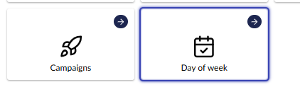

# Implement your own segment parameters

Umbraco Engage comes with built-in parameters to build a segment, such as "Customer Journey" and "Time of Day".
However, custom segments can be built by providing your own segment parameters.

The following guide explains how to achieve this. It is aimed at developers.
There are three steps, two are mandatory, and the last one is optional:

1. C# definition
2. Web component definition
3. Cockpit visualization (optional)

This guide uses code samples to add a "Day of week" segment parameter where you can select a single day of the week. If a pageview happens on that day, the segment parameter is satisfied.

## 1. C# definition

Your custom segment parameter needs to be defined in C# for Engage to use it.
In code, a segment parameter is referred to as a "segment rule".

A segment rule is not much more than this:

-   A unique rule identifier, e.g. "DayOfWeek".
-   A configuration object, e.g. "{ dayOfWeek: "Monday" }"
    -   This is optional, but most rules will have some sort of configuration that the user can alter in the Segment Builder. In our example, the user can configure the specific day of the week.
-   A method that specifies whether the rule is satisfied by the current pageview.

You will have to implement the following interfaces for a new custom parameter:

-   `Umbraco.Engage.Infrastructure.Personalization.Segments.Rules.ISegmentRule`
    -   You can extend the existing `BaseSegmentRule` to simplify the implementation.
    -   The most important part to implement is the `bool IsSatisfied(IPersonalizationProfile context)` method.
-   `Umbraco.Engage.Infrastructure.Personalization.Segments.Rules.ISegmentRuleFactory`
    -   Register your implementation of the segment rule factory as a transient service in a composer.

For the "Day of week" example, the code looks like this:

```c#
using Umbraco.Engage.Infrastructure.Personalization.PersonalizationProfile;
using Umbraco.Engage.Infrastructure.Personalization.Segments.Rules;

public class DayOfWeekSegmentRule : BaseSegmentRule
{
    public DayOfWeekSegmentRuleConfig TypedConfig { get; }

    public override SegmentRuleValidationMode ValidationMode => SegmentRuleValidationMode.Once;

    public DayOfWeekSegmentRule(long id, Guid key, long segmentId, string type, string config, bool isNegation, DateTime created, DateTime? updated, DayOfWeekSegmentRuleConfig typedConfig)
        : base(id, key, segmentId, type, config, isNegation, created, updated)
        => TypedConfig = typedConfig;

    public override bool IsSatisfied(IPersonalizationProfile context)
        => context.Pageview.Timestamp.DayOfWeek == TypedConfig.DayOfWeek;
}
```

And the factory which is used to create an instance of this rule:

```c#
using System.Text.Json;
using System.Text.Json.Serialization;
using Umbraco.Engage.Infrastructure.Personalization.Segments.Rules;

public class DayOfWeekSegmentRuleFactory : ISegmentRuleFactory
{
    // The backoffice stores the configuration with camelCase property names and the day as text.
    private static readonly JsonSerializerOptions _jsonOptions = new()
    {
        PropertyNameCaseInsensitive = true,
        Converters = { new JsonStringEnumConverter() },
    };

    public string RuleType { get; } = "DayOfWeek";

    public ISegmentRule CreateRule(string config, bool isNegation, long id, Guid key, long segmentId, DateTime created, DateTime? updated)
    {
        var typedConfig = JsonSerializer.Deserialize<DayOfWeekSegmentRuleConfig>(config, _jsonOptions)
            ?? throw new InvalidOperationException("Failed to deserialize DayOfWeekSegmentRuleConfig");

        return new DayOfWeekSegmentRule(id, key, segmentId, RuleType, config, isNegation, created, updated, typedConfig);
    }
}
```


The serializer options are required. Without them, the stored value `{ "dayOfWeek": "Wednesday" }` does not bind to the `DayOfWeek` property. The rule then always evaluates against `Sunday`.


The class `DayOfWeekSegmentRuleConfig` is used to represent the rule configuration. This is not strictly necessary, but it makes it easier.
The configuration is stored as a string in the database. In code, Intellisense is enabled to parse the stored configuration to this class:

```c#
public class DayOfWeekSegmentRuleConfig
{
    public DayOfWeek DayOfWeek { get; set; }
}
```

Register the factory in a composer. Umbraco Engage does not find the factory without the registration, and the segment parameter is then never satisfied.

```c#
using Microsoft.Extensions.DependencyInjection;
using Umbraco.Cms.Core.Composing;
using Umbraco.Cms.Core.DependencyInjection;
using Umbraco.Engage.Infrastructure.Personalization.Segments.Rules;

public class DayOfWeekSegmentRuleComposer : IComposer
{
    public void Compose(IUmbracoBuilder builder)
    {
        builder.Services.AddTransient<ISegmentRuleFactory, DayOfWeekSegmentRuleFactory>();
    }
}
```

## 2. Web component definition


Check the [Creating your first extension](https://docs.umbraco.com/umbraco-cms/extend-your-project/tutorials/creating-your-first-extension) and [Vite Package Setup](https://docs.umbraco.com/umbraco-cms/extend-your-project/backoffice-extensions/development-flow/vite-package-setup) articles for detailed extension-building tutorials.


The business logic for the segment parameter has been implemented, but the parameter cannot yet be used in the backoffice. In this step, a web component will be added to render the new rule in the Engage segment builder.

This demo assumes you are creating multiple custom rules, which are then provided as a bundle in the backoffice.

First, follow the [Vite Package Setup](https://docs.umbraco.com/umbraco-cms/extend-your-project/backoffice-extensions/development-flow/vite-package-setup) article to scaffold your extension. Use `MySegmentRules` as your package name.

1. Install the `@umbraco-engage/backoffice` package as a development dependency. Replace `x.x.x` with the Umbraco Engage version installed on your site:

```text
npm install -D @umbraco-engage/backoffice@x.x.x
```


The package version must match the installed Umbraco Engage version. The package is only used when you build. In the browser, the backoffice loads the Engage code from your site.


2. Ensure your `vite.config.ts` looks like the example below:

```typescript
import { defineConfig } from "vite";

export default defineConfig({
    build: {
        lib: {
            entry: "src/my-element.ts", // your web component source file
            formats: ["es"],
            fileName: "client", // the compiled file is named client.js
        },
        outDir: "./client", // all compiled files will be placed here
        emptyOutDir: true,
        sourcemap: true,
        rollupOptions: {
            external: [/^@umbraco/], // ignore the Umbraco Backoffice package in the build
        },
    },
    base: "/App_Plugins/MySegmentRules/client", // the base path of the app in the browser (used for assets)
});
```

3. Update `umbraco-package.json` to register a bundle. The bundle loads the compiled file when the backoffice starts. The segment rule manifest is defined in the TypeScript file in the next step.

```json
{
  "$schema": "../../umbraco-package-schema.json",
  "name": "My Custom Engage Segment Rules",
  "extensions": [
    {
      "name": "My Engage Segment Rules Bundle",
      "alias": "My.Bundle.SegmentRules",
      "type": "bundle",
      "js": "/App_Plugins/MySegmentRules/client/client.js"
    }
  ]
}
```

4. Update `src/my-element.ts` as below. The file contains the web component and the segment rule manifest.

Note `DayOfWeekSegmentRuleConfigModel` reflects the same data contract as the `DayOfWeekSegmentRuleConfig` class in C#. The `meta.type` property matches the `RuleType` defined above in `DayOfWeekSegmentRuleFactory`. The `meta.config` object implements the `DayOfWeekSegmentRuleConfigModel` interface.

By extending `UeSegmentRuleBaseElement` you avoid writing boilerplate code, and don't have to worry about handling value updates or syncing data back to the segment.


Use your own prefix for the `alias` and the element name. The `Engage.` alias prefix and the `ue-` element prefix are reserved for Umbraco Engage.


```typescript
import { customElement, html } from "@umbraco-cms/backoffice/external/lit";
import type { UUISelectEvent } from "@umbraco-cms/backoffice/external/uui";
import {
  ENGAGE_SEGMENT_RULE_EXTENSION_TYPE,
  UeSegmentRuleBaseElement,
} from "@umbraco-engage/backoffice/segment-rules";

export interface DayOfWeekSegmentRuleConfigModel {
  dayOfWeek: string;
}

const days = ["Sunday", "Monday", "Tuesday", "Wednesday", "Thursday", "Friday", "Saturday"];

@customElement("my-segment-rule-day-of-week")
export class MySegmentRuleDayOfWeekElement extends UeSegmentRuleBaseElement<DayOfWeekSegmentRuleConfigModel> {
  renderReadOnly() {
    return html`Day of week: ${this.value?.config.dayOfWeek}`;
  }

  renderEditor() {
    const current = (this.pending ?? this.value)?.config.dayOfWeek;
    const options = days.map((x) => ({ value: x, name: x, selected: x === current }));

    return html`
      <umb-property-layout label="Day" orientation="horizontal">
        <uui-select
          slot="editor"
          .options=${options}
          @change=${(e: UUISelectEvent) => this.onSelectChange(e)}
        ></uui-select>
      </umb-property-layout>
    `;
  }

  onSelectChange(e: UUISelectEvent) {
    if (!this.value) return;
    this.updateParameterValue(e.target.value as string, "dayOfWeek");
  }
}

export const manifests: Array<UmbExtensionManifest> = [
  {
    type: ENGAGE_SEGMENT_RULE_EXTENSION_TYPE,
    alias: "My.SegmentRule.DayOfWeek",
    name: "Day of week",
    weight: 100,
    element: MySegmentRuleDayOfWeekElement,
    meta: {
      name: "Day of week",
      icon: "icon-calendar",
      type: "DayOfWeek",
      config: { dayOfWeek: "Sunday" },
    },
  },
];
```


The bundle registers every array that the file exports. Export only the `manifests` array from this file.


5. Build the typescript file:

```text
npm run build
```

That's it. If all went well you will see your custom parameter editor show up in the segment builder:

<figure><figcaption><p>Day of week Segment.</p></figcaption></figure>

## 3. Cockpit visualization (optional)

The cockpit is a live view of Engage data for the current visitor. The view includes the active segments of the visitor and their segment parameters.

The cockpit shows a segment parameter with the same web component as the backoffice. The cockpit uses the output of the `renderReadOnly()` method, and the `name` and `meta.icon` of the manifest. No C# code is needed.

The cockpit does not load the backoffice bundles. Register a `cockpitSegmentRuleProvider` extension to tell the cockpit where to find your segment rules. Add the extension to the `umbraco-package.json` file from step 2:

```json
{
  "type": "cockpitSegmentRuleProvider",
  "alias": "My.CockpitSegmentRuleProvider",
  "name": "My Engage Cockpit Segment Rule Provider",
  "js": "/App_Plugins/MySegmentRules/client/client.js"
}
```

The `js` file must export a `manifests` array, as the file from step 2 does. A segment parameter without a provider is not shown in the cockpit.
