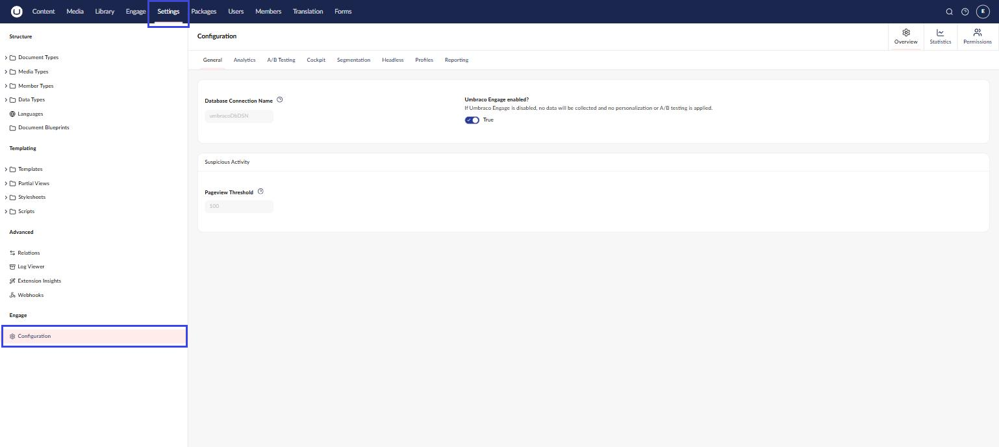

# Configuration

Most of the Umbraco Engage configuration options are stored in the configuration file. Umbraco Engage uses the standard for .NET Core applications, in which we make use of the `appsettings.json` (and environment variable support). Because of this new standard, most configuration options no longer require the application to restart to take effect. This comes with a few exceptions.

Umbraco Engage ships with an `appsettings-schema.json` file, allowing Visual Studio or Jetbrains Rider to auto-complete the configuration options. It comes with information about default values and a description of what each configuration option does. Do not change the `-schema.json` files.

The default configuration will look like this:


```json
{
  "Engage": {
    "Settings": {
      "DatabaseConnectionStringName": "umbracoDbDSN",
      "Enabled": true,
      "UseLegacySegmentNames": false
    },
    "Analytics": {
      "VisitorCookie": {
        "ExpirationInDays": 365,
        "CookieName": "umbracoEngageAnalyticsVisitorId",
        "LegacyCookieName": "uMarketingSuiteAnalyticsVisitorId",
        "IncludeSubdomains": false
      },
      "DataCollection": {
        "AnonymizeIPAddress": true,
        "RequireAnalyticsPermissionForMemberTracking": false,
        "FlushRateInRecords": 100,
        "FlushIntervalInSeconds": 30,
        "InternalSiteSearch": {
          "AutomaticSearchTracking": true,
          "SearchTermParameters": "q",
          "SearchBoxParameters": "a,b,c",
          "CategoryParameters": ""
        }
      },
      "DataProcessing": {
        "IntervalInSeconds": 30,
        "SessionLengthInMinutes": 30,
        "IsProcessingServer": true
      },
      "DataStorage": {
        "AnonymizeAnalyticsDataAfterDays": 730,
        "DeleteAnalyticsDataAfterDays": 1095,
        "DeleteControlGroupDataAfterDays": 180,
        "DeleteRawDataAfterDays": 5
      },
      "DataCleanup": {
        "Enabled": true,
        "FirstRunTime": null,
        "StartupDelay": "00:05:00",
        "Interval": "1.00:00:00",
        "CommandTimeout": 1200
      }
    },
    "ABTesting": {
      "RequiredVisitorPercentageBeforeShowingAdvice": 10,
      "MinimumPercentageMacroGoalWarning": 10
    },
    "DeliveryApi": {
      "DisableVisitorCookie": false,
      "Segmentation": {
        "ContentById": true,
        "ContentByIds": true,
        "ContentByPath": true,
        "ContentByQuery": true
      }
    },
    "Profiles": {
      "Potential": {
        "ActiveThresholdInDays": 30,
        "EngagedThresholdInSeconds": 300,
        "EngagedThresholdNumberOfSessions": 3
      },
      "Identification": {
        "Name": "{{name}}",
        "Abbreviation": "{{name[0]}}"
      }
    },
    "Reporting": {
      "DataGenerationEnabled": true,
      "DataGenerationTime": "",
      "Timezone": ""
    },
    "Cockpit": {
      "EnableInjection": true,
      "Authentication": {
        "TokenLifetimeSeconds": 60,
        "SessionLifetimeMinutes": 30,
        "RequireHttps": true,
        "CleanupIntervalMinutes": 60,
        "TokenRetentionBufferMinutes": 5,
        "SessionRetentionBufferMinutes": 1440,
        "SessionCookieSameSite": "Lax"
      }
    },
    "Segmentation": {
      "ExcludedPropertyAliases": []
    }
  }
}
```



**DataCleanup settings:**

* `Enabled`: Whether the data cleanup process runs at all.
* `FirstRunTime`: Optional crontab expression (`"0 2 * * *"` for 2 AM daily) to schedule the first cleanup run. Takes precedence over `StartupDelay` when set.
* `StartupDelay`: Time after application startup before the first cleanup run (default: 5 minutes). Used only when `FirstRunTime` is not set.
* `Interval`: Interval between cleanup runs (default: 24 hours).
* `CommandTimeout`: Database command timeout in seconds (default: 1200 = 20 minutes).

The previous settings `StartAfterSeconds`, `IntervalInSeconds`, and `NumberOfRows` are deprecated and no longer used.



**RequireAnalyticsPermissionForMemberTracking:** When set to `true`, Engage attaches an Umbraco member key to a pageview only when `AnalyticsIsAllowed` returns true for the request. Requests without analytics permission are tracked as an anonymous visitor with no member key. The default is `false`.

For the full behaviour and a script for clearing member keys from existing data, see [Module Permissions](../introduction/the-umbraco-engage-cookie/module-permissions.md).


All these settings are also visualized in Umbraco Engage. This overview can be found in the **Settings** section under **Engage** -> **Configuration**.




You cannot change any of the settings in the backoffice. To use the new settings, the website must be restarted.


## Reporting

The `Reporting` settings control when Engage generates reporting data.

* `DataGenerationEnabled`: Whether Engage generates reporting data once a day. Set it to `false` to turn generation off.
* `DataGenerationTime`: The time of day, in the reporting time zone, when Engage generates reporting data. Use the 24-hour format `hh:mm:ss`, for example `02:30:00`. Leave it empty to let Engage choose the time.
* `Timezone`: The time zone used for reporting. It also sets how Engage splits reporting data into days and the date ranges in Analytics. Use a time zone ID, for example `W. Europe Standard Time` or `Europe/Amsterdam`. Leave it empty to use the time zone of the web server, which is UTC on Umbraco Cloud. If Engage cannot find the ID, it uses the time zone of the web server.

When `DataGenerationTime` is empty, Engage picks a random time between 01:00 and 05:00 in the reporting time zone on first startup. Engage stores that time in UTC and uses it every day after that. In time zones with daylight saving time, the local time can move by one hour during part of the year. To keep a fixed local time, set `DataGenerationTime`.

If the site was not running at the chosen time, Engage generates reporting data when the site starts. It does this only before 06:00 in the reporting time zone. This catch-up applies only to the time Engage chooses, not to an explicit `DataGenerationTime`.

To see the time in use, go to the **Settings** section > **Engage** > **Configuration** and select the **Reporting** tab. The time shows *(automatic)* when Engage chose it.


Engage 19.0.0 includes a change to how Engage schedules reporting data generation. If you upgrade from an earlier version, see [Version specific Upgrade Notes](../../upgrading/version-specific-upgrade-notes.md).

