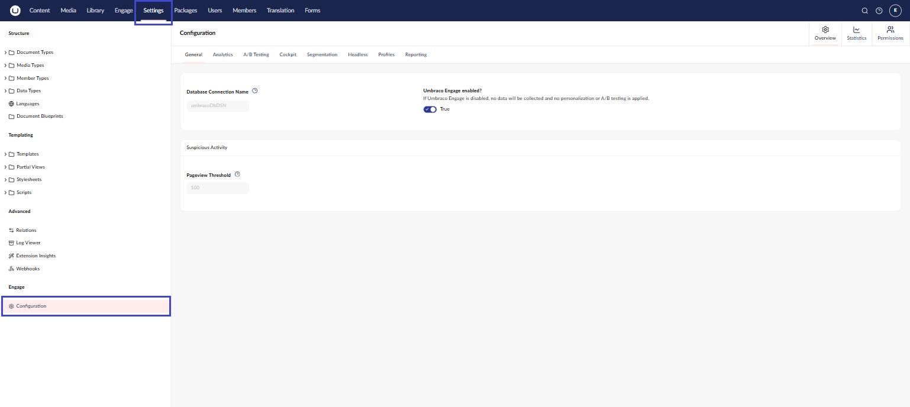

# Configuration

Most of the Umbraco Engage configuration options are stored in the configuration file. Umbraco Engage uses the standard for .NET Core applications, in which we make use of the `appsettings.json` (and environment variable support). Because of this new standard, most configuration options no longer require the application to restart to take effect. This comes with a few exceptions.

Umbraco Engage ships with an `appsettings-schema.Umbraco.Engage.json` file, allowing Visual Studio or Jetbrains Rider to auto-complete the configuration options. It comes with information about default values and a description of what each configuration option does. Do not change the `schema` files.

The default configuration will look like this:


```json
{
  "Engage": {
    "Settings": {
      "DatabaseConnectionStringName": "umbracoDbDSN",
      "Enabled": true,
      "UseLegacySegmentNames": false
    },
    "Analytics": {
      "VisitorCookie": {
        "ExpirationInDays": 365,
        "CookieName": "umbracoEngageAnalyticsVisitorId",
        "LegacyCookieName": "uMarketingSuiteAnalyticsVisitorId",
        "IncludeSubdomains": false
      },
      "DataCollection": {
        "AnonymizeIPAddress": true,
        "RequireAnalyticsPermissionForMemberTracking": false,
        "FlushRateInRecords": 100,
        "FlushIntervalInSeconds": 30,
        "InternalSiteSearch": {
          "AutomaticSearchTracking": true,
          "SearchTermParameters": "q",
          "SearchBoxParameters": "a,b,c",
          "CategoryParameters": ""
        }
      },
      "DataProcessing": {
        "IntervalInSeconds": 30,
        "SessionLengthInMinutes": 30,
        "IsProcessingServer": true,
        "ProfileBuildCommandTimeout": 5
      },
      "DataStorage": {
        "AnonymizeAnalyticsDataAfterDays": 730,
        "DeleteAnalyticsDataAfterDays": 1095,
        "DeleteControlGroupDataAfterDays": 180,
        "DeleteRawDataAfterDays": 2
      },
      "DataCleanup": {
        "Enabled": true,
        "FirstRunTime": null,
        "StartupDelay": "00:05:00",
        "Interval": "1.00:00:00",
        "CommandTimeout": 1200
      }
    },
    "ABTesting": {
      "RequiredVisitorPercentageBeforeShowingAdvice": 10,
      "MinimumPercentageMacroGoalWarning": 10
    },
    "DeliveryApi": {
      "DisableVisitorCookie": false,
      "Segmentation": {
        "ContentById": true,
        "ContentByIds": true,
        "ContentByPath": true,
        "ContentByQuery": true
      }
    },
    "Profiles": {
      "Potential": {
        "ActiveThresholdInDays": 30,
        "EngagedThresholdInSeconds": 300,
        "EngagedThresholdNumberOfSessions": 3
      },
      "Identification": {
        "Name": "{{name}}",
        "Abbreviation": "{{name[0]}}"
      }
    },
    "Reporting": {
      "DataGenerationEnabled": true,
      "DataGenerationTime": "",
      "Timezone": null,
      "QueryCommandTimeout": 120
    },
    "Cockpit": {
      "EnableInjection": true,
      "Authentication": {
        "TokenLifetimeSeconds": 60,
        "SessionLifetimeMinutes": 30,
        "RequireHttps": true,
        "CleanupIntervalMinutes": 60,
        "TokenRetentionBufferMinutes": 5,
        "SessionRetentionBufferMinutes": 1440,
        "SessionCookieSameSite": "Lax"
      }
    },
    "Segmentation": {
      "ExcludedPropertyAliases": []
    }
  }
}
```



**DataCleanup settings:**

* `Enabled`: Whether the data cleanup process runs at all.
* `FirstRunTime`: Optional crontab expression (`"0 2 * * *"` for 2 AM daily) to schedule the first cleanup run. Takes precedence over `StartupDelay` when set.
* `StartupDelay`: Time after application startup before the first cleanup run (default: 5 minutes). Used only when `FirstRunTime` is not set.
* `Interval`: Interval between cleanup runs (default: 24 hours).
* `CommandTimeout`: Database command timeout in seconds (default: 1200 = 20 minutes).



**Reporting settings:**

* `DataGenerationEnabled`: Whether the nightly generation of reporting data runs.
* `DataGenerationTime`: The time of day for the nightly generation, in the reporting time zone (for example `"03:30:00"`). The default is empty.
* `Timezone`: The time zone used for reporting, as a time zone ID known to the server (for example `Europe/Copenhagen`). When the value is not set or not found, the server time zone is used.
* `QueryCommandTimeout`: The time in seconds allowed for each analytics SQL command (default: 120). Values below 30 are raised to 30.

When `DataGenerationTime` is empty, Umbraco Engage picks a random time between 01:00 and 05:00 in the reporting time zone. The time is picked once and kept across restarts. Umbraco Engage stores the time in the `umbracoKeyValue` table under the key `Umbraco.Engage+Reporting+DataGenerationTime`. After a restart, a missed automatic run for that night still runs once, as long as the time is before 06:00.

A `DataGenerationTime` value that cannot be read logs a warning and is treated as empty.



**Timeouts and thresholds:**

* `DataProcessing:ProfileBuildCommandTimeout`: The time in seconds allowed for the SQL command that builds a visitor's personalization profile during a request (default: 5). Values below 5 are raised to 5. Available from Umbraco Engage 18.3.
* `DataCollection:RegexTimeoutInMilliseconds`: The time in milliseconds allowed for a regular expression that is evaluated during data collection (default: 100).
* `Settings:SuspiciousActivity:PageviewThreshold`: The number of pageviews from a single visitor above which the activity is listed as suspicious (default: 250). Learn more in the [Suspicious Activity](../../marketers-and-editors/settings/suspicious-activity.md) article.

`DataStorage:DeleteRawDataAfterDays` defaults to 2 days.



**RequireAnalyticsPermissionForMemberTracking:** When set to `true`, Engage attaches an Umbraco member key to a pageview only when `AnalyticsIsAllowed` returns true for the request. Requests without analytics permission are tracked as an anonymous visitor with no member key. The default is `false`.

For the full behaviour and a script for clearing member keys from existing data, see [Module Permissions](../introduction/the-umbraco-engage-cookie/module-permissions.md).


All these settings are also visualized in Umbraco Engage. This overview can be found in the **Settings** section under **Engage** -> **Configuration**.




You cannot change any of the settings in the backoffice. To use the new settings, the website must be restarted.

