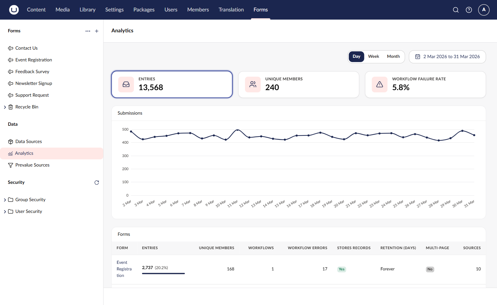
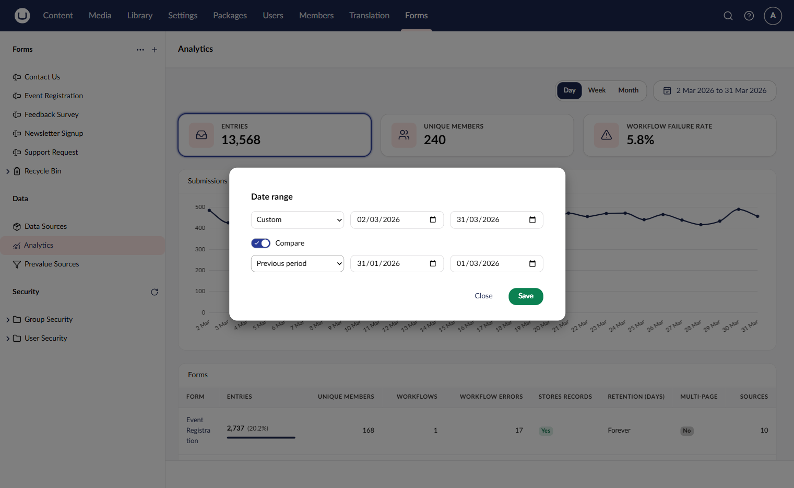
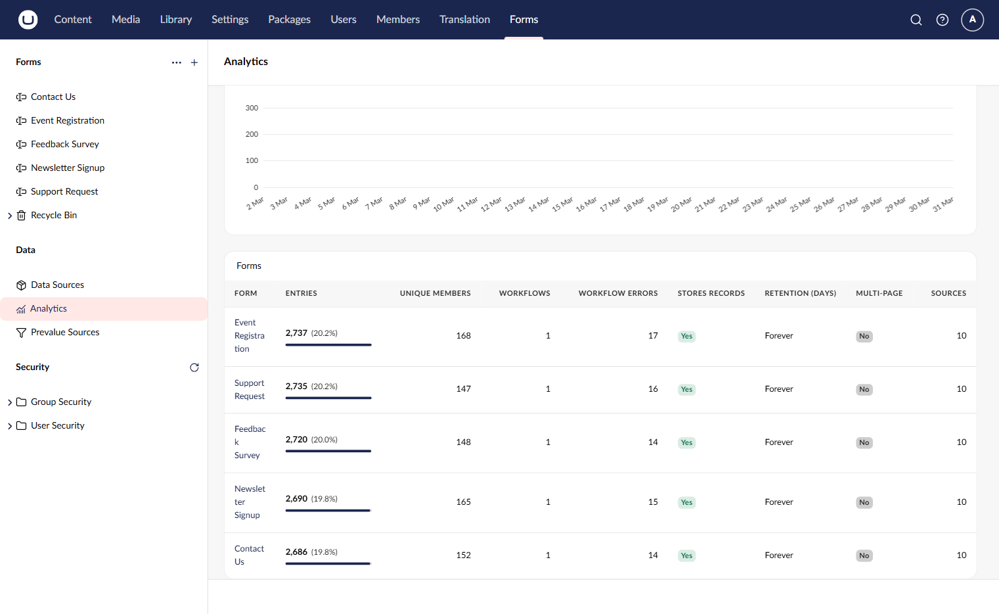
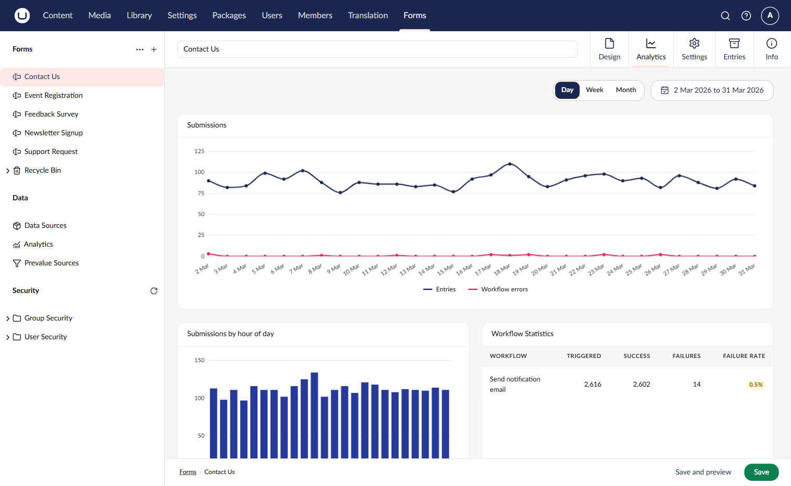
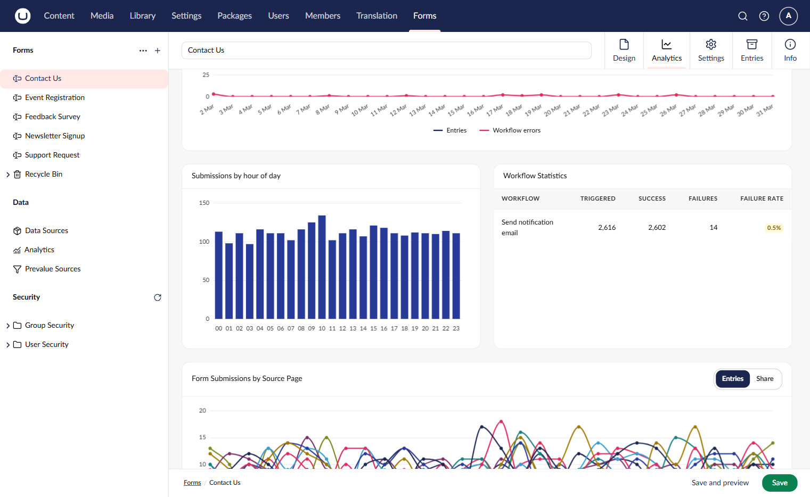
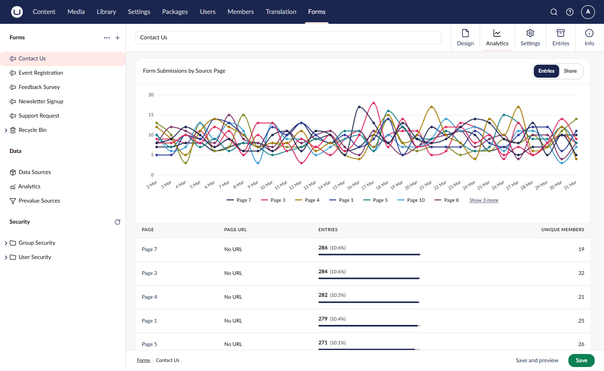
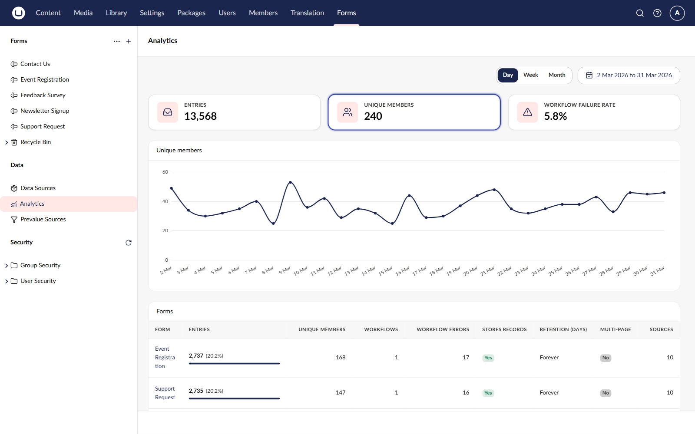

# Analytics

Umbraco Forms includes built-in analytics that provide insight into how your forms are performing. You can view submission trends over time, monitor workflow success rates, and identify which pages are driving submissions.

## Permissions

To view form analytics, you need:

* Access to the **Forms** section in the backoffice.
* The **View Entries** permission for the form.

Users only see analytics for forms they have permission to view entries for.

## Accessing Analytics

There are two ways to access form analytics in the backoffice.

### From the Forms Section Menu

In the Forms section, click **Analytics** under **Data** in the sidebar. This opens the analytics overview where you can browse data across all your forms.

### From a Specific Form

You can navigate directly to analytics for a specific form:

1. Go to the **Forms** section.
2. Right-click on a form or open its action menu.
3. Select **View Analytics**.

This opens the **Analytics** tab on the form workspace, showing analytics data for that form only.


The Analytics tab appears as a workspace view on existing forms. It is not available when creating a new form that has not yet been saved.


## Controls

The analytics views provide controls to adjust the data displayed. The backoffice remembers your choices in the browser, so they're kept the next time you open analytics.

### Date Range

Click the date range button to open the **Date range** dialog. Choose a preset, such as **Last 7 days**, **Last 30 days**, **This month**, **Last month**, or **Last year**. Or choose **Custom** and set your own start and end dates.

Turn on **Compare** to compare the selected range with another period. You can compare with the **Previous period**, the **Previous year**, or a **Custom** range. With a comparison on, the summary tiles and tables show the change against the comparison period.

A range can cover up to 1,095 days. A longer range is shortened, and the backoffice tells you that it was.

### Group By

Use the **Day**, **Week**, and **Month** buttons to change how the data is grouped in the time-series charts:

* **Day** shows a data point for each day in the selected range.
* **Week** groups data by week. Weeks start on Monday.
* **Month** groups data by month.

Days, weeks, and months follow your own time zone.

## Analytics Overview

The overview shows three summary tiles for the selected date range:

* **Entries**: the number of form submissions.
* **Unique members**: the number of distinct logged-in members who submitted. See [Unique Members](#unique-members).
* **Workflow failure rate**: the share of workflow runs that failed.

Select a tile to show its figures over time in the chart below the tiles.

### Forms Table

The **Forms** table lists all forms you have access to, with their statistics for the selected date range:

* Entries, and each form's share of all entries
* Unique members
* Workflows and workflow errors
* Whether the form stores records, and how long it keeps them
* Whether the form has more than one page
* The number of source pages

Click a column heading to sort the table. Click a form name to open the analytics for that form.

## Form Analytics

When viewing analytics for a specific form, the view displays four widgets providing different perspectives on form performance.

### Submissions

A time-series chart showing the number of form submissions and workflow errors over the selected date range.

### Submissions by Hour of Day

A chart showing the distribution of form submissions across the 24 hours of the day. This helps identify peak submission times and can inform decisions about when to schedule maintenance or review submissions.

### Workflow Statistics

A table listing each workflow attached to the form. It shows how many times each workflow was triggered, succeeded, and failed, and its failure rate. Use this to monitor the health of your form processing workflows.

If workflows have run that are no longer on the form, their runs are shown together in a **Removed workflows** row. The table then adds up to the figures on the analytics overview.

### Form Submissions by Source Page

A time-series chart showing form submissions broken down by the page where the form was submitted. This is useful when the same form is placed on multiple pages across your site, as it shows which pages are driving the most submissions.

Use the **Entries** and **Share** buttons to show either the number of entries from each page or each page's share of the entries.

Below the chart, a table lists each source page with its name, URL, entry count, and unique members. A page without a URL shows **No URL**.

## Unique Members

The **Unique members** metric counts the distinct logged-in members who submitted a form in the selected date range. It appears as a tile on the analytics overview and as a column in the **Forms** table. On a form's analytics, it appears for each source page.

A member who submits the same form more than once is counted once. Anonymous submissions are never counted. Entries from members who have since been deleted are still counted.

The metric shows `0` when there are no member submissions in the range.

## Data Processing

Analytics data is pre-aggregated by a background process that runs daily. This means the analytics views load quickly even for forms with a large number of submissions.

When forms are first installed or upgraded to a version that includes analytics, the background process will aggregate historical submission data. This may take some time depending on the volume of existing records.


The analytics data processing is enabled by default. It can be configured or disabled via the `AnalyticsProcessing` settings in `appsettings.json`. For more details, see the [Configuration](../developer/configuration/) article.

