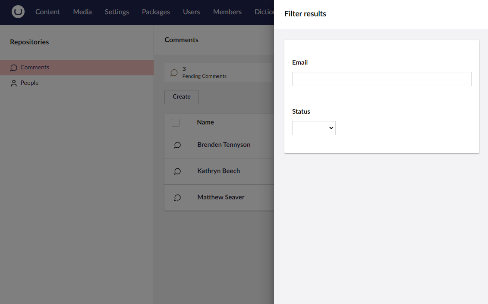

# Filterable Properties

Umbraco UI Builder dynamically constructs a filter dialog by choosing appropriate editor views based on basic property configurations. Properties of numeric or date types become range pickers, enums become select/checkbox lists, and other properties are text input filters.



## Defining Filterable Properties

Defining filterable properties is controlled via the [Collections](../collections/overview.md) settings.

### Using the `AddFilterableProperty()` Method

Adds a given property to the filterable properties collection.

#### Method Syntax

```cs
AddFilterableProperty(Lambda filterablePropertyExpression, Lambda filterConfig = null) : CollectionConfigBuilder<TEntityType>
```

#### Example

```csharp
collectionConfig.AddFilterableProperty(p => p.FirstName, filterConfig => filterConfig 
    // ...
);
```

## Changing the Label of a Filterable Property

### Using the `SetLabel()` Method

Sets the label for the filterable property.

#### Method Syntax

```cs
SetLabel(string label) : FilterablePropertyConfigBuilder<TEntityType, TValueType>
```

#### Example

```csharp
filterConfig.SetLabel("First Name");
```

## Adding a Description to a Filterable Property

### Using the `SetDescription()` Method

Sets a description for the filterable property.

#### Method Syntax

```cs
SetDescription(string description) : FilterablePropertyConfigBuilder<TEntityType, TValueType>
```

#### Example

```csharp
filterConfig.SetDescription("The first name of the person");
```

## Defining Basic Options for a Filterable Property

### Using the `SetOptions()` Method

Defines basic options for a filterable property.

#### Method Syntax

```cs
SetOptions(IDictionary<TValueType, string> options) : FilterablePropertyConfigBuilder<TEntityType, TValueType>
```

#### Example

```csharp
filterConfig.SetOptions(new Dictionary<string, string> {
    { "Option1", "Option One" },
    { "Option2", "Option Two" }
});
```

## Defining Options with Custom Compare Clauses for a Filterable Property

### Using the `AddOption()` Method

Defines options with custom comparison clauses for a filterable property.

#### Method Syntax

```cs
AddOption(object key, string label, Lambda compareExpression) : FilterablePropertyConfigBuilder<TEntityType, TValueType>
```

#### Example

```csharp
filterConfig.AddOption("Option1", "Option One", (val) => val != "Option Two");
```

## Defining Options with an Options Builder for a Filterable Property

An options builder creates the options of a filterable property at runtime. Use an options builder when the options come from a database or a service.

To define an options builder, create a class that inherits from `FilterOptionsBuilder<TValueType>`. `TValueType` is the type of the filterable property. Override `GetOptionsAsync` to return the options.

The following builder lists the teams of a `teams` collection as options for a `TeamId` property. The builder uses a `Team` model with an `int` ID and a `Name`.


```csharp
using System.Collections.Generic;
using System.Linq;
using System.Threading;
using System.Threading.Tasks;
using MyProject.Models;
using Umbraco.UIBuilder.Configuration.Builders.FilterOptions;
using Umbraco.UIBuilder.Configuration.Filters;
using Umbraco.UIBuilder.Persistence;

namespace MyProject.Filters;

public class TeamFilterOptionsBuilder : FilterOptionsBuilder<int>
{
    private readonly IRepositoryFactory _repositoryFactory;

    public TeamFilterOptionsBuilder(IRepositoryFactory repositoryFactory)
        => _repositoryFactory = repositoryFactory;

    public override async Task<IEnumerable<FilterOption<int>>> GetOptionsAsync(CancellationToken cancellationToken = default)
    {
        var result = await _repositoryFactory
            .GetRepository<Team, int>("teams")
            .GetAllAsync(orderBy: x => x.Name, cancellationToken: cancellationToken);

        if (!result.Success || result.Model is null)
        {
            return [];
        }

        return result.Model.Select(team => new FilterOption<int>(team.Id, team.Name)).ToList();
    }
}
```


Umbraco UI Builder only calls `GetOptionsAsync`. By default, `GetOptionsAsync` calls `GetOptions`, so a builder that only overrides `GetOptions` keeps working. A builder that overrides neither method throws a `NotImplementedException`.

The method signatures are:

```cs
Task<IEnumerable<FilterOption<TValueType>>> GetOptionsAsync(CancellationToken cancellationToken = default)
IEnumerable<FilterOption<TValueType>> GetOptions()
```

### Using the `SetOptionsBuilder()` Method

Sets the options builder of a filterable property. The options from the builder replace any options added with `AddOption()`.

#### Method Syntax

```cs
SetOptionsBuilder<TFilterOptionsBuilderType>() : PropertyFilterConfigBuilder<TEntityType, TValueType>
SetOptionsBuilder(Type filterOptionsBuilder) : PropertyFilterConfigBuilder<TEntityType, TValueType>
SetOptionsBuilder(FilterOptionsBuilder<TValueType> filterOptionsBuilder) : PropertyFilterConfigBuilder<TEntityType, TValueType>
```

#### Example

```csharp
collectionConfig.AddFilterableProperty(p => p.TeamId, filterConfig => filterConfig
    .SetLabel("Team")
    .SetOptionsBuilder<TeamFilterOptionsBuilder>()
);
```

## Configuring the Mode of a Filterable Property

For filterable properties with options, you can configure whether the options should allow multiple or single selections.

### Using the `SetMode()` Method

Configures the mode of a filterable property (multiple or single choice).

#### Method Syntax

```cs
SetMode(FilterMode mode) : FilterablePropertyConfigBuilder<TEntityType, TValueType>
```

#### Example

```csharp
filterConfig.SetMode(FilterMode.MultipleChoice);
```
