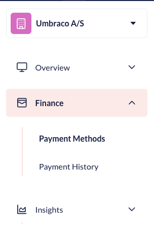
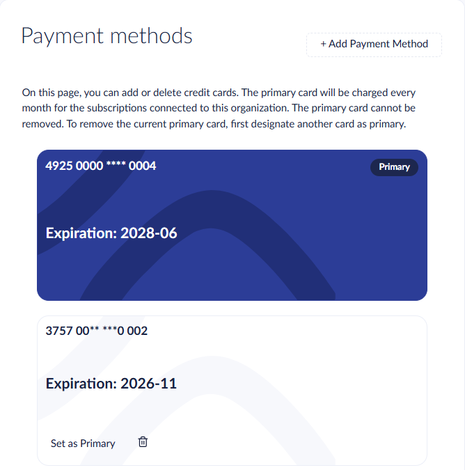
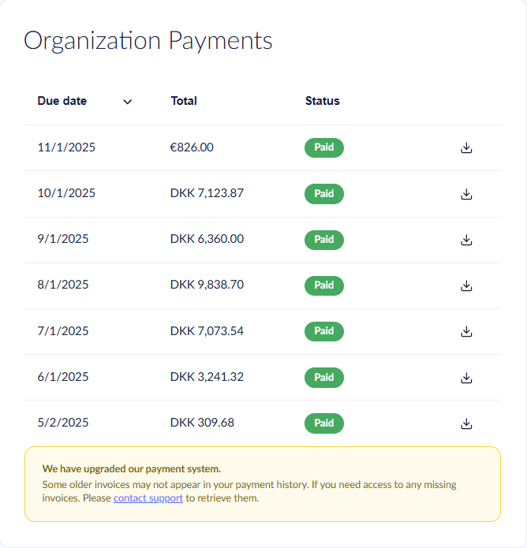
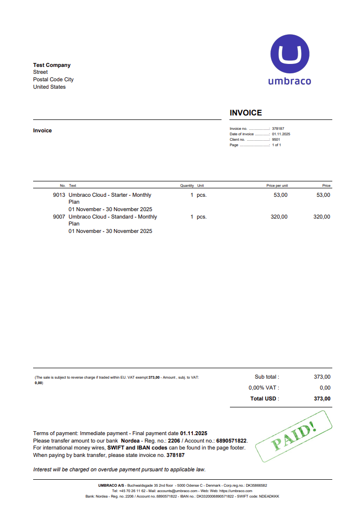

# Payments

In this article, you can find information on the following:

* How to add, change, and remove credit cards.
* What happens when a payment fails.
* How to view and download invoices.

## Open your organization

To manage payments, select the **Organization** icon in the top-right corner of the Umbraco Cloud Portal.

The payment pages are under **Finance** in the organization menu.

## Payment methods

To view your credit cards, go to **Finance** and select **Payment Methods**.

The primary card pays for all subscriptions in the organization. Umbraco Cloud charges the primary card on the 1st of each month.

You set up payment for a project after you create the project. On the **Setup payment** page, you select the organization that pays for the project. This can be a different organization than the one that owns the project. The project uses the primary card of the paying organization.

### Add a credit card

1. Select **+ Add Payment Method**.
2. Enter the card details on the payment page.

When you return to the **Payment Methods** page, a message tells you if the card was added.

### Change the primary card

To use a different card for payments, select **Set as Primary** on that card.

### Remove a credit card

To remove a card, select the trash can icon on the card.

You cannot remove the primary card. Set another card as primary first.

Cards that have expired show the **Expired** tag.

### If you cannot add a card

If the portal cannot add the card, it shows an error message. Ask your bank to allow recurring payments on the card. You can also try a different card.

## When a payment fails

If the monthly payment fails, Umbraco Cloud sends an email to the **Company Email** of your organization. You find this address on the [Information](organizations/README.md#information) page of the organization. Umbraco Cloud also sends the invoices to this address. All projects on the invoice change to the **Unpaid** status.

Umbraco Cloud tries the payment again one time each day. While a project is unpaid, the following happens:

| Days after the failed payment | What happens |
| --- | --- |
| 0 to 13 | Your website and the Umbraco backoffice keep working. In the Umbraco Cloud Portal, you can only set up payment or delete the project. |
| 14 | Umbraco Cloud disables the project. All environments stop, including the Live environment. |
| 28 | Umbraco Cloud deletes the project. |

While a project is unpaid, Umbraco Cloud sends reminder emails to the **Company Email** and to the [technical contacts](../project-features/team-members/technical-contact.md) of the project. Umbraco Cloud also sends an email when it disables or deletes the project.

### Fix a failed payment

The email and the project page in the Umbraco Cloud Portal show why the payment failed.

| Reason | What to do |
| --- | --- |
| The primary card has expired | Add a new card, or set another card as primary. |
| The organization has no primary card | Add a card. |
| The card issuer refused the payment | Contact your bank, or set another card as primary. |
| Other reasons, for example not enough funds or a card limit | Contact your bank, or set another card as primary. If the problem continues, contact Umbraco Support. |

The next daily attempt uses the new primary card within 24 hours.

When the payment succeeds, the project changes back to **Paid**. If Umbraco Cloud disabled the project, all environments start again.

## Payment and invoices


The invoices in this list are for **projects paid by credit card**.

Projects billed annually by invoice are excluded, as these invoices are handled manually and sent via email.


Umbraco Cloud sends one invoice by email each month. The invoice includes all projects that you pay for by credit card.

To view your invoices, go to **Finance** and select **Payment History**. The list shows the following for each invoice:

* The due date
* The total amount
* The payment status
* A download button, for paid invoices only


Some older invoices can be missing from the list because of an upgrade of the payment system. To get a missing invoice, contact Umbraco Support.


The downloaded invoice lists all projects that you paid for during the month.

