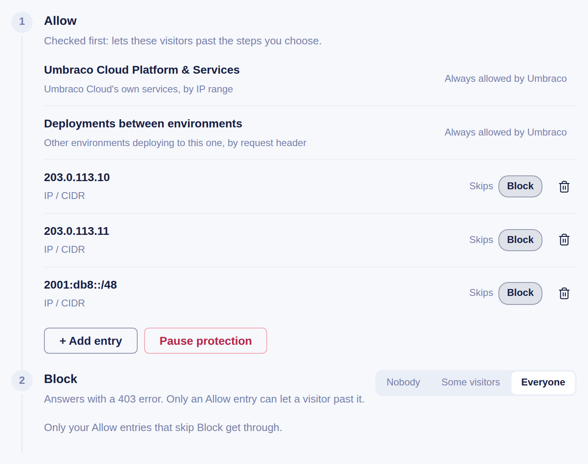
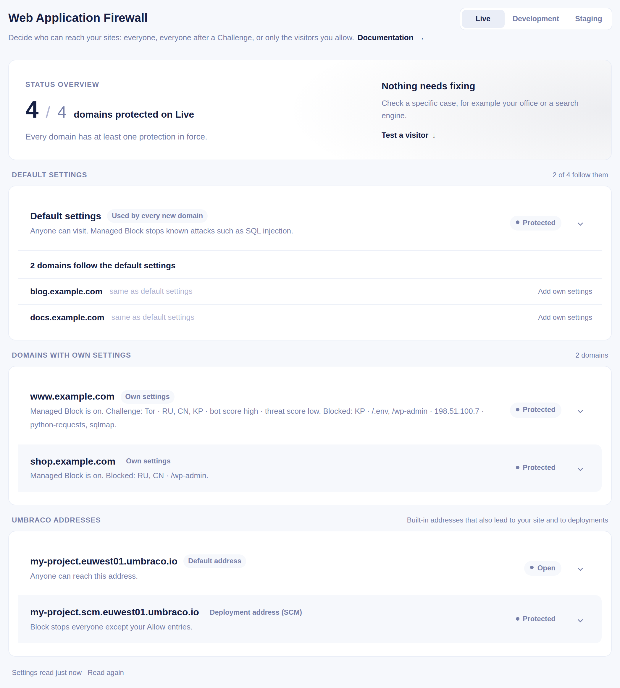
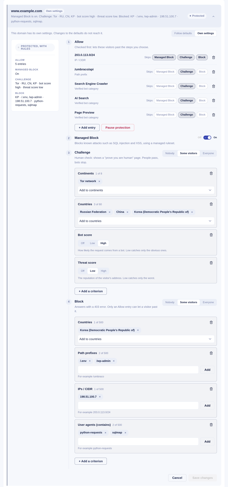
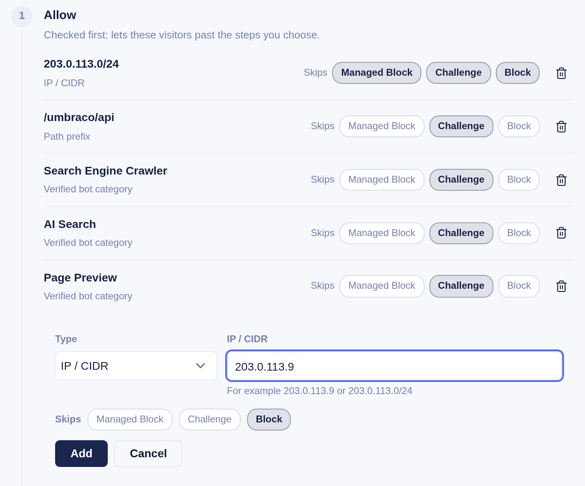
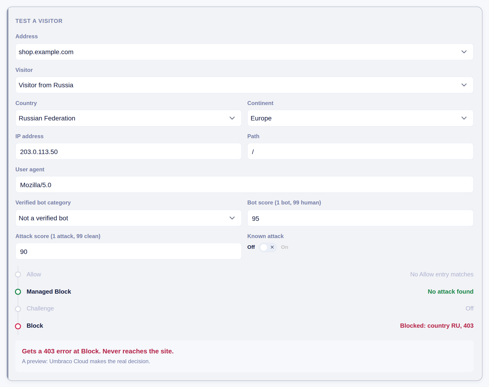
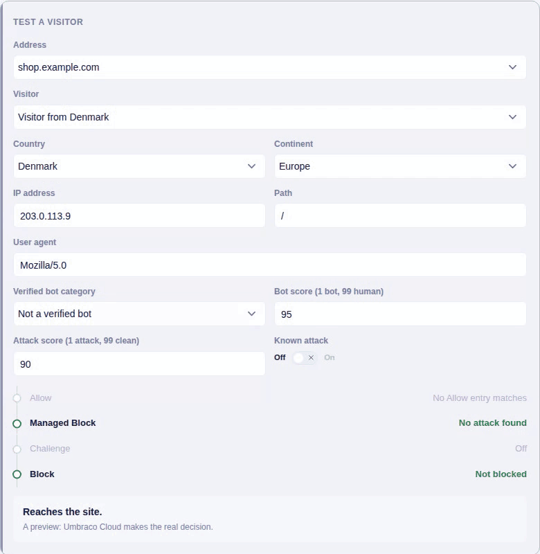
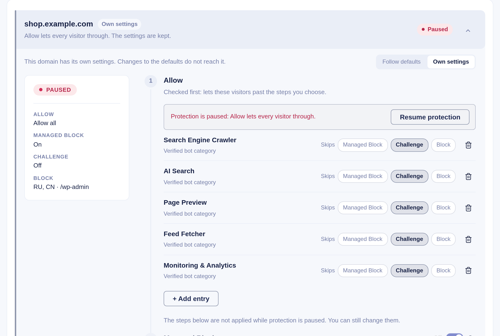

# Web Application Firewall

A Web Application Firewall (WAF) filters the HTTP traffic between the Internet and your website. Unwanted requests are stopped before they reach your site, so your site does not spend resources on them.

The Umbraco Cloud Web Application Firewall lets you decide which requests reach each of your sites:

* Every request.
* Every request that passes a Challenge.
* Only the requests you allow.

The firewall runs on Cloudflare, in front of your Umbraco Cloud environments.


To get notified when a DDoS attack against one of your hostnames is mitigated, set up a DDoS alert. See the [Alerting and Notifications](../../../optimize-and-maintain-your-site/monitor-and-troubleshoot/alerting-and-notifications/README.md#ddos) article.


## How a request is checked

Every request passes through the steps below, in this order. The request reaches your site when no step stops it.

| Step | What happens | Who decides |
| --- | --- | --- |
| **Allow** | Checked first. A matching request skips the steps you choose for that Allow entry. | You |
| **Managed Block** | Answers with a 403 error when the request looks like a known attack, such as SQL injection or cross-site scripting (XSS). | A managed ruleset from Cloudflare. You turn the step on or off. |
| **Challenge** | Answers with a "prove you are human" page. A person passes the page, a bot does not. | You |
| **Block** | Answers with a 403 error. | You |

Keep these rules in mind:

* **Allow always wins.** Only an Allow entry can let a request past a later step.
* **Challenge comes before Block.** A request that matches both gets the Challenge first. After the Challenge is passed, the request is blocked.
* **One match is enough.** A request that matches any one Allow entry, or any one criterion of a step, is handled by it. Entries and criteria cannot be combined, for example an IP address together with a path.

## Domains and Umbraco addresses

The firewall is configured for each environment and each address. The steps that are available depend on the type of address.

An environment has two built-in addresses next to your domains. The default address leads to your site. The deployment address is used for deployments and is also known as the Source Control Management (SCM) address.

| Address | Example | Allow | Managed Block | Challenge | Block |
| --- | --- | --- | --- | --- | --- |
| Domain (custom hostname) | `www.example.com` | Yes | Yes | Yes | Yes |
| Default address | `my-project.euwest01.umbraco.io` | Yes, to skip Block | No | No | Yes |
| Deployment address (SCM) | `my-project.scm.euwest01.umbraco.io` | Yes, to skip Block | No | No | Yes |

Umbraco Cloud always lets its own traffic through on these two addresses. The following entries are shown as **Always allowed by Umbraco** and cannot be removed:

* **Umbraco Cloud Platform & Services** on both addresses.
* **Internal monitoring** on the default address.
* **Deployments between environments** on the deployment address.

<figure><figcaption>
The steps of a deployment address, with the entries that are always allowed by Umbraco.
</figcaption></figure>


The deployment address also has its own IP filter. See the [Management API Security](../../../optimize-and-maintain-your-site/monitor-and-troubleshoot/management-api-security.md) article.


## Requirements

* The firewall is available on Umbraco Cloud projects. It is not available on Umbraco Heartcore projects.
* A domain must point to Umbraco Cloud with a CNAME record to `dns.umbraco.io` or with A records. Learn more in the [Managing Hostnames](../../../go-live/manage-hostnames/README.md) article.
* You need write access to the project to change the settings. Team members with read access can view them.


The firewall cannot protect a domain that reaches Umbraco Cloud through your own proxy server.


## Open the Web Application Firewall page

1. Open your project in the Umbraco Cloud Portal.
2. Go to **Security** -> **Web Application Firewall**.
3. Select the environment at the top of the page.

A number next to an environment shows how many of its domains need your attention.

The page has the following sections:

* **Status overview** - How many domains in the environment are protected. When a domain needs your attention, the overview also shows how many domains each step is switched on for.
* **Default settings** - The settings used by every new domain, and the domains that follow them.
* **Domains with own settings** - The domains that have settings of their own.
* **Umbraco addresses** - The default address and the deployment address.
* **Test a visitor** - A preview of what your settings do to a request.

<figure><figcaption>
The Web Application Firewall page for the Live environment.
</figcaption></figure>

Each domain and address shows its status:

| Status | Meaning |
| --- | --- |
| **Protected** | At least one protection is in force. |
| **Not protected** | Anyone can visit the domain and nothing is filtered, not even known attacks. |
| **Open** | Anyone can reach the default address or the deployment address. |
| **Paused** | Allow lets every request through. The settings are kept. |
| **Closed** | Block answers every request with a 403 error. Nobody can open the site. |

## Default settings and own settings

A new domain starts with the **Default settings** of its environment. You can set the defaults before you add a domain.

A domain follows the defaults until you give the domain its own settings:

1. Find the domain under **Default settings**.
2. Select **Add own settings**.
3. Change the settings for the domain.
4. Select **Save changes**.

A change to the defaults reaches every domain that follows them. The change does not reach a domain with its own settings. To make a domain follow the defaults again, open the domain and select **Follow defaults**.

Domains are added on the **Hostnames** page.

## Configure the steps

Open the **Default settings**, a domain, or an Umbraco address to see its steps. Select **Save changes** when you are done.

Saved settings are applied in the background. They usually take effect within a few minutes.

<figure><figcaption>
The four steps of a domain with own settings.
</figcaption></figure>

### Allow

Allow is the single list of exceptions. Each entry names a group of requests and the steps those requests skip.

An IP entry is a single IP address or a range. A range is written in Classless Inter-Domain Routing (CIDR) notation, for example `203.0.113.0/24`.

1. Select **+ Add entry**.
2. Choose the **Type** and fill in the value.
3. Select the steps the entry skips under **Skips**.
4. Select **Add**.

<figure><figcaption>
Adding an Allow entry for an IP address.
</figcaption></figure>

The following entry types are available:

| Type | Example | Matches |
| --- | --- | --- |
| **IP / CIDR** | `203.0.113.9` or `203.0.113.0/24` | A single IP address or a range. |
| **Path prefix** | `/umbraco/api/webhooks/` | Every path that starts with the value. The match is not case-sensitive. |
| **Verified bot category** | Search Engine Crawler | Requests from bots that Cloudflare has verified, by category. |
| **Country** | Denmark | Requests from the country. |

An entry skips only the steps you select. For example, an entry can skip Challenge while Managed Block still inspects the request.

Each entry works on its own. An entry for an IP address and an entry for the path `/umbraco` allow that IP address on every path, and every request to `/umbraco`. To limit a path to one IP address, block the path and allow the IP address. See [Common setups](web-application-firewall.md#common-setups).


Add the IP address the requests arrive from at Cloudflare. Some networks connect over IPv6, even when a lookup service shows an IPv4 address.


### Managed Block

Turn on **Managed Block** to stop requests that look like known attacks. Umbraco Cloud uses [Cloudflare's Managed Rulesets](https://developers.cloudflare.com/waf/managed-rules/). The rulesets are updated regularly to cover new vulnerabilities and attack techniques.

A legitimate request can look like an attack. Add an Allow entry that skips Managed Block for the affected path or IP address.

### Challenge

Challenge answers with a page that checks whether a person is behind the request. Choose who is challenged:

* **Nobody** - The step is off.
* **Some visitors** - Requests that match a criterion you add.
* **Everyone** - Every request, except Allow entries that skip Challenge.

For **Some visitors**, select **+ Add a criterion** and choose from the following:

| Criterion | Matches |
| --- | --- |
| **Continents** | Requests from the selected continents. Tor is listed as a continent. |
| **Countries** | Requests from the selected countries. |
| **Path prefixes** | Paths that start with the value, for example `/umbraco`. |
| **Verified bot categories** | Requests from verified bots in the selected categories. |
| **Bot score** | How likely the request comes from a bot. **Low** catches definite bots. **High** also catches likely bots. Verified bots are not affected. |
| **Threat score** | How likely the request is an attack. **Low** catches likely attacks. **High** also catches possible attacks. |


Verified bots, such as search engine crawlers, cannot pass a Challenge. Add an Allow entry for the **Search Engine Crawler** category that skips Challenge before you challenge everyone.


### Block

Block answers with a 403 error. Choose who is blocked:

* **Nobody** - The step is off.
* **Some visitors** - Requests that match a criterion you add.
* **Everyone** - Every request, except Allow entries that skip Block.

Block has the same criteria as Challenge, except Threat score. Block adds two criteria:

| Criterion | Matches |
| --- | --- |
| **IPs / CIDR** | A single IP address or a range, for example `203.0.113.0/24`. |
| **User agents (contains)** | Requests whose user agent contains the value, for example `python-requests`. The match is not case-sensitive. |


Blocking **Everyone** without an Allow entry that skips Block closes the site. Nobody can open the site, including you.


A verified bot category is either allowed or stopped. The same category cannot be both in an Allow entry and in Challenge or Block.

## Test a visitor

Use **Test a visitor** to check a specific request, for example one from your office or from a search engine.

1. Choose the **Address** to test.
2. Choose a sample **Visitor**, or fill in the country, IP address, path, user agent, and scores.
3. Read the result for each step.

<figure><figcaption>
A sample visitor that is stopped by the Block step.
</figcaption></figure>

The result shows the step that stops the request, or that the request reaches the site.

<figure><figcaption>
The result changes with the sample visitor.
</figcaption></figure>


The result is a preview. Umbraco Cloud makes the real decision when a request arrives.


## Pause protection

Pausing lets every request through on one domain or address, while your settings are kept. Use it to find out whether the firewall causes a problem.

1. Open the domain or address.
2. Select **Pause protection** in the Allow step and confirm.
3. Select **Save changes**.

The other steps are not applied while protection is paused. Select **Resume protection** and save to apply them again.

<figure><figcaption>
A domain with protection paused.
</figcaption></figure>

## Common setups

The examples below show how the steps combine.

| Goal | Settings |
| --- | --- |
| Only your office can reach the site | **Block**: Everyone. **Allow**: your office IP address, skipping Block. |
| Only your office can reach the backoffice | **Block**: Path prefix `/umbraco`. **Allow**: your office IP address, skipping Block. |
| Challenge every request from outside Denmark | **Challenge**: Everyone. **Allow**: Country Denmark, skipping Challenge. |
| Keep search engines out of the Challenge | **Allow**: Verified bot category Search Engine Crawler, skipping Challenge. |
| Stop AI crawlers | **Block**: Verified bot category AI Crawler. |
| Let a webhook through without a Challenge | **Allow**: Path prefix of the webhook, skipping Challenge. |
| Stop a scraper | **Block**: its IP address, or part of its user agent. |

## Limits

Some lists have a fixed size. The page shows how many entries a list holds, for example **3 of 60**.

| List | Limit |
| --- | --- |
| Challenge: Countries | 60 |
| Challenge: Continents | 8 |
| Challenge: Path prefixes | 10 |
| Block: each list | 500 |
| Allow entries that skip only Block | 500 for each type |
| Allow entries that skip Managed Block or Challenge: Countries | 60 for each skipped step |
| Allow entries that skip Managed Block or Challenge: Path prefixes | 10 for each skipped step |
| Allow entries that skip Managed Block or Challenge: IP addresses | See below |

IP entries that skip Managed Block or Challenge on a domain are stored in blocks of fixed sizes. For each skipped step, a domain holds the following:

* 20 single IPv4 addresses.
* 5 IPv4 ranges of size `/28`.
* 10 IPv4 ranges of size `/24`.
* 10 IPv6 ranges of size `/64`.

A wider range is divided into these blocks. A range that does not fit is rejected when you save, and the message names the entry.

## Recognize a stopped request

The response shows which step stopped a request. This helps when someone reports that the site cannot be reached.

| Step | Response |
| --- | --- |
| **Block** | Status 403 with the response header `uc-firewall: block`. |
| **Challenge** | The Challenge page, with the response header `cf-mitigated: challenge`. |
| **Managed Block** | Status 403 with the Cloudflare block page. |

A 403 response without these signs comes from your site or from another setting.

## WAF settings under Transport Security

The earlier WAF settings are found under **Security** -> **Transport Security**: Web Application Firewall, WAF sensitivity, and Managed Challenge. The Web Application Firewall setting there has been on by default since November 2024.

These settings keep working next to the Web Application Firewall page. A request is checked against both.

Learn more in the [Managing Transport Security](managing-transport-security.md) article.
