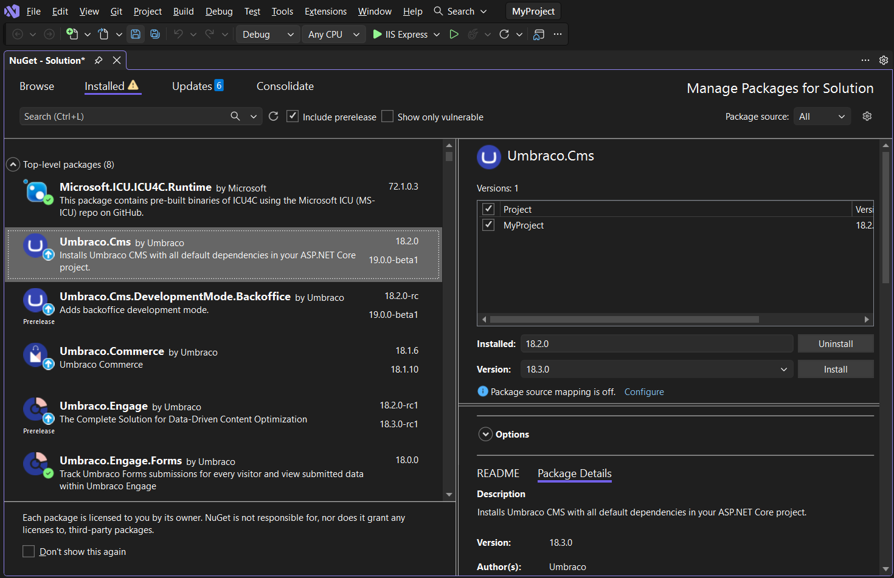

# Manual upgrade of Umbraco CMS

Projects on Cloud are either upgraded automatically with new patch and minor releases, or upgraded through the **Upgrade available** banner in the Cloud Portal. See the [Upgrade from the Cloud Portal](../minor-upgrades.md#upgrade-from-the-cloud-portal) section for details.

In rare cases, your project might not be on the latest patch or minor and you will need to upgrade the project manually.

Follow the steps below to upgrade your Umbraco Cloud project manually.

## Prepare for the upgrade

1. [Clone the left-most mainline environment to your local machine](../../../../build-and-customize-your-solution/handle-deployments-and-environments/working-locally/), or pull the latest changes.
2. Restore content and media, and make sure the project runs locally.
3. Check the [product dependencies](../product-dependencies.md) for the version you are upgrading to.
4. Make sure [unattended upgrades](https://docs.umbraco.com/umbraco-cms/fundamentals/setup/upgrading/upgrade-unattended) are enabled and deployed to all environments. Without the setting, the database upgrade is not run automatically.

## Get the latest version of Umbraco


For legacy Umbraco versions (7 or 8), follow the steps in the **Manual upgrades for legacy Umbraco** section below.


To get the latest version of Umbraco, follow these steps:

1. In the `/src/UmbracoProject/` folder, run `dotnet add package Umbraco.Cms`. To install a specific version, add `--version <VERSION>`.
2. Run `dotnet list package` and confirm that `Umbraco.Cms` shows the new version.

Alternatively, update Umbraco via the NuGet Package Manager in Visual Studio:



<details>

<summary>Manual upgrades for legacy Umbraco</summary>

**Get the latest version of Umbraco**

* [Download the relevant version of Umbraco CMS from Our](https://our.umbraco.com/download/)
* Unzip the folder to your computer
* Copy the following folders from the unzipped folder to your Cloud project folder:
  * `/bin`
  * `/Umbraco`

**Merge configuration files**

In this step, you need to merge the configuration files containing changes. For this, it is recommended to use a tool like [WinMerge](http://winmerge.org/) or [DiffMerge](https://sourcegear.com/diffmerge/).

Avoid overwriting these files, as it will overwrite any **custom configuration** and **Umbraco Cloud-specific settings**. Read more about which Cloud-specific details you should watch out for in the following sections.

**`Web.config`**

When merging the `web.config` file make sure that you **do not overwrite/remove** the following settings:

**`<configSettings>`**

```xml
<sectionGroup name="umbraco.deploy">
    <section name="environments" type="Umbraco.Deploy.Configuration.DeployEnvironmentsSection, Umbraco.Deploy" requirePermission="false" />
    <section name="settings" type="Umbraco.Deploy.Configuration.DeploySettingsSection, Umbraco.Deploy" requirePermission="false" />
</sectionGroup>
```

**`<appSettings>`**

```xml
<add key="umbracoConfigurationStatus" value="7.8.1" />
---
<add key="UmbracoLicensesDirectory" value="~/App_Plugins/UmbracoLicenses/" />
<add key="umbracoVersionCheckPeriod" value="0" />
<add key="umbracoDisableElectionForSingleServer" value="true" />
<add key="Umbraco.Deploy.ApiKey" value="9BEA9EAA7333131EB93B6DB7EF5D79709985F3FB" />
```

**`<connectionString>`**

```xml
<connectionStrings>
    <remove name="umbracoDbDSN" />
    <add name="umbracoDbDSN" connectionString="Data Source=|DataDirectory|\Umbraco.sdf;Flush Interval=1;" providerName="System.Data.SqlServerCe.4.0" />
    <!-- Important: If you're upgrading Umbraco, do not clear the connection string/provider name during your web.config merge. -->
</connectionStrings>
```

**`<umbraco.deploy>`**

```xml
<umbraco.deploy>
    <environments configSource="config\UmbracoDeploy.config" />
    <settings configSource="config\UmbracoDeploy.Settings.config" />
</umbraco.deploy>
```

**`Dashboard.config`**

This section only applies to Umbraco 7 projects.

When merging the `Dashboard.config` file make sure that you **do not overwrite/remove** the following settings:

**Deploy**

```xml
<section alias="Deploy">
    <areas>
    <area>content</area>
    </areas>
    <tab caption="Your workspace">
    <control>/App_Plugins/Deploy/views/dashboards/dashboard.html</control>
    </tab>
</section>
```

**`StartupFormsDashboardSection`**

```xml
<section alias="StartupFormsDashboardSection">
    <areas>
    <area>forms</area>
    </areas>
    <tab caption="Dashboard">
    <control>/App_Plugins/umbracoforms/backoffice/dashboards/licensing.html</control>
    <control>/App_Plugins/umbracoforms/backoffice/dashboards/yourforms.html</control>
    <control>/App_Plugins/umbracoforms/backoffice/dashboards/activity.html</control>
    </tab>
</section>
```

**Do not merge** the following section from the new version of Umbraco:

```xml
<section alias="StartupDashboardSection">
    <access>
    <deny>translator</deny>
    </access>
    <areas>
    <area>content</area>
    </areas>
    <tab caption="Get Started">
    <access>
        <grant>admin</grant>
    </access>

    <control showOnce="true" addPanel="true" panelCaption="">
        views/dashboard/default/startupdashboardintro.html
    </control>

    </tab>
</section>
```

**Other config files**

The following config files contain differences, and in most cases, you need to keep the ones from your Cloud project:

* `/Splashes/noNodes.aspx`
* `trees.config`
* `umbracoSettings.config`

This concludes the steps specific to the legacy Umbraco versions. To continue, follow the steps below.

</details>

## Run the upgrade locally

After updating the NuGet packages, follow these steps to complete the upgrade. Make sure everything is functioning correctly before pushing the changes to your Umbraco Cloud project.

1. Run the project locally.
2. Log in to the backoffice.
3. Select the Umbraco logo and confirm the version number.
4. Check that the site runs without errors.


If the URL shows `/umbraco/authorizeupgrade?redir=`, unattended upgrades are not enabled. See the [Prepare for the upgrade](#prepare-for-the-upgrade) section.


## Push upgrade to Cloud

If you also upgraded Umbraco Forms or Umbraco Deploy, include those changes in the same commit.

1. Stage and commit all changes in Git.
2. Push the changes to the left-most mainline environment. For more information, see the [Deploying Changes](../../../../build-and-customize-your-solution/handle-deployments-and-environments/deployment/local-to-cloud.md) article.
3. Log in to the backoffice of that environment and confirm the version number.
4. Check that the environment runs without errors.
5. Deploy the upgrade to the next environment from the Cloud Portal. For more information, see the [Deploying between environments](../../../../build-and-customize-your-solution/handle-deployments-and-environments/deployment/cloud-to-cloud.md) article.
6. Repeat steps 3–5 for each environment until the upgrade reaches Live.
