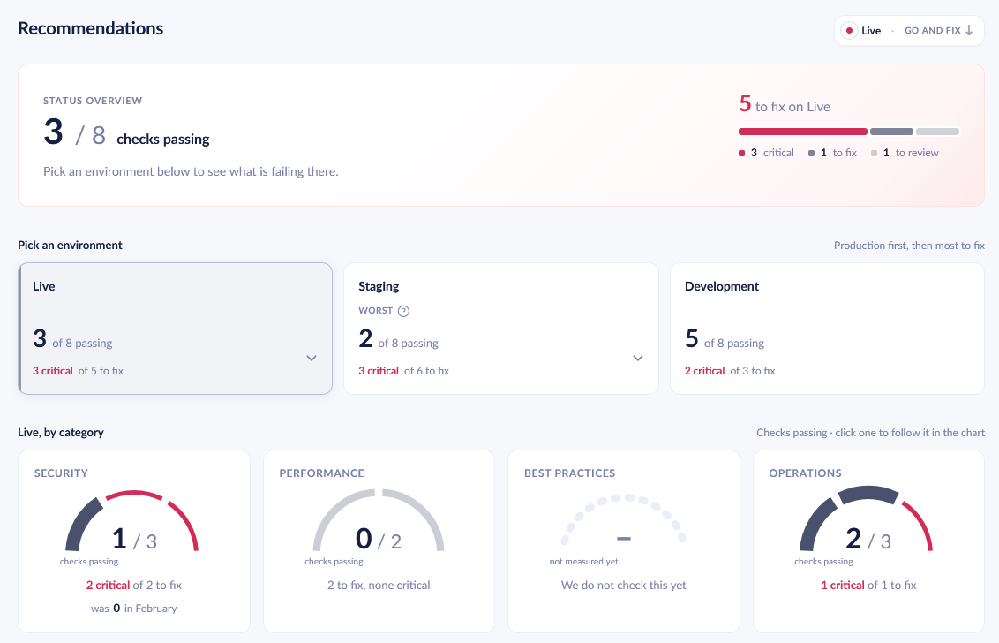
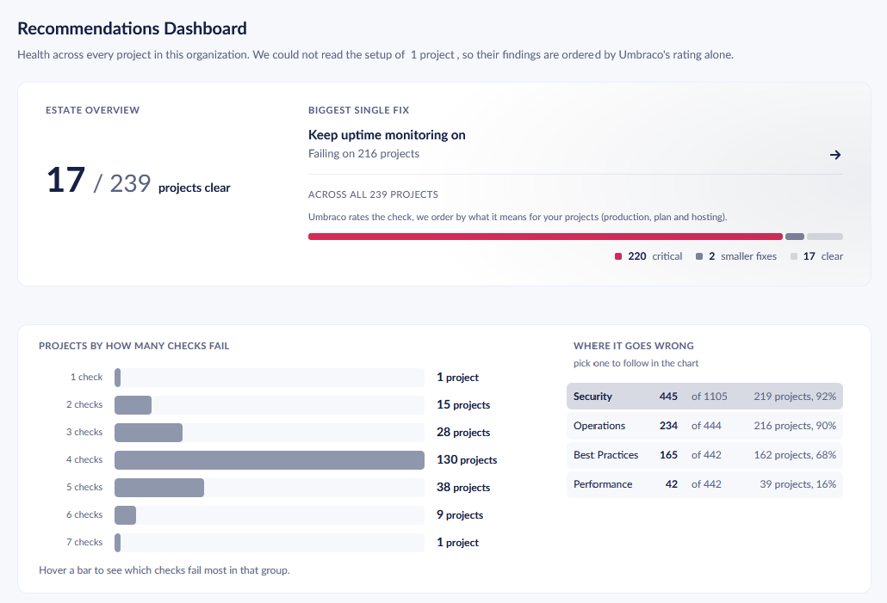
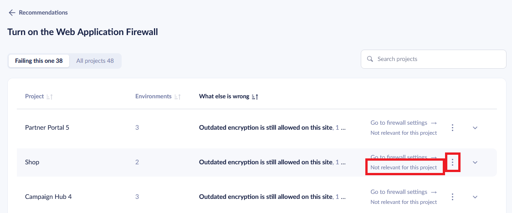
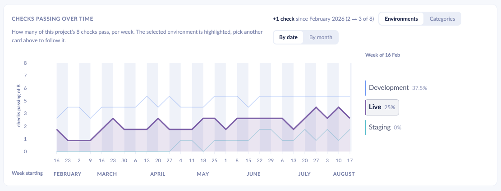

# Recommendations

Recommendations are automated checks of your project's setup against Umbraco Cloud best practices. They have been designed by the teams that make Umbraco Cloud and are intended to guide you on what to change and how.

Recommendations are enabled and collected automatically for your projects. Heartcore projects do not have recommendations.

## Find recommendations

### For a project

1. Go to your project in the [Umbraco Cloud Portal](https://www.s1.umbraco.io).
2. Navigate to **Insights** → **Recommendations**.


Only project admins and organization admins can see recommendations for a project.


<figure>
    
    <figcaption>
Project recommendations UI
</figcaption>
</figure>

This page shows recommendations for the project and its environments. Select each environment to access the overview of recommendations as well as the trend. The trend shows how many recommendations have passed in that environment over time.

### For an organization

1. Go to your organization in the [Umbraco Cloud Portal](https://www.s1.umbraco.io).
2. Navigate to **Overview** → **Recommendations**.


Only organization admins can see recommendations for an organization.


<figure>
    
    <figcaption>
Organization recommendations UI
</figcaption>
</figure>

This page shows recommendations for all projects in the organization, aggregated in different ways to draw your attention to the most important areas. From here you can access the project recommendations page too.

## Snooze and suppress recommendations

You might deem that some recommendations are not relevant for an environment, project, or organization. Depending on whether this is a temporary or permanent situation, you can snooze or suppress the recommendation through the UI. Snoozed and suppressed recommendations don't count towards the [recommendation score](#recommendation-score).


Recommendations that you snooze or suppress don't change your score immediately. Your score updates automatically [the next time the system collects recommendations](#when-recommendations-are-updated).


To snooze a recommendation:

1. Navigate through the UI to the specific recommendation you want to snooze.
2. Select the three-dot menu.
3. Choose **Snooze for 30 days**.

You can then select **Activate again** if you want to bring it back before the 30 days are over.

To suppress a recommendation:

1. Navigate through the UI to the specific recommendation you want to suppress.
2. Choose **Not relevant** or **Not relevant for this project**.
3. Provide a reason.
4. Select **Mark not relevant**.

<figure>
    
    <figcaption>
Snoozing and suppressing recommendations through the UI
</figcaption>
</figure>

## Recommendation score

The recommendation score refers to the number of checks that pass in a project (and its environments) and in an organization. Besides the count of checks that pass, you can also examine the pass trend for each environment on the project recommendations page:

<figure>
    
    <figcaption>
Environment recommendation pass trend over time
</figcaption>
</figure>

When a recommendation is snoozed or suppressed, it doesn't count towards the score.

## When recommendations are updated

Recommendations are collected automatically for your project, but changes might take some time to be reflected. Here are the rules that define when recommendations are collected, and therefore when the score is recalculated:

- When you create a project, recommendations are collected for it starting at 00:00 UTC the next day.
- Whenever Umbraco publishes a new recommendation, recommendations are collected for all projects in Umbraco Cloud starting at 00:00 UTC the next day.
- Whenever you take an action that can change the value of a recommendation, the affected recommendations are scanned asynchronously. Such actions include enabling a feature, changing configuration, or deploying your project. The recommendation score might be updated within the next 15 minutes.

Recommendations are not collected when you snooze or suppress one.

## How recommendations are organized

Here are the different ways recommendations are organized.

### Categories

This describes what the recommendation is related to.

- Security
- Performance
- Best practices
- Operations

### Scope

This describes where the recommendation applies: either an environment, a project, or an organization.

- Environment
- Project
- Organization

### Severity

This describes how important it is to take action on the specific recommendation.

- Critical
- To fix
- To review
- Passing

Severity of recommendations is evaluated on a case-by-case basis, looking at different factors. What factors affect severity depends on each individual recommendation. See [the catalog](#recommendation-catalog) below for more information.

## Recommendation catalog

Umbraco Cloud checks your projects against the following recommendations.

### S1: WAF Enabled

- Category: Security
- Scope: Environment
- Severity: Depends on the environment and on how many custom domains have the managed rules switched off. It is highest when the rules are off on every custom domain of the Live environment. It is lowest when the environment has no custom domains or is not the Live environment.

Cloudflare's managed WAF rules should be enabled for the environment's custom domains.

A web application firewall inspects incoming traffic. It blocks common attack patterns, such as SQL injection and cross-site scripting, before they reach the site. Cloudflare's managed rules are maintained by Cloudflare and updated as new threats appear, and they are included with the environment at no extra cost. They are off by default. You can switch them on from the portal at any time, for the whole environment or for a single domain. This check reports each active custom domain where the managed rules are off. This includes domains that inherit the setting from the environment default.

### S2: TLS No Legacy Ciphers

- Category: Security
- Scope: Environment
- Severity: Depends on the environment and on how many custom domains allow legacy cipher suites. It is highest when every custom domain of the Live environment allows them. It is lowest when the environment has no custom domains or is not the Live environment.

Custom domains should not allow legacy TLS cipher suites.

A cipher suite is the set of encryption methods a browser and the site agree on before any traffic is exchanged. The older ones are still accepted by many sites out of habit, and security audits flag them. Switching them off is free and can be done from the portal at any time. Be aware of one trade-off: visitors on older devices and browsers may no longer reach the site. This check reports each active custom domain that still allows a legacy cipher suite. A domain with no cipher list of its own is included, because Cloudflare then applies its own default set, and that set allows legacy encryption. A domain that requires TLS 1.3 is reported as fine whatever its cipher list says, because the legacy suites cannot be used at that version.

### S3: Custom Hostname Configured

- Category: Security
- Scope: Environment
- Severity: Depends on the environment and on whether a custom hostname is registered. It is highest on the Live environment when no custom hostname is registered. It is lowest on any environment other than Live.

Environments should serve traffic on a custom hostname.

A custom hostname is what enables the Web Application Firewall, TLS configuration and edge caching for an environment. The default Umbraco Cloud hostname supports none of them, so an environment without a custom hostname cannot be protected or tuned at the edge. This check reports whether a custom hostname is registered and whether it has become active.

### S4: Runtime Mode Production

- Category: Security
- Scope: Environment
- Severity: The same for every environment.

Live sites should run in the Production runtime mode.

Umbraco's runtime mode decides how the site behaves at run time. In a development mode the site rebuilds its content models while visitors are on it, runs slower, and keeps developer features switched on. Production mode turns those off and requires Models Builder to be set to Nothing, HTTPS to be enabled, and a valid application URL. This check reports the mode the live site is configured for. It reads the configuration from disk instead of checking the running site. It reports how the site is set up, not whether the site is healthy.

### S5: SQL Firewall Restricted

- Category: Security
- Scope: Environment
- Severity: The same for every environment.

SQL firewall should not allow traffic from any IP address.

Each environment's SQL database has firewall rules that restrict which IP addresses may connect. A rule allowing the full IPv4 range (0.0.0.0 to 255.255.255.255) exposes the database to the entire internet. This check flags any such wide-open rule so it can be removed and replaced with narrower allowances.

### P1: CDN Caching Enabled

- Category: Performance
- Scope: Environment
- Severity: Depends on the environment. It is lower when the environment has no custom domains or is not the Live environment.

Cloudflare edge caching should be enabled for the environment's custom domains.

With edge caching on, Cloudflare serves cached responses from the location closest to the visitor instead of asking the site for every request. Pages load faster, and the site itself handles less traffic, which leaves more headroom during campaigns and traffic spikes. Caching is part of the plan at no extra cost. This check reports each active custom domain where caching is currently switched off, either on the domain itself or through the environment default it inherits.

### P2: CDN Caching TTL

- Category: Performance
- Scope: Environment
- Severity: Depends on the environment and on the shortest edge cache time to live (TTL) among the custom hostnames. It is highest when any hostname has a TTL under 1 hour. It is lowest outside the Live environment, when no hostname is cached, or when every TTL is between 1 and 30 days.

Edge cache TTL should be 30 days or more on every custom hostname.

Cloudflare holds a cached response at the edge for the length of the edge cache TTL. A short TTL sends visitors back to the origin far more often than necessary, which costs response time and load on the environment. Umbraco Cloud purges the cache on publish and on deployment, so a long TTL does not delay content updates. This check reports the TTL in force on each active custom hostname. It uses the hostname's own setting, or the environment default if none is set. It flags any hostname below the recommended 30 days. Hostnames with caching switched off are reported by the [CDN Caching Enabled](#p1-cdn-caching-enabled) recommendation instead.

### B5: Umbraco.Cloud.Cms package installed

- Category: Best practices
- Scope: Environment
- Severity: The same for every environment.

Umbraco 13+ environments should have the Umbraco.Cloud.Cms package installed.

The Umbraco.Cloud.Cms package wires an Umbraco site into the Umbraco Cloud platform: it configures the Cloud-specific settings and integrations the platform relies on. From Umbraco 13 onwards it is a required part of a Cloud project. This check verifies that the package is present among the components collected from the environment.

### B6: Models Builder Disabled On Live

- Category: Best practices
- Scope: Environment
- Severity: The same for every environment.

Live sites should not generate content models while running.

Models Builder generates the code models for a site's content types. While building a site it is convenient to have Umbraco regenerate them as content types change, but on a live site that work belongs before deployment: the models should be fixed in the deployed code and Models Builder set to Nothing. Umbraco's Production runtime mode requires this, and a site configured for Production with any other Models Builder mode will not start. This check reports the mode the live site is configured for. It reads the configuration from disk rather than asking the site whether it started, so it can point at the cause of a site that is refusing to boot.

### X1: Uptime Monitoring Active

- Category: Operations
- Scope: Project
- Severity: The same for every project.
- More information: [Hostname Monitoring](hostname-monitoring.md)

At least one enabled uptime monitor should watch the project's hostnames.

An uptime monitor periodically requests one of your hostnames from several locations and records whether it answered with the expected status code within the expected time. Without an enabled monitor, an outage on your site goes unnoticed until a visitor reports it. This check reports whether the project has at least one enabled uptime monitor.

### X2: Non default alerts created

- Category: Operations
- Scope: Project
- Severity: The same for every project.
- More information: [Alerting and Notifications](alerting-and-notifications/README.md)

At least one alert rule should be enabled for the project.

Alert rules notify you by email or webhook when something happens to your project, such as a DDoS attack on a custom hostname, a failed deployment or an App Service auto-heal recycle. Without an enabled rule these events are only visible in the portal. This check reports whether at least one enabled rule, scoped to the project or to its organization, covers the project.
