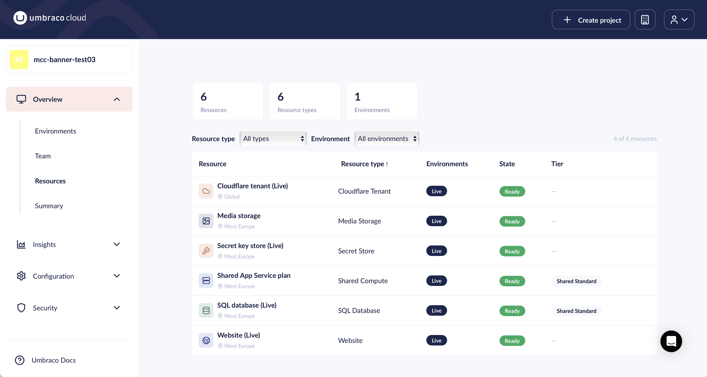

# October 2026

## Key Takeaways

* **Sweden Region Available** - Umbraco Cloud now has a Sweden region.
* **Automatic NuGet cache cleanup** - Superseded NuGet packages are removed from your environments after each deployment, so long-lived projects no longer fill their disk with old package versions.
* **Leftover `global.json` no longer breaks deployments** - The temporary `global.json` file written during a Git deployment is now removed when a build fails or the deployment is interrupted.
* **Updated Usage overview** - Monitor bandwidth forecasts and history, plan extensions, and additional metrics such as database size, disk usage, and content nodes.
* **Hosting resources overview** - A new **Resources** page lists every hosting resource in your project, with its environment, region, state, and tier.
* **Signed-in account shown in the user menu** - The user menu in the Cloud Portal now shows which account you are signed in with.

## Sweden Region Available

Umbraco Cloud now has a Sweden region, allowing you to host your projects in Sweden.

This is particularly beneficial for organizations with data residency requirements or those looking to enhance performance for users in the Nordics.

## Automatic NuGet cache cleanup

Every deployment and upgrade restores NuGet packages into the NuGet cache on your environment. Older package versions were never removed from the cache. On long-lived projects, the cache could grow to several gigabytes and use up the disk space of the environment.

Umbraco Cloud now cleans up the NuGet cache 15 minutes after each completed deployment. The cleanup works as follows:

* **Package versions your site uses are kept.** These are read from the `*.deps.json` files of the deployed site.
* **The newest version of build-only packages is kept.** These are packages used during the build, such as analyzers and SDK packs.
* **All other versions are removed.**

## Leftover `global.json` no longer breaks deployments

During a Git deployment, Umbraco Cloud writes a temporary `global.json` file to the repository in the environment. The file selects a .NET SDK that can build your project and is removed again after a successful build.

When a build failed, or the deployment was interrupted, the file was left behind. The leftover `global.json` could then cause the next deployment to fail.

The temporary `global.json` file is now removed in both cases:

* **Failed builds** - The repository on the environment is cleaned up when the build fails, the same way as after a successful build.
* **Interrupted deployments** - Umbraco Cloud checks the repository once the deployment has finished and removes a leftover `global.json` file.

## Updated Usage overview

The **Usage** page in the Cloud Portal has been updated to help you monitor resource usage and understand your plan limits.

The updated page includes:

* **Bandwidth forecasts** - See estimated bandwidth usage by the end of the month and when you may reach your limit.
* **Expanded bandwidth history** - Switch between 31 days of daily usage and up to 12 months of monthly totals.
* **Additional metrics** - View database size, disk usage, and content node history, alongside the latest Git repository size.
* **Plan extensions** - Bandwidth and media storage limits include active extensions. Expand **+X GB bought** to see active and scheduled extensions.

See the [Usage documentation](../../optimize-and-maintain-your-site/monitor-and-troubleshoot/usage/README.md) for the full overview.

## Hosting resources overview

An Umbraco Cloud project is more than its environments. Each project is made up of hosting resources, such as a website, a SQL database, a compute plan, and media storage.

The new **Resources** page in the Cloud Portal lists every hosting resource your project contains. Find the page under **Overview** > **Resources**.

<figure><figcaption>
The Resources page lists every hosting resource in the project.
</figcaption></figure>

For each resource, the page shows:

* **Resource type** - Website, SQL Database, Shared Compute, Media Storage, Redis Cache, Secret Store, or Cloudflare Tenant.
* **Environment** - The environment the resource belongs to.
* **Region** - Where the resource runs, for example West Europe or Global.
* **State** - The current state of the resource, for example Ready or Provisioning.
* **Tier** - The plan or tier of the resource, where relevant. For example, Shared Standard.

You can filter the list by resource type and by environment.

## Signed-in account shown in the user menu

The user menu in the top bar of the Cloud Portal now starts with a **Signed in as** block. The block shows the name and email of the account you are signed in with.

If you have more than one Umbraco Cloud account, you can see which one you are using without opening your profile.
