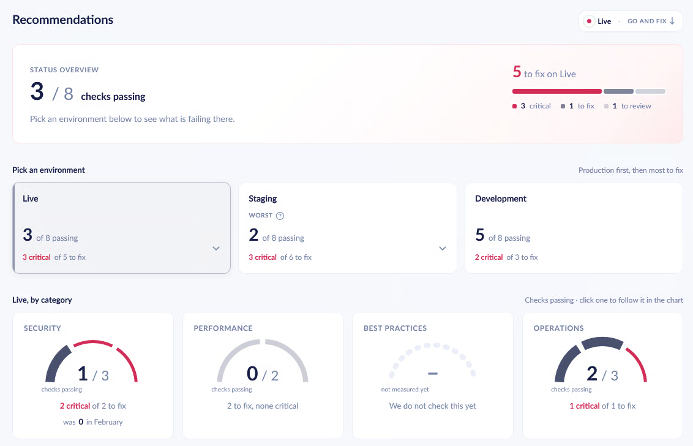
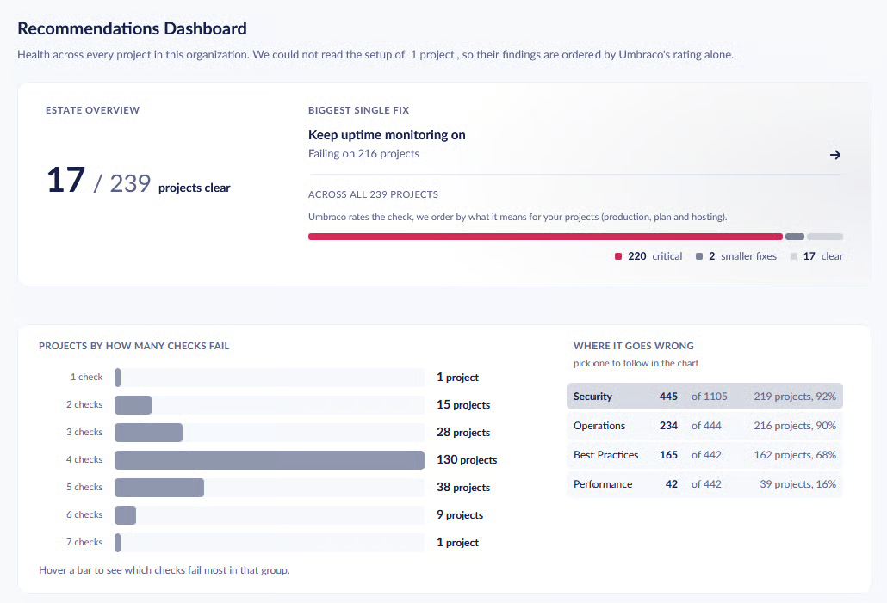

# November 2026

## Key Takeaways

* **Recommendations** - See how each project and environment measures up against Umbraco Cloud best practices, and how to address it.
* **Alerting and Notifications** - Set up alert rules that send an email or webhook notification about DDoS attacks, automatic restarts, deployments, and upgrades.
* **More details in the organization Projects list** - See the hosting type, the live Umbraco version, and the ownership of each project in your organization.
* **Reroll the Deploy API key** - Generate a new Deploy API key for a project from the Cloud Portal if the key has been shared or leaked.
* **Release Umbraco.Cloud.Cms 17.2.4 & 18.0.4** - Updates dependencies.
* **Release Umbraco.Cloud.Cms 17.2.5 & 18.0.5** - Fixes Umbraco ID login on projects that use `Microsoft.Data.SqlClient` 7.

## Recommendations

Recommendations check your project setup against Umbraco Cloud best practices, so you can spot gaps in security, performance, and operations before they turn into problems. Think of them as Umbraco CMS Health Checks for your hosting setup. Each check tells you what to change and how. Find them under **Insights** -> **Recommendations** on your project in the Cloud Portal.

The checks cover four areas:

* **Security** - For example, WAF rules, legacy TLS cipher suites, Production runtime mode, and SQL firewall rules.
* **Performance** - CDN caching and cache TTL on custom hostnames.
* **Best practices** - The `Umbraco.Cloud.Cms` package and Models Builder mode on the live environment.
* **Operations** - Uptime monitoring and alert rules for the project.

Each result is marked **Critical**, **To fix**, **To review**, or **Passing**, so you know where to start.

<figure><figcaption>
The project view shows what to fix on each environment, starting with Live.
</figcaption></figure>

Not every best practice fits every project. If a check does not apply to yours, disable it for the project or for your whole organization. Disabled checks do not count in the score, so the score reflects what matters for your project.

The score counts the checks that pass, and the trend shows how your setup improves over time. When you fix something, the results update within about 15 minutes.

Organization admins get an overview of every project in the organization under **Overview** -> **Recommendations**, so you can see where to focus across all your projects.

<figure><figcaption>
The organization view shows where to focus across all your projects.
</figcaption></figure> 

Recommendations grow with the platform. New checks are added over time, including checks that point you to new Umbraco Cloud features your project could benefit from.

For now, access to Recommendations is limited to project admins and organization admins. For more details, see the [Recommendations](../../optimize-and-maintain-your-site/monitor-and-troubleshoot/recommendations.md) documentation.

## Alerting and Notifications

Alerting and Notifications lets you choose which events on your Umbraco Cloud projects you want to hear about. You set up alert rules that send a notification by email or to a webhook when an event happens. Find the page under **Insights** -> **Alerting & Notifications** on your project or organization in the Cloud Portal.

The following alerts are available:

* **DDoS** - A DDoS attack against one of your hostnames is detected and mitigated.
* **Autoheal** - Umbraco Cloud restarts an environment automatically to recover it.
* **Deployment** - A deployment starts, completes, or fails.
* **Autoupgrade** - An upgrade starts, completes, fails, or times out.

You can create a rule for a single project or for your whole organization. Organization rules can cover every project, including projects you create later. A cooldown on each rule keeps you from being flooded during an ongoing incident. The alert history shows every alert and whether each destination received the notification.

For more details, see the [Alerting and Notifications](../../optimize-and-maintain-your-site/monitor-and-troubleshoot/alerting-and-notifications/README.md) documentation.

## More details in the organization Projects list

The **Projects** section of your organization in the Cloud Portal now shows more information about each project. You can compare your projects without opening each one.

<figure><figcaption>
The organization Projects list with the new Umbraco, Hosting, and Ownership columns.
</figcaption></figure>

The list has three new columns:

* **Umbraco** - The Umbraco version running on the live environment. Umbraco Heartcore projects show a dash, and **Unknown** is shown when the version cannot be read.
* **Hosting** - **Shared**, or **Dedicated** followed by the size of the dedicated option, for example **Dedicated · Small**.
* **Ownership** - The `PAY` and `TECH` labels show whether your organization is the payment owner and the technical owner. A crossed-out label means another organization holds the role.

You can sort the list by each of the new columns.

The project name now links to the project page for the projects where you are a team member.

For more details, see the [Organizations](../../begin-your-cloud-journey/the-cloud-portal/organizations/README.md#projects) documentation.

## Reroll the Deploy API key

You can now reroll the Deploy API key of a project from the Cloud Portal. Umbraco Deploy uses the key when content and schema are transferred between environments. Reroll the key if you suspect the key has been shared or leaked. Find the page under **Security** -> **Deploy** on your project in the Cloud Portal.

A reroll generates one new key and applies the new key to every environment in the project:

* **All environments are restarted.** Each website is unavailable for a short while during the restart.
* **The repository is updated.** The key in the `umbraco-cloud.json` file is updated in the repository of every environment. Pull the latest changes into any local clone before the next transfer.
* **The old key stops working.** Transfers and deployments that use the old key are rejected.
* **Baseline projects share one key.** Rerolling the key on a baseline project also applies the new key to every child project. The key cannot be rerolled from a child project.

Only project admins can reroll the key. The page shows the status of each environment while the reroll runs.

## Release Umbraco.Cloud.Cms 17.2.4 & 18.0.4

These releases update the `Microsoft.AspNetCore.SignalR.StackExchangeRedis` dependency to version 10.0.15. The new version fixes a high-severity denial-of-service vulnerability in the ASP.NET Core SignalR Redis backplane. For details, see [CVE-2026-114147](https://github.com/advisories/GHSA-wr8v-9x5q-ggcm).

`Umbraco.Cloud.Cms` only uses the SignalR Redis backplane on projects with Load Balancing enabled. Projects without Load Balancing do not run the affected code.

The releases also raise the minimum version of the related `Microsoft.Extensions` packages to 10.0.15. Existing projects receive the new versions through automatic upgrades.

## Release Umbraco.Cloud.Cms 17.2.5 & 18.0.5

These releases fix an Umbraco ID login failure that versions 17.2.4 and 18.0.4 introduced. On projects that use `Microsoft.Data.SqlClient` 7, backoffice login with Umbraco ID failed with a `FileNotFoundException` for `Microsoft.Identity.Client`.

Versions 17.2.4 and 18.0.4 raised the minimum version of all related `Microsoft.Extensions` packages to 10.0.15. The new releases apply the 10.0.15 minimum only to `Microsoft.AspNetCore.SignalR.StackExchangeRedis`. The fix for the [SignalR Redis vulnerability](https://github.com/advisories/GHSA-wr8v-9x5q-ggcm) stays in place, and the other packages return to their previous minimum versions.

Existing projects receive the new versions through automatic upgrades.
